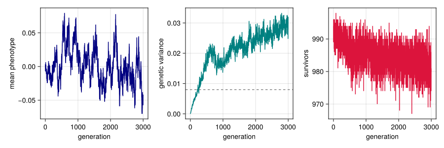
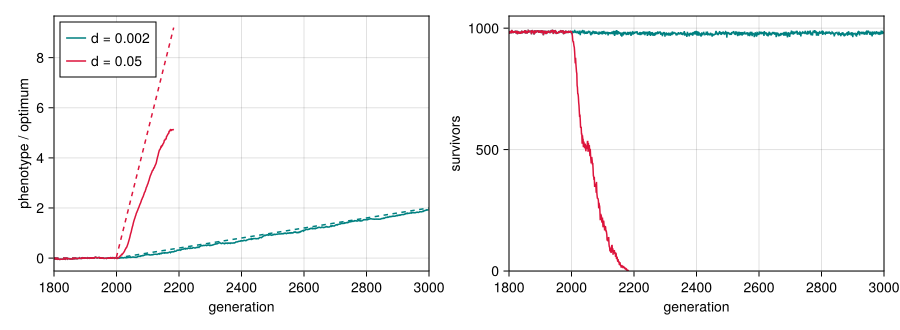

# Getting started
Simon Frost

- [Overview](#overview)
- [Setup](#setup)
- [Parameters](#parameters)
- [A first run](#a-first-run)
- [Reproducibility](#reproducibility)
- [Letting the optimum move](#letting-the-optimum-move)
- [Where next](#where-next)

## Overview

`QTLSim.jl` simulates the quantitative-genetic model of Pagel, Gardner
and Meade ([Pagel et al. 2025](#ref-Pagel2025)), who used it to ask how
fast a population can track a steadily changing environment before it
goes extinct. Their simulations were run with QTSim, a C program by
Andrew Meade; this package is a Julia port of it, built around a fast
kernel that reproduces QTSim’s output (see [Validation against
QTSim](08_validation_against_qtsim.md)).
An optional categorical layer, loaded with Catlab, describes the
population and its life cycle as a composition of operators ([The
categorical layer](04_categorical_layer.md)).

The model follows a population of $N$ diploid individuals with one
quantitative trait.

- Each individual carries two copies of `NoQTL` loci. Its genotype $G$
  is the sum of the allelic effects at all of them, and its phenotype is
  $z = G + E$, where the environmental deviation $E$ is drawn from
  $\mathcal{N}(0, V_E)$ at birth.
- Selection is on viability: an individual survives with probability
  $W(z) = \exp\!\left(-(z-\theta)^2 / 2\omega^2\right)$, a Gaussian
  fitness function with optimum $\theta$ and width $\omega$ (up to a
  constant close to one, which the package keeps exactly as QTSim
  computes it).
- The survivors mate at random. Each of the $N$ offspring has two
  distinct parents, each of which passes on a gamete made by recombining
  its two chromosomes.
- Each offspring chromosome receives a Poisson number of mutations, each
  adding a Gaussian effect to a randomly chosen locus.

This vignette runs the model once, looks at what it returns, and then
lets the optimum move, which is the experiment at the heart of the
paper.

## Setup

``` julia
using QTLSim
using CairoMakie, Printf, Statistics
CairoMakie.activate!(type = "png")
```

## Parameters

A simulation is described by a `Params` value. Its field names and
defaults follow the options of QTSim’s input files, so a published input
file translates field by field. The phenotypic variance $V_P$ and
heritability $h^2$ fix the genetic and environmental variances the model
aims for, $V_G = h^2 V_P$ and $V_E = (1-h^2) V_P$; the mutation scalar
$m$ sets the new variance mutation adds each generation, $V_m = m V_E$.

``` julia
p = Params(PopSize = 1000, Ploidy = 2, NoQTL = 100, NoGenerations = 3000,
           PhenotypeVar = 0.02, Heritability = 0.4, MutationScalar = 0.004,
           MutationRatePerGamete = 1e-4, RecombPoissonMean = 3.0)

@printf("target genetic variance V_G = h²·V_P      %.4f\n", geneticVar(p))
@printf("environmental variance  V_E = (1−h²)·V_P  %.4f\n", envVar(p))
@printf("mutational input        V_m = m·V_E       %.2e per generation\n", muteVar(p))
@printf("fitness width           ω                 %.3f\n", initFitSD(p))
```

    target genetic variance V_G = h²·V_P      0.0080
    environmental variance  V_E = (1−h²)·V_P  0.0120
    mutational input        V_m = m·V_E       4.80e-05 per generation
    fitness width           ω                 1.155

`MutationRatePerGamete` is the mutation rate per locus per gamete, so
each chromosome receives on average `NoQTL × MutationRatePerGamete` =
0.01 mutations per generation. `RecombPoissonMean` is the mean number of
crossover points drawn per gamete. When `InitFitnessSD` is left at its
default, the width $\omega$ is QTSim’s “analytical” value
$\omega = V_G / \sqrt{m V_E}$; the next vignette explains where it comes
from.

## A first run

`simulate` builds the population, runs it for `NoGenerations`
generations and returns one record per sampled generation (every
generation here, since `Sample = 1`). The genomes start at zero, so the
genetic variance starts at zero too and builds up through mutation.

``` julia
out = simulate(p; seed = 1)
keys(out)
```

    (:extinct, :extinct_gen, :gen, :pheno_mean, :pheno_var, :geno_var, :nsurv, :theta, :omega)

``` julia
fig = Figure(size = (900, 300))
ax1 = Axis(fig[1, 1], xlabel = "generation", ylabel = "mean phenotype")
lines!(ax1, out.gen, out.pheno_mean, color = :navy)
ax2 = Axis(fig[1, 2], xlabel = "generation", ylabel = "genetic variance")
lines!(ax2, out.gen, out.geno_var, color = :teal)
hlines!(ax2, [geneticVar(p)], color = :gray, linestyle = :dash)
ax3 = Axis(fig[1, 3], xlabel = "generation", ylabel = "survivors")
lines!(ax3, out.gen, out.nsurv, color = :crimson)
fig
```

```@raw html
<div id="fig-first-run">
```



Figure 1: One population under stabilising selection. The mean phenotype
stays near the optimum (zero), the genetic variance builds up from zero
to a balance between mutation, selection and drift, and almost every
individual survives selection each generation.

```@raw html
</div>
```

The dashed line is the target $h^2 V_P$. The variance the population
actually maintains is set by the balance of mutation, selection and
drift, not by the target; the [next
vignette](02_mutation_selection_balance.md)
compares it with theory.

``` julia
late = out.gen .>= 2000
@printf("mean genetic variance over generations 2000–2999: %.4f\n", mean(out.geno_var[late]))
@printf("mean number of survivors:                          %.1f of %d\n",
        mean(out.nsurv[late]), p.PopSize)
```

    mean genetic variance over generations 2000–2999: 0.0270
    mean number of survivors:                          982.8 of 1000

## Reproducibility

Runs are driven by a seeded random-number generator, so the same seed
gives the same run, and a different seed gives a different realisation
of the same process.

``` julia
same = simulate(p; seed = 1)
other = simulate(p; seed = 2)
(same_seed_identical = same.geno_var == out.geno_var,
 other_seed_identical = other.geno_var == out.geno_var)
```

    (same_seed_identical = true, other_seed_identical = false)

## Letting the optimum move

In the paper’s experiments the optimum stands still while the population
reaches equilibrium, then moves by a fixed amount $d$ every generation
(`MoveType = :continuous`, starting at `MoveFitnessSDGen`). A population
that can keep up follows the optimum with a constant lag; one that
cannot falls further and further behind, its survival collapses, and it
goes extinct. Here the same population faces a slow and a fast rate of
change, starting at generation 2000. Rates are easiest to compare in
units of the phenotypic standard deviation, which we measure just before
the move.

``` julia
moving(d) = Params(p; NoGenerations = 3000, MoveFitnessSDGen = 2000,
                   MoveFitnessSD = d, MoveType = :continuous)
slow = simulate(moving(0.002); seed = 1)
fast = simulate(moving(0.05); seed = 1)
sdP = sqrt(mean(slow.pheno_var[1900 .<= slow.gen .< 2000]))
@printf("phenotypic SD before the move: %.3f\n", sdP)
@printf("slow: d = 0.002 is %4.1f%% of an SD per generation; extinct: %s\n",
        100 * 0.002 / sdP, slow.extinct)
@printf("fast: d = 0.05  is %4.1f%% of an SD per generation; extinct at generation %d\n",
        100 * 0.05 / sdP, fast.extinct_gen)
```

    phenotypic SD before the move: 0.188
    slow: d = 0.002 is  1.1% of an SD per generation; extinct: false
    fast: d = 0.05  is 26.6% of an SD per generation; extinct at generation 2184

``` julia
fig = Figure(size = (900, 330))
ax1 = Axis(fig[1, 1], xlabel = "generation", ylabel = "phenotype / optimum",
           limits = ((1800, 3000), nothing))
ax2 = Axis(fig[1, 2], xlabel = "generation", ylabel = "survivors",
           limits = ((1800, 3000), (0, 1050)))
for (r, c, name) in ((slow, :teal, "d = 0.002"), (fast, :crimson, "d = 0.05"))
    lines!(ax1, r.gen, r.pheno_mean, color = c, label = name)
    lines!(ax1, r.gen, r.theta, color = c, linestyle = :dash)
    lines!(ax2, r.gen, r.nsurv, color = c, label = name)
end
axislegend(ax1, position = :lt)
fig
```

```@raw html
<div id="fig-moving">
```



Figure 2: The optimum (dashed) starts moving at generation 2000. At the
slow rate the mean phenotype (solid) keeps pace and survival stays high;
at the fast rate the population falls further and further behind,
survival collapses and the population dies out.

```@raw html
</div>
```

This population can keep up with surprisingly fast change: it holds a
lot of genetic variance, and its narrow fitness function turns a small
lag into strong selection. Across the range of populations the paper
simulated, sustainable change is limited to a few per cent of a standard
deviation per generation; [Adaptation to a moving
optimum](03_moving_optimum.md) measures this the
way the paper does, and [Replicating Pagel, Gardner and Meade
(2025)](09_replicating_pagel_2025.md)
reproduces the paper’s results.

## Where next

- [Mutation–selection
  balance](02_mutation_selection_balance.md):
  how much genetic variance the population maintains, compared with
  theory.
- [Adaptation to a moving
  optimum](03_moving_optimum.md): the ways the
  optimum can move, and the paper’s measures of lag and extinction.
- [The categorical
  layer](04_categorical_layer.md) and
  [Recomposing the
  model](05_recomposing_the_model.md): the
  population as an ACSet, and a generation as a composite of operators
  that can be rearranged.
- [Loci and
  recombination](07_loci_and_recombination.md):
  many loci, and the way QTSim recombines them.
- [Validation against
  QTSim](08_validation_against_qtsim.md)
  and [Replicating Pagel, Gardner and Meade
  (2025)](09_replicating_pagel_2025.md).

```@raw html
<div id="refs" class="references csl-bib-body hanging-indent">
```

```@raw html
<div id="ref-Pagel2025" class="csl-entry">
```

Pagel, Mark, Jacob D. Gardner, and Andrew Meade. 2025.
“Quantitative-Genetic Analysis of Directional Adaptation Suggests Low
Maximum Sustainable Rates of Change in Agreement with Data from Field
Populations.” *Scientific Reports* 15.
<https://doi.org/10.1038/s41598-025-24445-2>.

```@raw html
</div>
```

```@raw html
</div>
```
