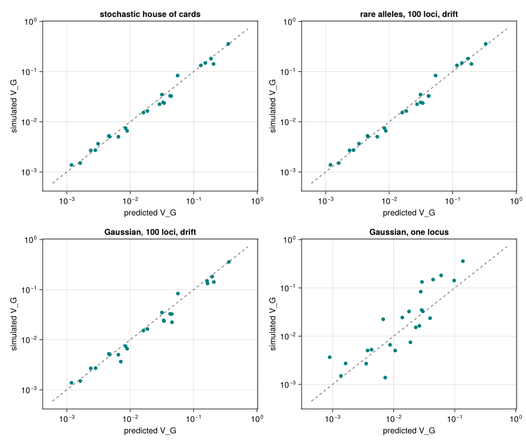
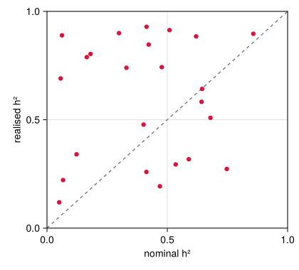
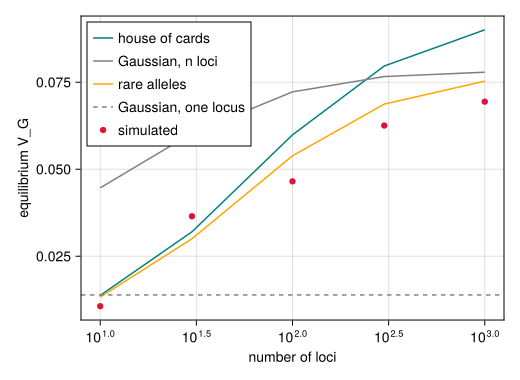

# Mutation–selection balance
Simon Frost

- [Overview](#overview)
- [Setup](#setup)
- [The mutational input](#the-mutational-input)
- [Where the “analytical” fitness width comes
  from](#where-the-analytical-fitness-width-comes-from)
- [Equilibrium across the paper’s parameter
  space](#equilibrium-across-the-papers-parameter-space)
- [More loci, more variance](#more-loci-more-variance)

## Overview

Before the optimum moves, each population in the paper spends 10,000
generations under stabilising selection, so that it starts the
experiment at equilibrium. How much genetic variance it holds then
matters: the genetic variance $V_G$ is the raw material of the response
to a moving optimum. This vignette measures the equilibrium and compares
it with classical approximations and with a model that bridges them.

Mutation adds variance and stabilising selection and drift remove it.
Write $V_m$ for the variance mutation adds per generation,
$V_s = \omega^2 + V_E$ for the width of selection on genotypes (the
fitness function, widened by environmental noise), $n$ for the number of
loci, $\mu$ for the mutation rate per locus, $\alpha^2$ for the variance
of a mutation’s effect and $N_e$ for the effective population size.

- Lande’s Gaussian approximation ([Lande 1975](#ref-Lande1975)) assumes
  many alleles of small effect at every locus, so that each locus is
  Gaussian. Each of the $2n$ allele positions of a diploid keeps the
  part of selection’s reduction of the variance that falls on its own
  share; the rest is linkage disequilibrium, which recombination breaks
  up. At equilibrium $V_G^2/(V_s + V_G) = 2n V_m$, so
  $V_G \approx \sqrt{2n V_m V_s}$ when mutation is weak
  (`gaussian_vg_loci`; with drift, `gaussian_vg_loci(p; drift = true)`),
  the fixed point of the moments lowering. For a single haploid locus it
  is $\sqrt{V_m V_s}$ (`gaussian_vg`), the form behind QTSim’s
  analytical fitness width (below).
- The stochastic house-of-cards approximation ([Bürger et al.
  1989](#ref-Burger1989)) allows for rare mutations of large effect and
  for drift:
  $V_G \approx 4 n \mu V_s \,/\, \left(1 + V_s / (N_e \alpha^2)\right)$.
  This is the approximation the paper compares its simulations with (its
  Supplementary Figure S1, labelled equation 21a in its results table).
- The rare-alleles closure (`rare_alleles_vg`,
  `run_moments(p; loci = :rare_alleles)`) bridges the two. The Gaussian
  model takes the fourth moment of the allelic values at a locus to be
  Gaussian; when a locus is mostly one allele with a few rare mutants,
  that moment is instead dominated by the mutants, lpha^2 the variance,
  so selection removes each rare mutant at its own rate besides the
  Gaussian loss. For loci in linkage equilibrium its equilibrium is the
  “stochastic house of Gauss” of Hermisson and Wagner
  ([2004](#ref-HermissonWagner2004)) (`house_of_gauss_vg`), which is the
  house of cards when mutations are rare, the Gaussian when they are
  many, and N_e V_m drift dominates; in the multilocus model it keeps
  linkage disequilibrium and recombination. Its comparison with the
  kernel across regimes is `validate/moments_regimes.jl`.

## Setup

``` julia
using QTLSim
using CairoMakie, Distributions, Printf, Random, Statistics
CairoMakie.activate!(type = "png")
Threads.nthreads()
```

    6

## The mutational input

Each offspring chromosome receives a Poisson number of mutations with
mean $n\mu$, and each mutation adds a Gaussian effect of variance
$\alpha^2 = m V_E / (2 n \mu)$ to a random locus. The scaling is chosen
so that, in expectation, mutation adds exactly $V_m = m V_E$ to the
genetic variance of a diploid individual each generation, whatever the
number of loci and the mutation rate. That statement is proved in Lean
(`mutationalVarianceInput_eq` in
`lean/CategoricalQuantGen/Mutation.lean`); here we check it by applying
the mutation operator to a large population of zero genomes, for several
locus counts and rates.

``` julia
function mutational_input(p; rounds = 20, seed = 1)
    w = World(p); rng = Xoshiro(seed); Δ = Float64[]
    for _ in 1:rounds
        setgenomes!(w, zeros(p.NoQTL, p.Ploidy, p.PopSize); offspring = true)
        mutate!(w, rng)                       # adds mutations to the offspring buffer
        G = genomes(w; offspring = true)
        append!(Δ, sum(@view G[:, :, j]) for j in 1:p.PopSize)
    end
    var(Δ)
end

for (k, (L, rate)) in enumerate(((10, 1e-3), (100, 1e-4), (100, 1e-2), (1000, 1e-3)))
    p = Params(PopSize = 20_000, Ploidy = 2, NoQTL = L, MutationRatePerGamete = rate,
               PhenotypeVar = 0.02, Heritability = 0.4, MutationScalar = 0.004)
    @printf("NoQTL = %4d, rate = %.0e (%4.2f mutations per gamete):  variance added %.3e   (m·V_E = %.3e)\n",
            L, rate, L * rate, mutational_input(p; seed = k), muteVar(p))
end
```

    NoQTL =   10, rate = 1e-03 (0.01 mutations per gamete):  variance added 4.901e-05   (m·V_E = 4.800e-05)
    NoQTL =  100, rate = 1e-04 (0.01 mutations per gamete):  variance added 4.770e-05   (m·V_E = 4.800e-05)
    NoQTL =  100, rate = 1e-02 (1.00 mutations per gamete):  variance added 4.778e-05   (m·V_E = 4.800e-05)
    NoQTL = 1000, rate = 1e-03 (1.00 mutations per gamete):  variance added 4.810e-05   (m·V_E = 4.800e-05)

The input agrees with $m V_E$ to within sampling error in every case,
even though the number of mutations per generation differs a
hundred-fold between the rows.

## Where the “analytical” fitness width comes from

When `InitFitnessSD` is not given, QTSim and this package use
$\omega = V_G / \sqrt{m V_E}$ with $V_G = h^2 V_P$. That is the
one-locus Gaussian approximation solved for $\omega$, with
$V_s \approx \omega^2$: if $V_G = \sqrt{V_m \omega^2}$ and
$V_m = m V_E$, then $\omega = V_G / \sqrt{m V_E}$. The algebra is proved
in `lean/CategoricalQuantGen/Heritability.lean` (`analyticalFitSD_eq`).
The width is therefore exactly the one that would hold the population at
the target $h^2 V_P$ if the one-locus Gaussian approximation were right.
For $n$ diploid loci the Gaussian approximation would hold about
$\sqrt{2n}$ times more variance at that width. The paper itself does not
use it: it draws $\omega$ at random for each population.

## Equilibrium across the paper’s parameter space

We draw 24 parameter sets from the paper’s priors ([Pagel et al.
2025](#ref-Pagel2025), Table 1): phenotypic variance $V_P$ exponential
with mean 0.018 above 0.01 and at most 0.09, heritability Weibull with
shape 1.6 and scale 0.4, mutation scalar gamma with shape 1.1 and scale
0.004, and fitness width uniform on $(0, 10)$. Each population has 1000
individuals and 100 loci with mutation rate $10^{-4}$, as in the paper,
and runs for 10,000 generations; we average the genetic variance and the
number of survivors over the last 1000.

``` julia
function draw_params(rng)
    VP = 0.01 + rand(rng, Exponential(0.018))
    while VP > 0.09; VP = 0.01 + rand(rng, Exponential(0.018)); end
    h2 = rand(rng, Weibull(1.6, 0.4))
    while !(0.01 <= h2 <= 0.99); h2 = rand(rng, Weibull(1.6, 0.4)); end
    (; VP, h2, m = rand(rng, Gamma(1.1, 0.004)), ω = rand(rng, Uniform(0, 10)))
end

function equilibrium(θ; L = 100, gens = 10_000, seed)
    p = Params(PopSize = 1000, Ploidy = 2, NoQTL = L, NoGenerations = gens,
               PhenotypeVar = θ.VP, Heritability = θ.h2, MutationScalar = θ.m,
               MutationRatePerGamete = 1e-4, RecombPoissonMean = 3.0, InitFitnessSD = θ.ω)
    o = simulate(p; seed)
    o.extinct && return nothing
    last = o.gen .>= gens - 1000
    (; p, VG = mean(o.geno_var[last]), ns = mean(o.nsurv[last]))
end

draws = [draw_params(Xoshiro(k)) for k in 1:24]
eq = Vector{Any}(undef, length(draws))
Threads.@threads for k in eachindex(draws)
    eq[k] = equilibrium(draws[k]; seed = k)
end
eq = filter(!isnothing, eq)
length(eq)
```

    24

The approximations, written for a `Params` value: the house of cards,
the Gaussian approximation summed over the loci with drift, and its
one-locus form. For $N_e$ we use the number of survivors: each of the
$2N$ gametes of the next generation comes from a survivor chosen at
random, so the number a survivor contributes is binomial with variance
$V_k = 2N (n_s - 1)/n_s^2$ when $n_s$ individuals survive, and
$N_e = 4N/(V_k + 2)$ ([Falconer and Mackay
1996](#ref-FalconerMackay1996)). This is how the paper’s results table
computes it.

``` julia
gaussian(p) = gaussian_vg_loci(p; drift = true)           # n loci, linkage disequilibrium, drift
rare(p) = rare_alleles_vg(p; drift = true)                # the same with the rare-alleles closure
one_locus(p) = sqrt(muteVar(p) * (initFitSD(p)^2 + envVar(p)))   # gaussian_vg(p)

function house_of_cards(p, ns)
    N, n, μ = p.PopSize, p.NoQTL, p.MutationRatePerGamete
    Vs = initFitSD(p)^2 + envVar(p)
    α2 = muteVar(p) / (2n * μ)            # variance of one mutation's effect
    Vk = 2N * (ns - 1) / ns^2              # variance in gametes contributed per survivor
    Ne = 4N / (Vk + 2)
    4n * μ * Vs / (1 + Vs / (Ne * α2))
end

shc = [house_of_cards(r.p, r.ns) for r in eq]
gau = [gaussian(r.p) for r in eq]
rar = [rare(r.p) for r in eq]
one = [one_locus(r.p) for r in eq]
sim = [r.VG for r in eq]
@printf("simulated / house of cards: median %.2f (range %.2f–%.2f)\n",
        median(sim ./ shc), extrema(sim ./ shc)...)
@printf("simulated / Gaussian, n loci: median %.2f (range %.2f–%.2f)\n",
        median(sim ./ gau), extrema(sim ./ gau)...)
@printf("simulated / rare alleles:    median %.2f (range %.2f–%.2f)\n",
        median(sim ./ rar), extrema(sim ./ rar)...)
@printf("simulated / one locus:       median %.2f (range %.2f–%.2f)\n",
        median(sim ./ one), extrema(sim ./ one)...)
```

    simulated / house of cards: median 0.95 (range 0.69–1.50)
    simulated / Gaussian, n loci: median 0.90 (range 0.49–1.48)
    simulated / rare alleles:    median 0.97 (range 0.70–1.55)
    simulated / one locus:       median 1.28 (range 0.19–4.57)

``` julia
fig = Figure(size = (900, 760))
for (k, (pred, name)) in enumerate(((shc, "stochastic house of cards"), (rar, "rare alleles, 100 loci, drift"),
                                     (gau, "Gaussian, 100 loci, drift"), (one, "Gaussian, one locus")))
    ax = Axis(fig[fld1(k, 2), mod1(k, 2)], xscale = log10, yscale = log10, title = name,
              xlabel = "predicted V_G", ylabel = "simulated V_G")
    lo, hi = extrema(vcat(pred, sim))
    lines!(ax, [lo / 2, 2hi], [lo / 2, 2hi], color = :gray, linestyle = :dash)
    scatter!(ax, pred, sim, color = :teal)
end
fig
```

```@raw html
<div id="fig-balance">
```



Figure 1: Equilibrium genetic variance of 24 simulated populations
against four approximations (the line is equality). The stochastic house
of cards and the rare-alleles closure track the simulations across
nearly three orders of magnitude, within a factor of 1.5. The Gaussian
approximation summed over the 100 loci, with drift, is right on average
but scatters more widely. Its one-locus form misses by up to a factor of
about five in either direction.

```@raw html
</div>
```

The house-of-cards regime is the relevant one here because mutation is
rare: with 100 loci and a rate of $10^{-4}$ there is only about one new
mutation per hundred gametes, each with an effect large compared with
the standing variation at its locus. The Gaussian approximation assumes
the opposite, many small effects at every locus, yet with the loci
counted and drift included its median is within 10% of the simulations;
it scatters more than the house of cards because it misses how the
variance depends on the size of a mutation’s effect. The rare-alleles
closure, which adds that dependence to the Gaussian model, does as well
as the house of cards here (median 0.97 against 0.95, with the same
scatter, much of which is the sampling noise of single runs). The
one-locus form, which counts all of selection’s reduction of the
variance as inherited, is not a model of these populations at all. One
consequence is that the heritability in `Params` is not the heritability
the population ends up with. It only sets the environmental variance,
$V_E = (1-h^2)V_P$; the genetic variance is whatever mutation, selection
and drift balance at.

``` julia
fig = Figure(size = (420, 380))
ax = Axis(fig[1, 1], xlabel = "nominal h²", ylabel = "realised h²", limits = (0, 1, 0, 1))
lines!(ax, [0, 1], [0, 1], color = :gray, linestyle = :dash)
scatter!(ax, [r.p.Heritability for r in eq],
         [r.VG / (r.VG + envVar(r.p)) for r in eq], color = :crimson)
fig
```

```@raw html
<div id="fig-heritability">
```



Figure 2: Realised heritability V_G/(V_G + V_E) at equilibrium against
the nominal heritability that set the environmental variance.

```@raw html
</div>
```

## More loci, more variance

The paper simulated 100, 500, 1000 and 5000 loci. With the mutational
input held fixed, more loci means more frequent mutations of smaller
effect, which selection removes less efficiently, so the house of cards
predicts more variance. The Gaussian approximation grows too, as about
$\sqrt{n}$ until drift limits it, while its one-locus form does not
depend on the number of loci. Here one parameter set is run with 10 to
1000 loci.

``` julia
θ = (VP = 0.02, h2 = 0.4, m = 0.004, ω = 2.0)
Ls = [10, 30, 100, 300, 1000]
byL = Vector{Any}(undef, length(Ls))
Threads.@threads for k in eachindex(Ls)
    byL[k] = equilibrium(θ; L = Ls[k], seed = 100 + k)
end
for (L, r) in zip(Ls, byL)
    @printf("NoQTL = %4d:  simulated %.4f   house of cards %.4f   Gaussian, n loci %.4f   rare alleles %.4f\n",
            L, r.VG, house_of_cards(r.p, r.ns), gaussian(r.p), rare(r.p))
end
```

    NoQTL =   10:  simulated 0.0106   house of cards 0.0137   Gaussian, n loci 0.0446   rare alleles 0.0133
    NoQTL =   30:  simulated 0.0365   house of cards 0.0320   Gaussian, n loci 0.0604   rare alleles 0.0300
    NoQTL =  100:  simulated 0.0465   house of cards 0.0599   Gaussian, n loci 0.0722   rare alleles 0.0539
    NoQTL =  300:  simulated 0.0626   house of cards 0.0797   Gaussian, n loci 0.0766   rare alleles 0.0687
    NoQTL = 1000:  simulated 0.0694   house of cards 0.0901   Gaussian, n loci 0.0779   rare alleles 0.0753

``` julia
fig = Figure(size = (520, 380))
ax = Axis(fig[1, 1], xscale = log10, xlabel = "number of loci", ylabel = "equilibrium V_G")
lines!(ax, Ls, [house_of_cards(r.p, r.ns) for r in byL], color = :teal, label = "house of cards")
lines!(ax, Ls, [gaussian(r.p) for r in byL], color = :gray, label = "Gaussian, n loci")
lines!(ax, Ls, [rare(r.p) for r in byL], color = :orange, label = "rare alleles")
hlines!(ax, [one_locus(byL[1].p)], color = :gray, linestyle = :dash, label = "Gaussian, one locus")
scatter!(ax, Ls, [r.VG for r in byL], color = :crimson, label = "simulated")
axislegend(ax, position = :lt)
fig
```

```@raw html
<div id="fig-loci">
```



Figure 3: Equilibrium genetic variance against the number of loci for
one parameter set (points), with the house-of-cards prediction (teal),
the Gaussian prediction summed over the loci with drift (gray), the
rare-alleles closure (orange) and its one-locus form, which does not
depend on the number of loci (dashed).

```@raw html
</div>
```

The equilibrium variance grows with the number of loci, as the house of
cards predicts. In these single runs the house of cards overestimates
the level by about 30% at 100 loci and above. The Gaussian approximation
over the loci is four times too high at 10 loci, where mutations are
largest compared with the variance at a locus, and approaches the
simulations as the loci multiply and the effects shrink; at 300 and 1000
loci it is closer than the house of cards (22% and 12% high, against 27%
and 30%). The rare-alleles closure follows the Gaussian model where
mutations are small and the house of cards where they are large, and is
the closest of the three from 100 loci on (16%, 10% and 8% high); at 10
and 30 loci it is 25% high and 18% low, as close as the house of cards.
The one-locus form misses the trend entirely. The [replication
vignette](09_replicating_pagel_2025.md)
makes the same comparison for the paper’s own parameter sets.

```@raw html
<div id="refs" class="references csl-bib-body hanging-indent">
```

```@raw html
<div id="ref-Burger1989" class="csl-entry">
```

Bürger, Reinhard, Günter P. Wagner, and Franz Stettinger. 1989. “How
Much Heritable Variation Can Be Maintained in Finite Populations by
Mutation-Selection Balance?” *Evolution* 43 (8): 1748–66.
<https://doi.org/10.1111/j.1558-5646.1989.tb02624.x>.

```@raw html
</div>
```

```@raw html
<div id="ref-FalconerMackay1996" class="csl-entry">
```

Falconer, Douglas S., and Trudy F. C. Mackay. 1996. *Introduction to
Quantitative Genetics*. 4th ed. Longman.

```@raw html
</div>
```

```@raw html
<div id="ref-HermissonWagner2004" class="csl-entry">
```

Hermisson, Joachim, and Günter P. Wagner. 2004. “The Population Genetic
Theory of Hidden Variation and Genetic Robustness.” *Genetics* 168 (4):
2271–84. <https://doi.org/10.1534/genetics.104.029173>.

```@raw html
</div>
```

```@raw html
<div id="ref-Lande1975" class="csl-entry">
```

Lande, Russell. 1975. “The Maintenance of Genetic Variability by
Mutation in a Polygenic Character with Linked Loci.” *Genetical
Research* 26 (3): 221–35. <https://doi.org/10.1017/S0016672300016037>.

```@raw html
</div>
```

```@raw html
<div id="ref-Pagel2025" class="csl-entry">
```

Pagel, Mark, Jacob D. Gardner, and Andrew Meade. 2025.
“Quantitative-Genetic Analysis of Directional Adaptation Suggests Low
Maximum Sustainable Rates of Change in Agreement with Data from Field
Populations.” *Scientific Reports* 15.
<https://doi.org/10.1038/s41598-025-24445-2>.

```@raw html
</div>
```

```@raw html
</div>
```
