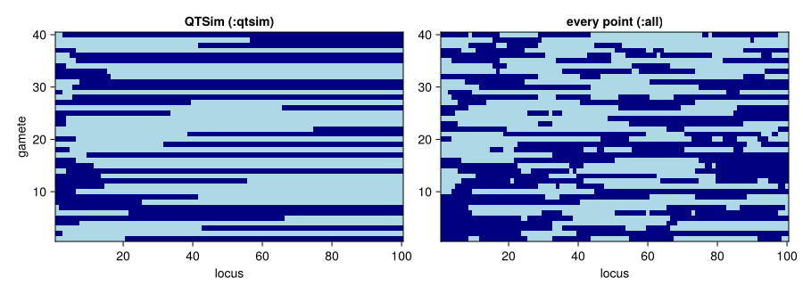
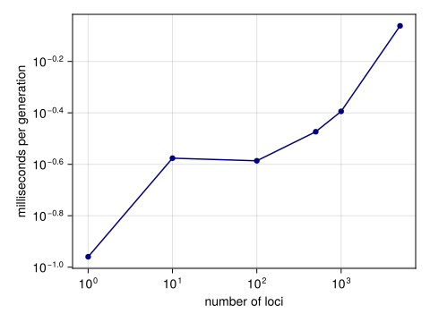

# Loci and recombination
Simon Frost

- [Overview](#overview)
- [Setup](#setup)
- [What gametes look like](#what-gametes-look-like)
- [Why it matters for the results](#why-it-matters-for-the-results)
- [What more loci cost](#what-more-loci-cost)

## Overview

The paper’s populations carry 100, 500, 1000 or 5000 loci and recombine
them with a mean of three or five crossovers per gamete ([Pagel et al.
2025](#ref-Pagel2025)). This vignette looks at how gametes are made, at
a feature of QTSim’s recombination that the published results depend on,
and at what more loci cost.

Each gamete is built from one parent’s two chromosomes. The number of
crossover points is drawn from a Poisson distribution with mean
`RecombPoissonMean` (none if the draw is zero or at least the number of
loci), the points are placed at distinct random positions, and the
gamete starts on a randomly chosen parental chromosome and switches
strands at the crossover points. In QTSim the copying loop never
advances to the next point, so only the lowest point ever switches:
every gamete has at most one crossover, however many points were drawn.
The published simulations were run that way. The package reproduces it
by default (`CrossoverModel = :qtsim`) and offers the evidently intended
model, in which every point switches, as `CrossoverModel = :all`.

## Setup

``` julia
using QTLSim
using CairoMakie, Printf, Random, Statistics
CairoMakie.activate!(type = "png")
```

## What gametes look like

`gamete!` builds one gamete from two parental chromosomes. With one
parental chromosome all zeros and the other all ones, the gamete shows
which parent each locus came from. Here are 40 gametes from 100 loci
with a mean of five crossover points, under each model.

``` julia
L = 100
A = zeros(L); B = ones(L); dest = zeros(L)
rng = Xoshiro(1)
draw(allpoints) = reduce(hcat, [copy(gamete!(dest, A, B, rng, 5.0, L, allpoints)) for _ in 1:40])
qtsim, every = draw(false), draw(true)
switches(G) = [count(i -> G[i, j] != G[i+1, j], 1:L-1) for j in axes(G, 2)]
@printf("mean crossovers per gamete: QTSim model %.2f, every point %.2f\n",
        mean(switches(qtsim)), mean(switches(every)))
```

    mean crossovers per gamete: QTSim model 1.00, every point 5.30

``` julia
fig = Figure(size = (900, 330))
for (k, (G, name)) in enumerate(((qtsim, "QTSim (:qtsim)"), (every, "every point (:all)")))
    ax = Axis(fig[1, k], title = name, xlabel = "locus", ylabel = k == 1 ? "gamete" : "")
    heatmap!(ax, 1:L, 1:40, G, colormap = [:lightblue, :navy])
end
fig
```

```@raw html
<div id="fig-gametes">
```



Figure 1: Forty gametes (rows) from a parent with one chromosome of
zeros (light) and one of ones (dark), 100 loci, a mean of five crossover
points. Under QTSim’s model (left) each gamete switches strands at most
once; when every point switches (right) gametes are mosaics.

```@raw html
</div>
```

Whatever the crossover pattern, a gamete takes each locus from one
parental chromosome, and the starting chromosome is chosen fairly. On
average, then, a gamete carries half of the parent’s additive genotype
under either model, so neither biases the mean. Lean proves this for any
assignment of loci to strands (`gamete_expected_sum_by` in
`lean/CategoricalQuantGen/Recombination.lean`). With random allelic
effects:

``` julia
a = randn(Xoshiro(2), L); b = randn(Xoshiro(3), L)
for allpoints in (false, true)
    s = [sum(gamete!(dest, a, b, rng, 3.0, L, allpoints)) for _ in 1:100_000]
    @printf("%-6s mean gamete genotype %.3f ± %.3f (standard error)   half the parent's genotype %.3f\n",
            allpoints ? ":all" : ":qtsim", mean(s), std(s) / sqrt(length(s)), (sum(a) + sum(b)) / 2)
end
```

    :qtsim mean gamete genotype -1.013 ± 0.025 (standard error)   half the parent's genotype -1.047
    :all   mean gamete genotype -1.066 ± 0.024 (standard error)   half the parent's genotype -1.047

## Why it matters for the results

Recombination does not change the mean, but it changes how genetic
variance is distributed among gametes, and so how much variance the
population holds and how fast it can respond to selection. To see the
effect, the same populations are run under both models: 100 loci with
five crossover points per gamete, paper-like parameters, 10,000
generations of stabilising selection and then a continuously moving
optimum, for 48 seeds each.

``` julia
paperlike = Params(PopSize = 1000, Ploidy = 2, NoQTL = 100, NoGenerations = 12_000,
                   PhenotypeVar = 0.022, Heritability = 0.32, MutationScalar = 0.004,
                   MutationRatePerGamete = 1e-4, RecombPoissonMean = 5.0, InitFitnessSD = 5.0,
                   MoveFitnessSDGen = 10_000, MoveFitnessSD = 0.05, MoveType = :continuous)
jobs = [(model, seed) for model in (:qtsim, :all) for seed in 1:48]
res = Vector{Any}(undef, length(jobs))
Threads.@threads for k in eachindex(jobs)
    model, seed = jobs[k]
    o = simulate(Params(paperlike; CrossoverModel = model); seed)
    j = findfirst(==(9_999), o.gen)
    res[k] = (; model, VG = o.geno_var[j], T = o.extinct ? o.extinct_gen - 9_999 : 2_000)
end

summ(model, f) = [log(f(r)) for r in res if r.model === model]
for (name, f) in (("genetic variance before the move", r -> r.VG),
                  ("generations to extinction", r -> r.T))
    q, a = summ(:qtsim, f), summ(:all, f)
    δ = mean(a) - mean(q); se = sqrt(var(a) / length(a) + var(q) / length(q))
    @printf("%-33s every-point / QTSim model: ×%.2f  (95%% interval ×%.2f–×%.2f)\n",
            name, exp(δ), exp(δ - 1.96se), exp(δ + 1.96se))
end
```

    genetic variance before the move  every-point / QTSim model: ×1.08  (95% interval ×0.99–×1.17)
    generations to extinction         every-point / QTSim model: ×1.10  (95% interval ×1.08–×1.12)

Applying every crossover point lets the populations survive the moving
optimum about 10% longer, and they tend to hold more genetic variance
(in these runs the interval for the variance only just includes no
difference). The comparison of the Julia model with the paper’s
published results ([Validation against
QTSim](08_validation_against_qtsim.md))
shows the same effect across all the paper’s strata, and shows that only
QTSim’s model reproduces the published numbers.

## What more loci cost

Most of the work in a generation is copying chromosomes into gametes and
summing genotypes, so the time per generation grows with the number of
loci.

``` julia
Ls = [1, 10, 100, 500, 1000, 5000]
costs = map(Ls) do L
    q = Params(paperlike; NoQTL = L, NoGenerations = 40, MoveFitnessSDGen = -1)
    simulate(Params(q; NoGenerations = 2); seed = 1)              # compile
    1000 * minimum(@elapsed(simulate(q; seed = s)) for s in 1:3) / q.NoGenerations
end
for (L, c) in zip(Ls, costs); @printf("%5d loci: %7.3f ms per generation\n", L, c); end
```

        1 loci:   0.110 ms per generation
       10 loci:   0.265 ms per generation
      100 loci:   0.259 ms per generation
      500 loci:   0.336 ms per generation
     1000 loci:   0.404 ms per generation
     5000 loci:   0.868 ms per generation

``` julia
fig = Figure(size = (480, 360))
ax = Axis(fig[1, 1], xscale = log10, yscale = log10, xlabel = "number of loci",
          ylabel = "milliseconds per generation")
scatterlines!(ax, Ls, costs, color = :navy)
fig
```

```@raw html
<div id="fig-cost">
```



Figure 2: Time per generation against the number of loci for 1000
diploid individuals, on one thread. With a few loci the fixed cost of
each individual dominates; from a few hundred loci on, the cost grows
steadily with the number of loci.

```@raw html
</div>
```

The kernel copies and sums blocks of about √L loci rather than single
loci, so the time grows far more slowly than the number of loci: a
5000-locus population takes under a millisecond per generation, about
three times as long as a 100-locus one. One of the paper’s
250,000-generation runs still takes a few minutes, and all 119,984 of
them thousands of CPU-hours, so the
[replication](09_replicating_pagel_2025.md)
therefore samples the paper’s inputs and stops each run 2000 generations
after the optimum starts to move.

```@raw html
<div id="refs" class="references csl-bib-body hanging-indent">
```

```@raw html
<div id="ref-Pagel2025" class="csl-entry">
```

Pagel, Mark, Jacob D. Gardner, and Andrew Meade. 2025.
“Quantitative-Genetic Analysis of Directional Adaptation Suggests Low
Maximum Sustainable Rates of Change in Agreement with Data from Field
Populations.” *Scientific Reports* 15.
<https://doi.org/10.1038/s41598-025-24445-2>.

```@raw html
</div>
```

```@raw html
</div>
```
