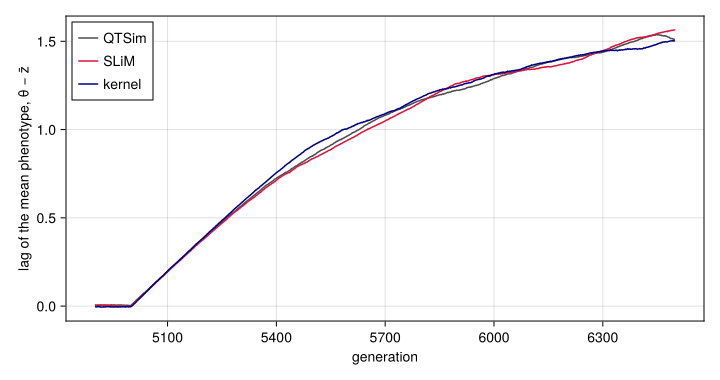

# One life cycle, two backends
Simon Frost

- [Overview](#overview)
- [Setup](#setup)
- [The life cycle as a morphism](#the-life-cycle-as-a-morphism)
- [Two functors](#two-functors)
- [A SLiM model from the life cycle](#a-slim-model-from-the-life-cycle)
- [The generated model is the hand-written
  port](#the-generated-model-is-the-hand-written-port)
- [The generated model agrees with
  QTSim](#the-generated-model-agrees-with-qtsim)
- [A new step, lowered twice](#a-new-step-lowered-twice)
- [Summary](#summary)

## Overview

The previous vignettes build a generation by composing the kernel’s
operators directly. Here the life cycle is written once, as syntax: a
morphism of a free category whose objects are the stages of a generation
and whose generating morphisms are the steps between them. A functor out
of a free category is fixed by where it sends the generators, so giving
each step a meaning in a backend gives every life cycle built from those
steps a meaning there. Two such functors lower the life cycle: one to
the simulation kernel and one to Eidos, the scripting language of the
population-genetics simulator SLiM ([Haller and Messer
2023](#ref-Haller2023)).

The SLiM model lowered from QTSim’s life cycle is, run for run, the SLiM
port of QTSim that was written by hand for this project, and it agrees
with QTSim in distribution. A new step, given a meaning in both
backends, yields two simulators of a model QTSim does not have, which
can be checked against each other.

The vignette needs SLiM (version 4 or later), the hand-written port and
QTSim. It looks for the first two in `slim/build/slim` and
`slim_port/qtsim.slim` in the folder that holds the package’s folder
(the `SLIM` environment variable, or a `slim` on the path, can stand in
for the first), and for QTSim built from the source that comes with the
package (`make -C reference/QTSim`) or in the paper’s code.

## Setup

``` julia
using QTLSim
import Catlab                       # loads QTLSim's categorical layer
using Catlab: ⋅, dom, codom, Hom
using CairoMakie, HypothesisTests, Printf, Random, Statistics
CairoMakie.activate!(type = "png")

const ROOT = normpath(joinpath(@__DIR__, "..", "..", ".."))
const SLIM = let built = joinpath(ROOT, "slim", "build", "slim")
    haskey(ENV, "SLIM") ? ENV["SLIM"] : isfile(built) ? built : something(Sys.which("slim"), built)
end
const PORT = joinpath(ROOT, "slim_port", "qtsim.slim")
include(joinpath(@__DIR__, "..", "..", "validate", "qtsim.jl"))   # find_qtsim(): see reference/QTSim/README.md
const QTSIM = something(find_qtsim(), "")
all(isfile, (SLIM, PORT, QTSIM)) || error("this vignette needs SLiM, the SLiM port and QTSim")
Threads.nthreads()
```

    6

## The life cycle as a morphism

`lifecycle()` returns the syntax: the Catlab presentation of a free
category with four objects, the stages of a generation, and seven
generating morphisms, the steps of QTSim’s generation loop.

``` julia
L = lifecycle()
const STEP_NAMES = (:develop, :select, :reproduce, :record, :rescale, :mutate, :swap)
println("| step | from | to |\n|:--|:--|:--|")
for s in STEP_NAMES
    f = getfield(L, s)
    println("| `", s, "` | ", dom(f), " | ", codom(f), " |")
end
```

| step        | from      | to        |
|:------------|:----------|:----------|
| `develop`   | Zygotes   | Adults    |
| `select`    | Adults    | Survivors |
| `reproduce` | Survivors | Offspring |
| `record`    | Offspring | Offspring |
| `rescale`   | Offspring | Offspring |
| `mutate`    | Offspring | Offspring |
| `swap`      | Offspring | Zygotes   |

Steps compose with Catlab’s `⋅` when the stage one step ends in is the
stage the next begins with. QTSim’s generation is the composite of all
seven, in the order of its loop, and is a morphism from zygotes to
zygotes:

``` julia
(; develop, select, reproduce, record, rescale, mutate, swap) = L
qtsim = develop ⋅ select ⋅ reproduce ⋅ record ⋅ rescale ⋅ mutate ⋅ swap
```

    develop⋅select⋅reproduce⋅record⋅rescale⋅mutate⋅swap: Zygotes → Zygotes

Steps whose stages do not match do not compose. Selecting before
developing is not a life cycle, and Catlab says so:

``` julia
try
    select ⋅ develop
catch e
    println(first(sprint(showerror, e), 120), "…")
end
```

    Domain error in term constructor compose(select,develop)…

## Two functors

`lower(f, :kernel)` sends each step to the kernel function it wraps
(`develop!`, `select!`, `reproduce!`, recording, the scheduled change of
the fitness width, `mutate!`, and the swap of the parent and offspring
buffers), and composition to `⋅`. The image of the generation is an
operator on a `World`:

``` julia
lower(qtsim, :kernel)
```

    Operator(:develop⋅select⋅reproduce⋅record⋅rescale⋅mutate⋅swap)

Run once per generation by `run_composed`, it is `run!`, bit for bit,
here for one locus, with the optimum moving from generation 5000 and the
fitness function narrowing:

``` julia
p = Params(PopSize = 1000, NoQTL = 1, Ploidy = 2, NoGenerations = 6500, PhenotypeVar = 0.02,
           Heritability = 0.5, MutationScalar = 0.001, MutationRatePerGamete = 0.0002,
           MoveFitnessSDGen = 5000, MoveFitnessSD = 1.0, MoveType = :phenotype,
           ChangeFitnessGen = 5000, ChangeFitnessSD = 0.3)
a = run!(World(p), Xoshiro(1))
b = run_composed(World(p), Xoshiro(1); cycle = qtsim)
all(getfield(a, k) == getfield(b, k) for k in keys(a))
```

    true

`lower(f, :eidos)` sends each step to a fragment of Eidos. Each
individual carries its two allele values, as in QTSim’s
continuum-of-alleles model, and SLiM supplies only the life cycle of a
non-Wright–Fisher model. Selection, for example:

``` julia
lower(select, :eidos)
```

        // select: move the optimum, Gaussian fitness with QTSim's 0.4, viability   [Adults → Survivors]
        if (moveGen >= 0 & gen >= moveGen) {
            if (moveType == "phenotype") defineGlobal("THETA", mean(pheno) + sqrt(VP) * moveSD);
            else if (moveType == "fitness") defineGlobal("THETA", mean(pheno) + OMEGA * moveSD);
            else defineGlobal("THETA", THETA + moveSD);
        }
        x = standardise ? (pheno - THETA) / sd(pheno) else pheno - THETA;
        W = drift ? rep(1.0, size(adults)) else dnorm(x, 0.0, OMEGA) / (0.4 / OMEGA);
        survived = runif(size(adults)) < W;
        sidx = which(survived);
        ns = size(sidx);
        if (ns < 2) { catn("Pop all died."); sim.simulationFinished(); self.active = 0; return; }

Composition goes to concatenation, so the image of the generation is the
seven fragments in order:

``` julia
lower(qtsim, :eidos).code == join(lower(getfield(L, s), :eidos).code for s in STEP_NAMES)
```

    true

## A SLiM model from the life cycle

`slim_script` puts the image of a life cycle inside a complete SLiM
model, in a `reproduction()` callback that runs once per tick, with the
parameters of a `Params` as defaults that `slim -d` can override:

``` julia
script = slim_script(qtsim, p)
print(script)
```

    // QTSim as a nonWF SLiM model, generated by QTLSim.jl from the life cycle
    //
    //     develop⋅select⋅reproduce⋅record⋅rescale⋅mutate⋅swap: Zygotes → Zygotes
    //
    // by the lowering to Eidos: each step of the life cycle is a fragment of the
    // reproduction() callback below, in the order of the composite. Regenerate it with
    // QTLSim's `slim_script` rather than editing it.
    //
    // Parameters can be overridden with  slim -d "NAME=value"  and the seed set with -s.

    initialize() {
        initializeSLiMModelType("nonWF");

        if (!exists("N"))           defineConstant("N", 1000);
        if (!exists("VP"))          defineConstant("VP", 0.02);
        if (!exists("h2"))          defineConstant("h2", 0.5);
        if (!exists("m"))           defineConstant("m", 0.001);
        if (!exists("rate"))        defineConstant("rate", 0.0002);
        if (!exists("NGEN"))        defineConstant("NGEN", 6500);
        if (!exists("sampleEvery")) defineConstant("sampleEvery", 1);
        if (!exists("moveGen"))     defineConstant("moveGen", 5000);
        if (!exists("moveSD"))      defineConstant("moveSD", 1.0);
        if (!exists("moveType"))    defineConstant("moveType", "phenotype");
        if (!exists("changeGen"))   defineConstant("changeGen", 5000);
        if (!exists("changeSD"))    defineConstant("changeSD", 0.3);
        if (!exists("initOmega"))   defineConstant("initOmega", -1.0);
        if (!exists("drift"))       defineConstant("drift", F);
        if (!exists("standardise")) defineConstant("standardise", F);

        defineConstant("VG", h2 * VP);
        defineConstant("VE", VP - VG);
        defineConstant("ESD", sqrt(VE));
        defineConstant("MUTVAR", (m / (2 * rate)) * VE);           // m/(Ploidy·NoQTL·rate)·V_E
        defineConstant("OMEGA0", initOmega < 0 ? VG / sqrt(m * VE) else initOmega);

        // vestigial genetics: SLiM supplies only the life cycle
        initializeMutationRate(0.0);
        initializeMutationType("m1", 0.5, "f", 0.0);
        initializeGenomicElementType("g1", m1, 1.0);
        initializeGenomicElement(g1, 0, 0);
        initializeRecombinationRate(0.0);
    }

    1 first() {
        sim.addSubpop("p1", N);
        p1.individuals.setValue("a0", 0.0);      // founders: allele values 0
        p1.individuals.setValue("a1", 0.0);
        defineGlobal("THETA", 0.0);
        defineGlobal("OMEGA", OMEGA0);
    }

    // one generation per tick, done in the first call of the callback
    reproduction() {
        gen = sim.cycle - 1;                       // QTSim's generation index
        // develop: genotype a0 + a1, phenotype genotype + e with e ~ N(0, V_E)   [Zygotes → Adults]
        adults = p1.individuals;
        a0 = adults.getValue("a0");
        a1 = adults.getValue("a1");
        genotype = a0 + a1;
        env = rnorm(size(adults), 0.0, ESD);
        pheno = genotype + env;
        // select: move the optimum, Gaussian fitness with QTSim's 0.4, viability   [Adults → Survivors]
        if (moveGen >= 0 & gen >= moveGen) {
            if (moveType == "phenotype") defineGlobal("THETA", mean(pheno) + sqrt(VP) * moveSD);
            else if (moveType == "fitness") defineGlobal("THETA", mean(pheno) + OMEGA * moveSD);
            else defineGlobal("THETA", THETA + moveSD);
        }
        x = standardise ? (pheno - THETA) / sd(pheno) else pheno - THETA;
        W = drift ? rep(1.0, size(adults)) else dnorm(x, 0.0, OMEGA) / (0.4 / OMEGA);
        survived = runif(size(adults)) < W;
        sidx = which(survived);
        ns = size(sidx);
        if (ns < 2) { catn("Pop all died."); sim.simulationFinished(); self.active = 0; return; }
        // reproduce: N offspring of two distinct survivors, a random allele from each   [Survivors → Offspring]
        sa0 = a0[sidx]; sa1 = a1[sidx];
        i1 = rdunif(N, 0, ns - 1);
        i2 = rdunif(N, 0, ns - 1);
        dup = which(i1 == i2);
        while (size(dup) > 0) { i2[dup] = rdunif(size(dup), 0, ns - 1); dup = which(i1 == i2); }
        c0 = ifelse(runif(N) < 0.5, sa1[i1], sa0[i1]);
        c1 = ifelse(runif(N) < 0.5, sa1[i2], sa0[i2]);
        // record: the parent generation's statistics, every `sampleEvery` generations   [Offspring → Offspring]
        if (gen == 0) catn("gen\tphenoMean\tgenoVar\tnSurv\ttheta\tomega");
        if (gen % sampleEvery == 0)
            catn(gen + "\t" + mean(pheno) + "\t" + var(genotype) + "\t" + ns + "\t" + THETA + "\t" + OMEGA);
        // rescale: the scheduled change of the fitness width, from the next generation   [Offspring → Offspring]
        if (gen == changeGen) defineGlobal("OMEGA", changeSD);
        // mutate: Poisson(rate) increments of N(0, MUTVAR) per offspring chromosome   [Offspring → Offspring]
        k0 = rpois(N, rate);
        k1 = rpois(N, rate);
        c0 = c0 + rnorm(N, 0.0, sqrt(k0 * MUTVAR));
        c1 = c1 + rnorm(N, 0.0, sqrt(k1 * MUTVAR));
        // swap: the offspring replace their parents   [Offspring → Zygotes]
        for (k in seqLen(N)) {
            child = p1.addEmpty();
            child.setValue("a0", c0[k]);
            child.setValue("a1", c1[k]);
        }
        adults.fitnessScaling = 0.0;
        if (gen >= NGEN - 1) sim.simulationFinished();
        self.active = 0;
    }

    1000000 late() { sim.simulationFinished(); }   // backstop

`run_slim` runs a SLiM model and reads the table it prints, which has
the columns QTSim’s output has.

``` julia
function run_slim(model, seed; defines = Dict{String,Any}())
    args = ["-s", string(seed)]
    for (k, v) in defines
        push!(args, "-d", v isa AbstractString ? "$k=\"$v\"" : "$k=$v")
    end
    path = tempname() * ".slim"; write(path, model)
    text = try read(`$SLIM $args $path`, String) finally rm(path; force = true) end
    rows = [split(l, '\t') for l in split(text, '\n') if occursin(r"^\d+\t", l)]
    (; gen = [parse(Int, r[1]) for r in rows], pheno_mean = [parse(Float64, r[2]) for r in rows],
       geno_var = [parse(Float64, r[3]) for r in rows], nsurv = [parse(Int, r[4]) for r in rows],
       theta = [parse(Float64, r[5]) for r in rows], extinct = occursin("Pop all died.", text),
       lines = [join(r, '\t') for r in rows])
end
nothing
```

## The generated model is the hand-written port

The project also has a SLiM port of QTSim written by hand,
`slim_port/qtsim.slim`, validated against QTSim before the life cycle
existed. Run with the same seed and parameters, the generated model and
the port print the same table, number for number, because their steps
are the same Eidos statements in the same order and so draw the same
random numbers. The one difference is intended: when a population dies,
the port also prints the generation in which it died, and QTSim does
not.

``` julia
port = read(PORT, String)
checks = (
    ("stabilising selection", Dict{String,Any}("N" => 1000, "VP" => 0.02, "h2" => 0.5, "m" => 0.02,
        "rate" => 0.5, "NGEN" => 600, "moveGen" => -1, "changeGen" => -1, "changeSD" => -1.0, "initOmega" => 0.3)),
    ("moving optimum", Dict{String,Any}("N" => 1000, "VP" => 0.02, "h2" => 0.5, "m" => 0.001,
        "rate" => 0.0002, "NGEN" => 600, "moveGen" => 300, "moveSD" => 1.0, "changeGen" => 300,
        "changeSD" => 0.3, "initOmega" => -1.0)),
    ("extinction", Dict{String,Any}("N" => 300, "VP" => 0.02, "h2" => 0.5, "m" => 0.001,
        "rate" => 0.0002, "NGEN" => 600, "moveGen" => 50, "moveSD" => 6.0, "changeGen" => 50,
        "changeSD" => 0.05, "initOmega" => -1.0)))
println("| scenario | seeds | identical tables | extinct |\n|:--|--:|--:|--:|")
for (name, d) in checks
    same = Threads.Atomic{Int}(0); died = Threads.Atomic{Int}(0)
    Threads.@threads for seed in 1:10
        a = run_slim(port, seed; defines = d); b = run_slim(script, seed; defines = d)
        ref = a.extinct ? a.lines[1:end-1] : a.lines      # the port's extra line at extinction
        Threads.atomic_add!(same, Int(a.extinct == b.extinct && ref == b.lines))
        Threads.atomic_add!(died, Int(b.extinct))
    end
    println("| ", name, " | 10 | ", same[], " | ", died[], " |")
end
```

| scenario              | seeds | identical tables | extinct |
|:----------------------|------:|-----------------:|--------:|
| stabilising selection |    10 |               10 |       0 |
| moving optimum        |    10 |               10 |       0 |
| extinction            |    10 |               10 |      10 |

## The generated model agrees with QTSim

SLiM and QTSim draw different random numbers, so they can agree only in
distribution. Each of three scenarios is run 50 times by QTSim, by the
SLiM model generated from the life cycle, and by the kernel’s image of
the same life cycle. Scenarios A and B are those of [Validation against
QTSim](08_validation_against_qtsim.md):
a sharp mutation–selection balance, and an optimum that keeps a fixed
lead over the mean phenotype from generation 5000 while the fitness
function narrows. In scenario C the optimum moves by a fixed amount each
generation from generation 5000, as in the paper’s simulations. The
hand-written port has no continuous move; the generated model has it
because the selection step does.

``` julia
scen = (
    A = Params(PopSize = 1000, NoQTL = 1, Ploidy = 2, NoGenerations = 4000, PhenotypeVar = 0.02,
               Heritability = 0.5, MutationScalar = 0.02, MutationRatePerGamete = 0.5, InitFitnessSD = 0.3),
    B = p,
    C = Params(p; MoveType = :continuous, MoveFitnessSD = 0.002, ChangeFitnessGen = -1))

function write_qtsim_options(path, q::Params, seed)
    open(path, "w") do io
        println(io, "Sample $(q.Sample)\nPopSize $(q.PopSize)\nNoQTL $(q.NoQTL)")
        println(io, "Generations $(q.NoGenerations)\nPloidy $(q.Ploidy)")
        q.MoveFitnessSDGen != -1 && println(io, "MoveFitnessSD $(q.MoveFitnessSDGen) $(q.MoveFitnessSD)")
        q.ChangeFitnessGen != -1 && println(io, "ChangeFitnessSD $(q.ChangeFitnessGen) $(q.ChangeFitnessSD)")
        println(io, "OptimumMoveType $(q.MoveType)\nPhenotypeVar $(q.PhenotypeVar)")
        println(io, "MutationScalar $(q.MutationScalar)\nHeritability $(q.Heritability)")
        println(io, "MutationRatePerGamete $(q.MutationRatePerGamete)")
        q.InitFitnessSD >= 0 && println(io, "InitFitnessSD $(q.InitFitnessSD)")
        println(io, "Seed $seed")
    end
end

function run_qtsim(q::Params, seed)
    opts = tempname() * ".txt"; write_qtsim_options(opts, q, seed)
    text = try read(`$QTSIM $opts`, String) finally rm(opts; force = true) end
    gen = Int[]; zbar = Float64[]; vg = Float64[]; ns = Int[]; θ = Float64[]; inbody = false
    for line in split(text, '\n')
        startswith(line, "Pop all died") &&
            return (; gen, pheno_mean = zbar, geno_var = vg, nsurv = ns, theta = θ, extinct = true)
        startswith(line, "Generation\t") && (inbody = true; continue)
        (inbody && !isempty(strip(line))) || continue
        f = split(line, '\t')
        push!(gen, parse(Int, f[1])); push!(zbar, parse(Float64, f[2])); push!(vg, parse(Float64, f[4]))
        push!(ns, parse(Int, f[5])); push!(θ, parse(Float64, f[6]))
    end
    (; gen, pheno_mean = zbar, geno_var = vg, nsurv = ns, theta = θ, extinct = false)
end

const R = 50
programs = (:QTSim, :SLiM, :kernel)
models = map(q -> slim_script(qtsim, q), scen)
jobs = [(prog, s, k) for prog in programs for s in keys(scen) for k in 1:R]
runs = Vector{Any}(undef, length(jobs))
Threads.@threads :greedy for j in eachindex(jobs)
    prog, s, k = jobs[j]
    q = scen[s]
    runs[j] = prog === :QTSim ? run_qtsim(q, 1000k) :
              prog === :SLiM ? run_slim(models[s], 1000k + 1) :
              run_composed(World(q), Xoshiro(1000k + 2); cycle = qtsim)
end
result(prog, s) = [runs[j] for j in eachindex(jobs) if jobs[j][1] === prog && jobs[j][2] === s]
nothing
```

The summary statistics are those of the validation vignette: the genetic
variance at equilibrium or at the end, the fraction of each generation
that survives selection after the move, and how far the mean phenotype
advances. The table gives their medians over the runs, and the p-values
of two-sample Kolmogorov–Smirnov tests against QTSim.

``` julia
window(r, lo, hi) = findall(g -> lo <= g <= hi, r.gen)
statistics = (
    (:A, "equilibrium genetic variance", r -> mean(r.geno_var[window(r, 3000, 3999)])),
    (:B, "genetic variance at the end", r -> mean(r.geno_var[window(r, 6400, 6499)])),
    (:B, "survival after the move", r -> mean(r.nsurv[window(r, 5000, 6499)]) / 1000),
    (:B, "advance of the mean phenotype", r -> mean(r.pheno_mean[window(r, 6400, 6499)]) - mean(r.pheno_mean[window(r, 5000, 5010)])),
    (:C, "genetic variance at the end", r -> mean(r.geno_var[window(r, 6400, 6499)])),
    (:C, "survival after the move", r -> mean(r.nsurv[window(r, 5000, 6499)]) / 1000),
    (:C, "advance of the mean phenotype", r -> mean(r.pheno_mean[window(r, 6400, 6499)]) - mean(r.pheno_mean[window(r, 5000, 5010)])))
ksp(a, b) = pvalue(ApproximateTwoSampleKSTest(a, b))
println("| scenario | statistic | QTSim | SLiM (generated) | kernel | KS p, SLiM | KS p, kernel |")
println("|:--|:--|--:|--:|--:|--:|--:|")
for (s, name, f) in statistics
    v = Dict(prog => [f(r) for r in result(prog, s) if !r.extinct] for prog in programs)
    @printf("| %s | %s | %.4g | %.4g | %.4g | %.2f | %.2f |\n", s, name,
            median(v[:QTSim]), median(v[:SLiM]), median(v[:kernel]), ksp(v[:SLiM], v[:QTSim]), ksp(v[:kernel], v[:QTSim]))
end
@printf("\nExtinctions: %s.\n", join(("$prog $(sum(r.extinct for s in keys(scen) for r in result(prog, s)))" for prog in programs), ", "))
```

| scenario | statistic | QTSim | SLiM (generated) | kernel | KS p, SLiM | KS p, kernel |
|:---|:---|---:|---:|---:|---:|---:|
| A | equilibrium genetic variance | 0.006416 | 0.006426 | 0.006412 | 0.86 | 0.96 |
| B | genetic variance at the end | 0.00301 | 0.002083 | 0.002459 | 0.04 | 0.27 |
| B | survival after the move | 0.8469 | 0.8475 | 0.8475 | 0.39 | 0.27 |
| B | advance of the mean phenotype | 4.533 | 4.343 | 4.198 | 0.02 | 0.18 |
| C | genetic variance at the end | 0.008948 | 0.007413 | 0.007797 | 0.39 | 0.27 |
| C | survival after the move | 0.9428 | 0.9382 | 0.9382 | 0.86 | 0.71 |
| C | advance of the mean phenotype | 1.347 | 1.315 | 1.425 | 0.96 | 0.71 |

Extinctions: QTSim 0, SLiM 0, kernel 0.

Twelve of the fourteen comparisons are comfortably consistent. The two
below 0.05 are both for the SLiM model in scenario B: the genetic
variance at the end of the run and the advance of the mean phenotype,
which depends on it. With fourteen tests one or two such p-values are
not unusual, and these are the noisiest statistics here: in scenario B
about 0.4 new mutations enter the population each generation, each with
a standard deviation of 0.16, more than the phenotypic standard
deviation of 0.14, so the genetic variance late in a run rests on a
handful of them. Ten times as many runs of scenario B, with new seeds,
settle it:

``` julia
const RB = 500
jobs_b = [(prog, k) for prog in programs for k in 1:RB]
runs_b = Vector{Any}(undef, length(jobs_b))
Threads.@threads :greedy for j in eachindex(jobs_b)
    prog, k = jobs_b[j]
    runs_b[j] = prog === :QTSim ? run_qtsim(scen.B, 170_000 + k) :
                prog === :SLiM ? run_slim(models.B, 180_000 + k) :
                run_composed(World(scen.B), Xoshiro(190_000 + k); cycle = qtsim)
end
println("| scenario B, $RB runs each | QTSim | SLiM (generated) | kernel | KS p, SLiM | KS p, kernel |")
println("|:--|--:|--:|--:|--:|--:|")
for (s, name, f) in statistics
    s === :B || continue
    v = Dict(prog => [f(runs_b[j]) for j in eachindex(jobs_b) if jobs_b[j][1] === prog && !runs_b[j].extinct]
             for prog in programs)
    @printf("| %s | %.4g | %.4g | %.4g | %.2f | %.2f |\n", name, median(v[:QTSim]), median(v[:SLiM]),
            median(v[:kernel]), ksp(v[:SLiM], v[:QTSim]), ksp(v[:kernel], v[:QTSim]))
end
```

| scenario B, 500 runs each | QTSim | SLiM (generated) | kernel | KS p, SLiM | KS p, kernel |
|:---|---:|---:|---:|---:|---:|
| genetic variance at the end | 0.002494 | 0.002438 | 0.002465 | 0.86 | 0.67 |
| survival after the move | 0.8473 | 0.8476 | 0.8474 | 0.08 | 0.56 |
| advance of the mean phenotype | 4.345 | 4.242 | 4.339 | 0.11 | 0.99 |

With ten times the runs nothing separates the three programs: the two
low p-values were chance.

``` julia
fig = Figure(size = (720, 380))
ax = Axis(fig[1, 1], xlabel = "generation", ylabel = "lag of the mean phenotype, θ − z̄")
for (prog, c) in zip(programs, (:gray30, :crimson, :navy))
    rs = filter(r -> !r.extinct, result(prog, :C))
    @assert all(r -> r.gen == 0:6499, rs)                # one row per generation
    gens = 4900:6499
    lag = [mean(r.theta[g + 1] - r.pheno_mean[g + 1] for r in rs) for g in gens]
    lines!(ax, gens, lag, color = c, label = string(prog))
end
axislegend(ax, position = :lt)
fig
```

```@raw html
<div id="fig-lag">
```



Figure 1: Scenario C: how far the mean phenotype lags behind the optimum
after the optimum starts to move at generation 5000, averaged over the
50 runs of each program.

```@raw html
</div>
```

In scenario C the three programs’ lag curves lie on top of one another:
the mean phenotype falls further and further behind the moving optimum,
ever more slowly as selection against the lag strengthens.

## A new step, lowered twice

A step that QTSim does not have, an optimum that fluctuates from
generation to generation, is a new generator: Catlab’s `Hom` gives it a
name and the stages it connects, here adults to adults, between
development and selection. A life cycle that uses it type-checks like
any other:

``` julia
Adults = codom(develop)
fluctuate = Hom(:fluctuate, Adults, Adults)
noisy = develop ⋅ fluctuate ⋅ select ⋅ reproduce ⋅ record ⋅ rescale ⋅ mutate ⋅ swap
```

    develop⋅fluctuate⋅select⋅reproduce⋅record⋅rescale⋅mutate⋅swap: Zygotes → Zygotes

The lowering functors know nothing of `fluctuate`, so each needs its
image: in the kernel, a function that draws a new optimum; in Eidos, the
statement that does the same.

``` julia
σθ = 0.15
images = (kernel = Dict(:fluctuate => (w, rng) -> (w.θ = σθ * randn(rng); w)),
          eidos = Dict(:fluctuate => """
              // fluctuate: a new optimum each generation   [Adults → Adults]
              defineGlobal("THETA", rnorm(1, 0.0, $σθ));
          """))
noisy_model = slim_script(noisy, scen.A; images = images.eidos)
print(noisy_model[findfirst("// develop", noisy_model).start:findfirst("// reproduce", noisy_model).start-1])
```

    // develop: genotype a0 + a1, phenotype genotype + e with e ~ N(0, V_E)   [Zygotes → Adults]
        adults = p1.individuals;
        a0 = adults.getValue("a0");
        a1 = adults.getValue("a1");
        genotype = a0 + a1;
        env = rnorm(size(adults), 0.0, ESD);
        pheno = genotype + env;
        // fluctuate: a new optimum each generation   [Adults → Adults]
        defineGlobal("THETA", rnorm(1, 0.0, 0.15));
        // select: move the optimum, Gaussian fitness with QTSim's 0.4, viability   [Adults → Survivors]
        if (moveGen >= 0 & gen >= moveGen) {
            if (moveType == "phenotype") defineGlobal("THETA", mean(pheno) + sqrt(VP) * moveSD);
            else if (moveType == "fitness") defineGlobal("THETA", mean(pheno) + OMEGA * moveSD);
            else defineGlobal("THETA", THETA + moveSD);
        }
        x = standardise ? (pheno - THETA) / sd(pheno) else pheno - THETA;
        W = drift ? rep(1.0, size(adults)) else dnorm(x, 0.0, OMEGA) / (0.4 / OMEGA);
        survived = runif(size(adults)) < W;
        sidx = which(survived);
        ns = size(sidx);
        if (ns < 2) { catn("Pop all died."); sim.simulationFinished(); self.active = 0; return; }
        

With the optimum’s standard deviation at 0.15, about one phenotypic
standard deviation, the two backends are two independent simulators of
the new model. Each is run 50 times under scenario A, with the constant
optimum’s runs from above for comparison (medians, and the p-value of a
Kolmogorov–Smirnov test between the backends):

``` julia
noisy_runs = Vector{Any}(undef, 2R)
Threads.@threads :greedy for j in 1:2R
    noisy_runs[j] = j <= R ? run_slim(noisy_model, 5000 + j) :
                    run_composed(World(scen.A), Xoshiro(5000 + j); cycle = noisy, images = images.kernel)
end
vg(r) = mean(r.geno_var[window(r, 3000, 3999)])
sv(r) = mean(r.nsurv[window(r, 3000, 3999)]) / 1000
println("| life cycle | statistic | SLiM | kernel | KS p |\n|:--|:--|--:|--:|--:|")
for (name, f) in (("equilibrium genetic variance", vg), ("survival", sv))
    for (cycle, sl, ke) in (("constant optimum", result(:SLiM, :A), result(:kernel, :A)),
                            ("fluctuating optimum", noisy_runs[1:R], noisy_runs[R+1:end]))
        xs = f.(sl); ys = f.(ke)
        @printf("| %s | %s | %.4g | %.4g | %.2f |\n", cycle, name, median(xs), median(ys), ksp(xs, ys))
    end
end
# Gaussian selection: E[W] = c ω / √(ω² + V_P + σθ²), with QTSim's c = 1/(0.4√(2π))
predicted(vgeq, σ2) = scen.A.InitFitnessSD / sqrt(scen.A.InitFitnessSD^2 + vgeq + envVar(scen.A) + σ2) /
                      (0.4 * sqrt(2π))
@printf("\nGaussian selection predicts survival %.3f with the constant optimum and %.3f with the fluctuating one, at the genetic variance the kernel's runs reach.\n",
        predicted(median(vg.(result(:kernel, :A))), 0.0), predicted(median(vg.(noisy_runs[R+1:end])), σθ^2))
```

| life cycle          | statistic                    |     SLiM |   kernel | KS p |
|:--------------------|:-----------------------------|---------:|---------:|-----:|
| constant optimum    | equilibrium genetic variance | 0.006426 | 0.006412 | 0.39 |
| fluctuating optimum | equilibrium genetic variance | 0.006429 | 0.006386 | 0.27 |
| constant optimum    | survival                     |   0.9169 |   0.9169 | 0.86 |
| fluctuating optimum | survival                     |   0.8306 |   0.8299 | 0.18 |

Gaussian selection predicts survival 0.917 with the constant optimum and
0.833 with the fluctuating one, at the genetic variance the kernel’s
runs reach.

The two backends agree with each other, and both match what Gaussian
selection predicts: a fluctuating optimum adds its variance to the
spread of phenotypes about the optimum, and so lowers survival.

## Summary

QTSim’s life cycle is written once, as the morphism
`develop ⋅ select ⋅ reproduce ⋅ record ⋅ rescale ⋅ mutate ⋅ swap` of a
free category, and two functors lower it: to the simulation kernel,
where it is `run!` bit for bit, and to Eidos, where it is the
hand-written SLiM port run for run, in agreement with QTSim in
distribution, including the continuous move of the optimum that the port
never had. A new step needs one image per backend and nothing else. That
a lowering is fixed by its images on the steps, and that for Markov
kernels two lowerings whose steps agree in distribution give the whole
generation the same distribution, is proved in Lean in
`lean/CategoricalQuantGen/Lowering.lean`.

```@raw html
<div id="refs" class="references csl-bib-body hanging-indent">
```

```@raw html
<div id="ref-Haller2023" class="csl-entry">
```

Haller, Benjamin C., and Philipp W. Messer. 2023. “SLiM 4: Multispecies
Eco-Evolutionary Modeling.” *The American Naturalist* 201 (5): E127–39.
<https://doi.org/10.1086/723601>.

```@raw html
</div>
```

```@raw html
</div>
```
