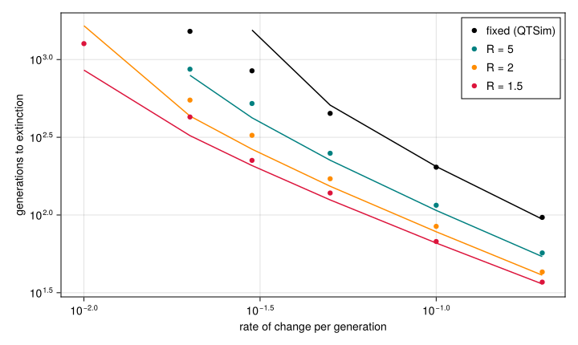
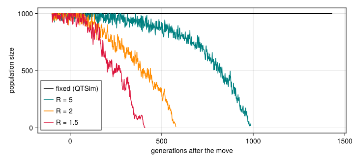

# Demography and evolutionary rescue
Simon Frost

- [Overview](#overview)
- [Setup](#setup)
- [A density-regulated population](#a-density-regulated-population)
- [How fast can the environment
  change?](#how-fast-can-the-environment-change)
- [A population in decline](#a-population-in-decline)
- [Summary](#summary)

## Overview

QTSim, and with it the paper ([Pagel et al. 2025](#ref-Pagel2025)),
keeps the population at a fixed size: however few individuals survive
selection, they produce `PopSize` offspring. A population that falls
behind a moving optimum loses nothing until fewer than two survive a
single generation, and then it is gone. Real populations shrink when
their mean fitness falls, smaller populations have less genetic variance
to adapt with, and a population that adapts fast enough can recover.
Whether evolution prevents extinction then depends on a race between
adaptation and decline: evolutionary rescue ([Gomulkiewicz and Holt
1995](#ref-GomulkiewiczHolt1995)).

QTLSim has a density-regulated alternative,
`Demography = :beverton_holt`. This vignette asks how much the fixed
size matters for the paper’s question: how fast can the environment
change before a population that adapts to it goes extinct? It compares
the simulations with the moments lowering of the life cycle, the
deterministic predictions of quantitative-genetic theory for the same
model ([Lande 1976](#ref-Lande1976); [Bürger and Lynch
1995](#ref-BurgerLynch1995)).

## Setup

``` julia
using QTLSim
import Catlab                       # loads the categorical layer, for run_moments
using CairoMakie, Printf, Statistics
CairoMakie.activate!(type = "png")
```

## A density-regulated population

With `n` survivors, carrying capacity `K = PopSize` and `R = GrowthRate`
offspring per survivor at low density, the next generation has
$\mathrm{Poisson}\big(Rn/(1 + (R-1)n/K)\big)$ individuals, at most $K$
(`noffspring`). When a fraction $\bar W$ survives, the population
settles near $K (R\bar W - 1)/((R-1)\bar W)$, and it shrinks when
$R\bar W < 1$. Under stabilising selection $\bar W$ is close to one, so
the population stays close to $K$.

The parameters are those of [Adaptation to a moving
optimum](03_moving_optimum.md), with 5000
generations of stabilising selection before the optimum starts to move.
The growth rates compared are $R = 5$, $2$ and $1.5$, against QTSim’s
fixed size.

``` julia
base = Params(PopSize = 1000, Ploidy = 2, NoQTL = 100, NoGenerations = 7000,
              PhenotypeVar = 0.022, Heritability = 0.32, MutationScalar = 0.004,
              MutationRatePerGamete = 1e-4, RecombPoissonMean = 3.0, InitFitnessSD = 5.0,
              MoveFitnessSDGen = 5000, MoveType = :continuous)
demog = [("fixed (QTSim)", (Demography = :fixed,)),
         ("R = 5", (Demography = :beverton_holt, GrowthRate = 5.0)),
         ("R = 2", (Demography = :beverton_holt, GrowthRate = 2.0)),
         ("R = 1.5", (Demography = :beverton_holt, GrowthRate = 1.5))]

eq = Vector{Any}(undef, length(demog))
Threads.@threads :greedy for k in eachindex(demog)
    q = Params(base; demog[k][2]..., MoveFitnessSDGen = -1, NoGenerations = 5000)
    o = simulate(q; seed = k)
    eq[k] = (; N = mean(o.popsize[4001:end]), W = mean(o.mean_fitness[4001:end]),
             VG = mean(o.geno_var[4001:end]), sd = mean(sqrt.(o.pheno_var[4001:end])),
             m = run_moments(q))
end
println("| demography | population size | predicted from W̄ | moments lowering | mean fitness | V_G | phenotypic SD |")
println("|:--|--:|--:|--:|--:|--:|--:|")
for (k, (name, kw)) in enumerate(demog)
    e = eq[k]; R = get(kw, :GrowthRate, Inf)
    pred = isinf(R) ? 1000.0 : 1000 * (R * e.W - 1) / ((R - 1) * e.W)
    @printf("| %s | %.0f | %.0f | %d | %.4f | %.4f | %.3f |\n", name, e.N, pred, e.m.popsize[end], e.W, e.VG, e.sd)
end
```

| demography | population size | predicted from W̄ | moments lowering | mean fitness | V_G | phenotypic SD |
|:---|---:|---:|---:|---:|---:|---:|
| fixed (QTSim) | 1000 | 1000 | 1000 | 0.9949 | 0.0935 | 0.329 |
| R = 5 | 986 | 999 | 999 | 0.9951 | 0.0841 | 0.314 |
| R = 2 | 979 | 994 | 996 | 0.9940 | 0.1204 | 0.367 |
| R = 1.5 | 972 | 990 | 993 | 0.9952 | 0.0820 | 0.311 |

At equilibrium every population is within 3% of its carrying capacity, a
little below the value predicted from its mean fitness: random
fluctuations in size, which the prediction ignores, pull the average
down. The phenotypic standard deviation, which sets the scale of the
rates below, is about a third.

## How fast can the environment change?

Each demography faces seven rates of change, from 0.005 to 0.2 per
generation (about 1.5% to 60% of a phenotypic standard deviation), six
populations each, for up to 2000 generations after the move. The moments
lowering gives each rate a deterministic prediction: the generation in
which fewer than two individuals are expected to survive, or, under
density regulation, the population is expected to fall below one.

``` julia
rates = [0.005, 0.01, 0.02, 0.03, 0.05, 0.1, 0.2]
jobs = [(i, d, rep) for i in eachindex(demog) for d in rates for rep in 1:6]
res = Vector{Any}(undef, length(jobs))
Threads.@threads :greedy for k in eachindex(jobs)
    i, d, rep = jobs[k]
    o = simulate(Params(base; demog[i][2]..., MoveFitnessSD = d); seed = 1000k + rep)
    res[k] = (; i, d, extinct = o.extinct, T = o.extinct ? o.extinct_gen - 5000 : missing)
end
predicted = Dict((i, d) => run_moments(Params(base; demog[i][2]..., MoveFitnessSD = d))
                 for i in eachindex(demog) for d in rates)
Tpred(i, d) = (m = predicted[(i, d)]; m.extinct ? m.extinct_gen - 5000 : missing)

println("| rate | ", join(first.(demog), " | "), " |")
println("|:--|", repeat("--:|", length(demog)))
for d in rates
    cells = map(eachindex(demog)) do i
        rs = filter(r -> r.i == i && r.d == d, res)
        died = filter(r -> r.extinct, rs)
        tp = Tpred(i, d)
        s = length(died) >= 3 ? @sprintf("%d", round(Int, median(r.T for r in died))) : "survive"
        @sprintf("%s (%d/6) [%s]", s, length(rs) - length(died), ismissing(tp) ? "survives" : string(tp))
    end
    @printf("| %.3f | %s |\n", d, join(cells, " | "))
end
```

| rate | fixed (QTSim) | R = 5 | R = 2 | R = 1.5 |
|:---|---:|---:|---:|---:|
| 0.005 | survive (6/6) \[survives\] | survive (6/6) \[survives\] | survive (6/6) \[survives\] | survive (6/6) \[survives\] |
| 0.010 | survive (6/6) \[survives\] | survive (6/6) \[survives\] | survive (4/6) \[1650\] | 1266 (0/6) \[855\] |
| 0.020 | 1519 (0/6) \[survives\] | 867 (0/6) \[792\] | 548 (0/6) \[433\] | 427 (0/6) \[324\] |
| 0.030 | 846 (0/6) \[1548\] | 522 (0/6) \[422\] | 326 (0/6) \[265\] | 224 (0/6) \[208\] |
| 0.050 | 450 (0/6) \[509\] | 250 (0/6) \[225\] | 171 (0/6) \[153\] | 138 (0/6) \[125\] |
| 0.100 | 203 (0/6) \[205\] | 116 (0/6) \[107\] | 84 (0/6) \[78\] | 68 (0/6) \[66\] |
| 0.200 | 96 (0/6) \[94\] | 57 (0/6) \[54\] | 43 (0/6) \[41\] | 37 (0/6) \[36\] |

Each cell is the median time to extinction after the move, the number of
the six populations alive 2000 generations after it (in parentheses),
and the moments lowering’s prediction \[in brackets\].

``` julia
fig = Figure(size = (720, 430))
ax = Axis(fig[1, 1], xscale = log10, yscale = log10, xlabel = "rate of change per generation",
          ylabel = "generations to extinction")
colors = [:black, :teal, :darkorange, :crimson]
for (i, (name, _)) in enumerate(demog)
    ds = Float64[]; Ts = Float64[]
    for d in rates
        died = filter(r -> r.i == i && r.d == d && r.extinct, res)
        length(died) >= 3 && (push!(ds, d); push!(Ts, median(r.T for r in died)))
    end
    scatter!(ax, ds, Ts, color = colors[i], label = name)
    pd = [d for d in rates if !ismissing(Tpred(i, d))]
    lines!(ax, pd, [Tpred(i, d) for d in pd], color = colors[i])
end
axislegend(ax, position = :rt)
fig
```

```@raw html
<div id="fig-extinction">
```



Figure 1: Time to extinction after the optimum starts moving, against
the rate of change (medians of six populations; populations alive after
2000 generations are not shown). Lines: the deterministic prediction of
the moments lowering.

```@raw html
</div>
```

Density regulation shortens every population’s life, and the lower the
growth rate, the shorter. At the fast rates the population is far behind
the optimum within a few generations: under QTSim’s fixed size it dies
when survival collapses, while a density-regulated population is already
shrinking, by a factor $R\bar W$ each generation, as soon as its mean
fitness falls below $1/R$. With $R = 1.5$ populations die in about a
third of the time they last at a fixed size.

The sustainable rate moves too. At a fixed size every population
survived 0.01 per generation, about 3% of a standard deviation, the
paper’s estimate of the maximum sustainable rate. With $R = 2$ two of
six died at that rate, and with $R = 1.5$ all six did; only 0.005, about
1.5% of a standard deviation, was sustained by every demography. A
population that cannot grow fast enough to make good its losses cannot
sustain the rates a population of fixed size can.

The moments lowering predicts the time to extinction closely at fast
rates, where the outcome is decided by the lag. At slow rates it is less
accurate, and it predicts that the fixed-size population survives 0.02
per generation, which none of the six did: the Gaussian approximation’s
genetic variance and its deterministic population size leave out the
drift and the fluctuations in size that decide whether a slowly
declining population lasts.

## A population in decline

The trajectories of one population of each demography at 0.02 per
generation show the difference: the fixed-size population stays at 1000
until it dies, while the density-regulated populations shrink, faster
the lower their growth rate, and die small.

``` julia
fig = Figure(size = (720, 330))
ax = Axis(fig[1, 1], xlabel = "generations after the move", ylabel = "population size")
for (i, (name, kw)) in enumerate(demog)
    o = simulate(Params(base; kw..., MoveFitnessSD = 0.02); seed = 7)
    k = findall(>=(4900), o.gen)
    lines!(ax, o.gen[k] .- 5000, o.popsize[k], color = colors[i], label = name)
end
axislegend(ax, position = :lb)
fig
```

```@raw html
<div id="fig-decline">
```



Figure 2: Population size after the optimum starts moving at 0.02 per
generation, one population of each demography.

```@raw html
</div>
```

## Summary

QTSim’s fixed population size is not neutral for the paper’s question. A
population that is refilled every generation pays nothing for being
maladapted until it dies, so it sustains faster change, and lasts longer
once it cannot, than a population whose size follows its fitness. How
much faster depends on how fast the population could regrow: with a few
offspring per survivor the maximum sustainable rate is about half the
rate at a fixed size. The paper’s estimate of about 3% of a phenotypic
standard deviation per generation is therefore an upper bound that holds
for populations able to make good their losses. The density-regulated
model is QTLSim’s, not QTSim’s, and has no SLiM lowering.

```@raw html
<div id="refs" class="references csl-bib-body hanging-indent">
```

```@raw html
<div id="ref-BurgerLynch1995" class="csl-entry">
```

Bürger, Reinhard, and Michael Lynch. 1995. “Evolution and Extinction in
a Changing Environment: A Quantitative-Genetic Analysis.” *Evolution* 49
(1): 151–63. <https://doi.org/10.1111/j.1558-5646.1995.tb05967.x>.

```@raw html
</div>
```

```@raw html
<div id="ref-GomulkiewiczHolt1995" class="csl-entry">
```

Gomulkiewicz, Richard, and Robert D. Holt. 1995. “When Does Evolution by
Natural Selection Prevent Extinction?” *Evolution* 49 (1): 201–7.
<https://doi.org/10.1111/j.1558-5646.1995.tb05971.x>.

```@raw html
</div>
```

```@raw html
<div id="ref-Lande1976" class="csl-entry">
```

Lande, Russell. 1976. “Natural Selection and Random Genetic Drift in
Phenotypic Evolution.” *Evolution* 30 (2): 314–34.
<https://doi.org/10.1111/j.1558-5646.1976.tb00911.x>.

```@raw html
</div>
```

```@raw html
<div id="ref-Pagel2025" class="csl-entry">
```

Pagel, Mark, Jacob D. Gardner, and Andrew Meade. 2025.
“Quantitative-Genetic Analysis of Directional Adaptation Suggests Low
Maximum Sustainable Rates of Change in Agreement with Data from Field
Populations.” *Scientific Reports* 15.
<https://doi.org/10.1038/s41598-025-24445-2>.

```@raw html
</div>
```

```@raw html
</div>
```
