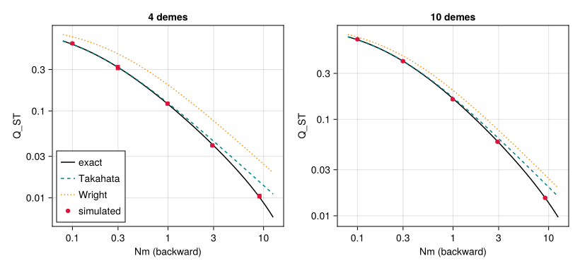
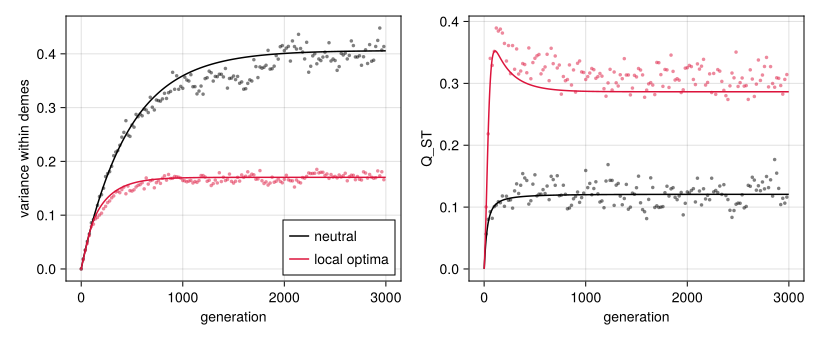

# Metapopulations and migration
Simon Frost

- [Overview](#overview)
- [Setup](#setup)
- [Building a metapopulation](#building-a-metapopulation)
- [How migration works](#how-migration-works)
- [Neutral differentiation](#neutral-differentiation)
  - [The model and the statistic](#the-model-and-the-statistic)
  - [Theory](#theory)
  - [Simulations](#simulations)
  - [The stepping-stone ring](#the-stepping-stone-ring)
  - [The variance within demes, and the
    exchange](#the-variance-within-demes-and-the-exchange)
- [Local adaptation](#local-adaptation)
- [What the moments lowering
  predicts](#what-the-moments-lowering-predicts)
- [Summary](#summary)
- [Where next](#where-next)

## Overview

QTSim follows one population. The categorical layer of QTLSim places
populations side by side as demes, with the monoidal product `⊗` of the
life cycle, and couples them with a migration step, `migrate(k)` ([One
life cycle, two
backends](07_one_life_cycle_two_backends.md)).
This vignette shows how to build and run such metapopulations, explains
what the kernel’s migration does, and checks the simulated
differentiation among neutral demes against population-genetic theory:
Wright’s island model ([Wright 1931](#ref-Wright1931)), its exact
finite-island form ([Takahata 1983](#ref-Takahata1983)), the
stepping-stone ring ([Kimura and Weiss 1964](#ref-KimuraWeiss1964);
[Slatkin 1991](#ref-Slatkin1991)), and the neutral theory of
quantitative variation in a subdivided population ([Lande
1992](#ref-Lande1992); [Whitlock 1999](#ref-Whitlock1999)). It ends with
demes adapted to optima of their own, whose differentiation in the trait
exceeds the neutral expectation.

## Setup

``` julia
using QTLSim
import Catlab                       # loads the categorical layer
using Catlab: ⋅, ⊗
using CairoMakie, Printf, Random, Statistics
using Distributions: Normal, cdf
CairoMakie.activate!(type = "png")
L = lifecycle(); g = L.generation   # QTSim's generation, Zygotes → Zygotes
```

    develop⋅select⋅reproduce⋅record⋅rescale⋅mutate⋅swap: Zygotes → Zygotes

## Building a metapopulation

A metapopulation needs two things: populations, one per deme, and a life
cycle on all of them. `p ⊗ demes(k)` makes `k` demes with the parameters
`p`. The life cycle `g ⊗ g ⊗ g ⊗ g` runs QTSim’s generation in each of
four demes, and composing it with `L.migrate(4)` adds a migration step
after the generation:

``` julia
p = Params(PopSize = 200, NoQTL = 10, Ploidy = 2, NoGenerations = 500, PhenotypeVar = 1.0,
           Heritability = 0.5, MutationScalar = 0.01, MutationRatePerGamete = 0.01, Drift = true)
cycle = g ⊗ g ⊗ g ⊗ g ⋅ L.migrate(4)
```

    ((develop⋅select⋅reproduce⋅record⋅rescale⋅mutate⋅swap)⊗(develop⋅select⋅reproduce⋅record⋅rescale⋅mutate⋅swap)⊗(develop⋅select⋅reproduce⋅record⋅rescale⋅mutate⋅swap)⊗(develop⋅select⋅reproduce⋅record⋅rescale⋅mutate⋅swap))⋅migrate: Zygotes⊗Zygotes⊗Zygotes⊗Zygotes → Zygotes⊗Zygotes⊗Zygotes⊗Zygotes

`run_composed` runs it. `migration_rate` is the probability that an
individual starts an exchange with an individual of another deme, chosen
at random among the other three. The records have one row per deme and
generation, with the deme in the column `deme`. With `Drift = true`
every individual has fitness one, so the demes drift apart, and
migration holds them together:

``` julia
o = run_composed(p ⊗ demes(4), Xoshiro(1); cycle, migration_rate = 0.01)
last_gen = o.gen .== 499
for d in 1:4
    i = findfirst(last_gen .& (o.deme .== d))
    @printf("deme %d, generation 499: mean phenotype %6.3f, genetic variance %.4f, size %d\n",
            d, o.pheno_mean[i], o.geno_var[i], o.popsize[i])
end
```

    deme 1, generation 499: mean phenotype -1.424, genetic variance 1.9559, size 200
    deme 2, generation 499: mean phenotype -0.944, genetic variance 1.4993, size 200
    deme 3, generation 499: mean phenotype -0.719, genetic variance 2.0551, size 200
    deme 4, generation 499: mean phenotype -0.550, genetic variance 1.7720, size 200

A scalar rate is the island model. For other graphs, `migration_rate`
takes a matrix whose entry `[a, b]` is the probability that an
individual of deme `a` starts an exchange with a random individual of
deme `b`: `island_migration(k, r)` is the island model as a matrix, and
`stepping_stone(k, r)` sends half of `r` to each neighbour on a ring
(or, with `circular = false`, a line).

``` julia
stepping_stone(6, 0.02)
```

    6×6 Matrix{Float64}:
     0.0   0.01  0.0   0.0   0.0   0.01
     0.01  0.0   0.01  0.0   0.0   0.0
     0.0   0.01  0.0   0.01  0.0   0.0
     0.0   0.0   0.01  0.0   0.01  0.0
     0.0   0.0   0.0   0.01  0.0   0.01
     0.01  0.0   0.0   0.0   0.01  0.0

``` julia
o_ring = run_composed(p ⊗ demes(6), Xoshiro(2); cycle = foldl(⊗, fill(g, 6)) ⋅ L.migrate(6),
                      migration_rate = stepping_stone(6, 0.02))
size(o_ring.gen)
```

    (3000,)

Demes can have parameters of their own in two ways. A vector of
`Params`, `[p1, …, pk] ⊗ demes(k)`, gives each deme its own constants:
here four demes of different sizes. Because migration exchanges
individuals, each keeps its size exactly:

``` julia
sizes = [50, 100, 200, 400]
o_sizes = run_composed([Params(p; PopSize = n) for n in sizes] ⊗ demes(4), Xoshiro(3); cycle,
                       migration_rate = 0.05)
[extrema(o_sizes.popsize[o_sizes.deme .== d]) for d in 1:4]
```

    4-element Vector{Tuple{Int64, Int64}}:
     (50, 50)
     (100, 100)
     (200, 200)
     (400, 400)

Or the steps of the life cycle can carry parameters, as part of the
syntax: `withparams` gives the steps of a deme’s generation a width `ω`
or a fixed optimum `θ` of its own, and `L.migrate(k; rate)` carries its
rate (a number or a matrix), so `run_composed` needs no
`migration_rate`:

``` julia
local_cycle = withparams(g; θ = -0.5) ⊗ withparams(g; θ = 0.5, ω = 0.5) ⋅ L.migrate(2; rate = 0.01)
```

    ((develop⋅select(θ = -0.5)⋅reproduce⋅record⋅rescale⋅mutate⋅swap)⊗(develop⋅select(θ = 0.5, ω = 0.5)⋅reproduce⋅record⋅rescale⋅mutate⋅swap))⋅migrate(rate = 0.01): Zygotes⊗Zygotes → Zygotes⊗Zygotes

The optimum is a parameter of the step `select`, not of `Params`; the
section on local adaptation below uses it.

## How migration works

The kernel’s `migrate!` visits each individual once. With probability
`r` it starts an exchange: it picks a deme (uniformly among the others
in the island model, from its row of the matrix otherwise) and a random
individual there, and the two change places. Three consequences follow.

- Deme sizes are exact. An exchange moves one individual each way, so
  migration never changes a deme’s size, as above.
- About twice as many individuals move as start an exchange. A deme’s
  individuals start about `N r` exchanges, and as many individuals of
  the other demes start exchanges with it, so the fraction of a deme’s
  adults that came from elsewhere, the backward migration rate `m` of
  population genetics, is about `2r`. `backward_migration(M, N)`
  computes it exactly: a little less than `2r`, because an individual
  that has moved can be exchanged again.
- Exchanges are made one after another, so the order of the demes could
  matter: with a fixed order, deme 1 would send migrants that deme 2 can
  pass on in the same generation, but not the reverse. `migrate!`
  therefore visits the demes in a new uniformly random order at each
  call, and `randomOrderSweep_exchangeable` in
  `lean/CategoricalQuantGen/Migration.lean` proves that migration is
  then exchangeable: relabelling the demes commutes with it, in
  distribution, for any migration matrix that relabelling leaves
  unchanged (such as the island model).

The second point can be checked directly. Tag every individual with its
deme (in its environmental-deviation slot, which `migrate!` exchanges
with it), migrate once, and count, 2000 times for each rate, in four
demes of 50:

``` julia
function migrant_fraction(k, N, r, ncalls, rng)
    s = Params(PopSize = N, Ploidy = 2, Drift = true) ⊗ demes(k)
    f = 0.0
    for _ in 1:ncalls
        for (a, w) in enumerate(s.demes); fill!(view(w.env, 1:w.N), a); end
        migrate!(s, rng; rate = r)
        f += mean(count(!=(a), view(w.env, 1:w.N)) / w.N for (a, w) in enumerate(s.demes))
    end
    f / ncalls
end
println("| rate r | 2r | backward m, exact | measured |\n|--:|--:|--:|--:|")
for r in (0.001, 0.01, 0.05, 0.1)
    m = 1 - backward_migration(4, r, 50)[1, 1]
    @printf("| %g | %g | %.5f | %.5f |\n", r, 2r, m, migrant_fraction(4, 50, r, 2000, Xoshiro(round(Int, 1e4r))))
end
```

| rate r |    2r | backward m, exact | measured |
|-------:|------:|------------------:|---------:|
|  0.001 | 0.002 |           0.00200 |  0.00206 |
|   0.01 |  0.02 |           0.01980 |  0.02001 |
|   0.05 |   0.1 |           0.09515 |  0.09513 |
|    0.1 |   0.2 |           0.18112 |  0.18134 |

So `Nm`, the number of migrants per deme per generation that the
classical formulas take, is $N$ times the backward rate, about $2Nr$;
below, every $Nm$ is computed from `backward_migration`.

## Neutral differentiation

### The model and the statistic

Without selection (`Drift = true`) the trait is neutral, and its
differentiation among demes is a measure of population structure. For an
additive trait, $Q_{ST} = \sigma^2_B / (\sigma^2_B + 2 V_W)$, with
$\sigma^2_B$ the variance among deme means and $V_W$ the additive
variance within demes, has the same expectation as Wright’s $F_{ST}$ at
neutral loci ([Spitze 1993](#ref-Spitze1993); [Whitlock
1999](#ref-Whitlock1999)). Here $\sigma^2_B$ is the variance among the
deme means relative to the whole metapopulation (Wright’s convention, as
in Takahata ([1983](#ref-Takahata1983)) and Slatkin
([1991](#ref-Slatkin1991))): $(k-1)/k$ times the variance among the $k$
deme means, less the sampling variance of a deme mean, $V_W/N$.

The demes have $N = 50$ diploids with 20 loci and a mutational variance
$V_m = 0.001$ per individual per generation. The statistics are on
genotypes, which the standard records do not keep for each deme, so a
custom image of the step `record` collects them at chosen generations.
QTLSim’s lowering takes images of steps from the `images` dictionary, so
changing what is recorded changes no other step:

``` julia
p0 = Params(Ploidy = 2, NoQTL = 20, RecombPoissonMean = 1.0, PhenotypeVar = 1.0, Heritability = 0.5,
            MutationScalar = 0.002, MutationRatePerGamete = 0.05, Drift = true)
Vm = muteVar(p0)

"Run `ps ⊗ demes(k)`, recording each deme's mean and variance of genotypes at the census generations."
function census_run(ps, cycle, M, seed, census)
    s = ps ⊗ demes(length(ps))
    idx = IdDict(w => i for (i, w) in enumerate(s.demes))
    mg = zeros(length(ps), length(census)); vg = zeros(length(ps), length(census))
    rec = operator(:record, function (w, rng)
        j = searchsortedfirst(census, w.gen)
        if j <= length(census) && census[j] == w.gen
            gt = view(w.genotype, 1:w.N)
            mg[idx[w], j] = mean(gt); vg[idx[w], j] = var(gt)
        end
        w
    end)
    run_composed(s, Xoshiro(seed); cycle, record = false, images = Dict(:record => rec), migration_rate = M)
    (; mg, vg)
end

"Q_ST from the mean within-deme variance and the mean sample variance among deme means."
qst_of(VW, among, k, N) = (σ2 = (k - 1) / k * (among - VW / N); σ2 / (σ2 + 2VW))
Vm
```

    0.001

### Theory

`neutral_deme_variances(P, N, Vm)` gives the expected within-deme
variance, the variance among deme means and $Q_{ST}$ exactly, for the
kernel’s own life cycle, from a recursion for the expected coalescence
times of pairs of genes (`deme_coalescence`), at equilibrium or at any
generation of a run that starts, as the kernel’s does, with all genomes
equal ([Slatkin 1991](#ref-Slatkin1991); [Whitlock
1999](#ref-Whitlock1999)). `P` is the backward migration matrix, and
`origins` the law of the demes two distinct adults came from:
`:exchange` is that of the kernel’s exchanges, to first order in the
migration rate. For the island model the equilibrium has a closed form,
`qst_island(N, m; k)`, exact when the two adults’ origins are
independent (as when migrants are drawn from a common pool):

$$Q_{ST} = \frac{\tfrac{k-1}{k} R}{\tfrac{k-1}{k} R + 1}, \qquad
R = \frac{\lambda}{2N(1 - \lambda)}, \qquad \lambda = \Big(1 - \frac{m k}{k - 1}\Big)^2.$$

For small $m$ it is close to Takahata’s $1/(1 + 4Nm\,(k/(k-1))^2)$, and
with infinitely many demes it becomes Wright’s $1/(1 + 4Nm)$.

### Simulations

Each scenario runs 50 times for about four times the longest mean
coalescence time (between 1600 and 13,400 generations), and the
statistics are averaged over every 10th generation of the second half of
each run. The island model has $k = 4$ and $10$ demes and $Nm$ from
about 0.1 to 10, and the ring has $k = 8$ demes. The predictions are the
exact expectations for the same generations, which are within about 3%
of equilibrium for the variances and closer for $Q_{ST}$.

``` julia
N = 50; R = 50
plans = []
for k in (4, 10), Nm in (0.1, 0.3, 1.0, 3.0, 10.0)
    push!(plans, (; k, ring = false, M = island_migration(k, Nm / (2N))))
end
for Nm in (1.0, 10.0)
    push!(plans, (; k = 8, ring = true, M = stepping_stone(8, Nm / (2N))))
end
plans = map(plans) do pl
    P = backward_migration(pl.M, N)
    T = maximum(deme_coalescence(P, N; origins = :exchange).S)
    gens = ceil(Int, 4T / 100) * 100
    census = collect(gens ÷ 2:10:gens-1)
    (; pl..., P, m = 1 - P[1, 1], gens, census, p = Params(p0; PopSize = N, NoGenerations = gens),
     cycle = foldl(⊗, fill(g, pl.k)) ⋅ L.migrate(pl.k))
end
jobs = sort!([(i, rep) for i in eachindex(plans) for rep in 1:R]; by = j -> -plans[j[1]].gens * plans[j[1]].k)
runs = Vector{Any}(undef, length(jobs))
elapsed = @elapsed Threads.@threads :greedy for j in eachindex(jobs)
    i, rep = jobs[j]
    pl = plans[i]
    runs[j] = census_run(fill(pl.p, pl.k), pl.cycle, pl.M, 1000i + rep, pl.census)
end
@printf("%d runs in %.0f s on %d threads\n", length(jobs), elapsed, Threads.nthreads())
```

    600 runs in 90 s on 3 threads

``` julia
ringdist(a, b, k) = min(mod(a - b, k), mod(b - a, k))
brng = Xoshiro(12)
results = map(eachindex(plans)) do i
    pl = plans[i]; k = pl.k
    rs = [runs[j] for j in eachindex(jobs) if jobs[j][1] == i]
    w = [mean(r.vg) for r in rs]
    a = [mean(var(view(r.mg, :, c)) for c in axes(r.mg, 2)) for r in rs]
    q = qst_of(mean(w), mean(a), k, N)
    boot = sort([(ix = rand(brng, 1:R, R); qst_of(mean(w[ix]), mean(a[ix]), k, N)) for _ in 1:2000])
    th = neutral_deme_variances(pl.P, N, Vm; t = pl.census, origins = :exchange)
    tw, ta = mean(mean(x.within) for x in th), mean(x.among for x in th)
    eq = neutral_deme_variances(pl.P, N, Vm; origins = :exchange)
    # half the squared difference of deme means, by distance on the ring
    dists = pl.ring ? (1:k÷2) : (1:0)
    pairs_sim = [mean(mean((r.mg[x, c] - r.mg[y, c])^2 / 2 for x in 1:k for y in x+1:k if ringdist(x, y, k) == d
                            for c in axes(r.mg, 2)) for r in rs) for d in dists]
    bydist(v, d) = mean(v.pairs[x, y] for x in 1:k for y in x+1:k if ringdist(x, y, k) == d)
    pairs_eq = [bydist(eq, d) for d in dists]
    pairs_pred = [mean(bydist(x, d) for x in th) for d in dists]
    pairs_se = [std([mean(mean((r.mg[x, c] - r.mg[y, c])^2 / 2 for x in 1:k for y in x+1:k if ringdist(x, y, k) == d)
                          for c in axes(r.mg, 2)) for r in rs]) / sqrt(R) for d in dists]
    (; pl.k, pl.ring, pl.m, Nm = N * pl.m, VW = mean(w), VW_se = std(w) / sqrt(R), q, q_lo = boot[50], q_hi = boot[1950],
     q_se = std(boot), q_pred = qst_of(tw, ta, k, N), q_eq = eq.qst, VW_pred = tw, VW_eq = mean(eq.within),
     pairs_sim, pairs_se, pairs_pred, pairs_eq)
end;
```

``` julia
println("| demes | Nm | simulated Q_ST (95% CI) | expected at the census | z | exact equilibrium | qst_island | Takahata | Wright |")
println("|--:|--:|--:|--:|--:|--:|--:|--:|--:|")
for r in results
    r.ring && continue
    k = r.k
    @printf("| %d | %.3g | %.4f (%.4f–%.4f) | %.4f | %.2f | %.4f | %.4f | %.4f | %.4f |\n", k, r.Nm, r.q, r.q_lo, r.q_hi,
            r.q_pred, (r.q - r.q_pred) / r.q_se, r.q_eq, qst_island(N, r.m; k),
            1 / (1 + 4r.Nm * (k / (k - 1))^2), 1 / (1 + 4r.Nm))
end
```

| demes | Nm | simulated Q_ST (95% CI) | expected at the census | z | exact equilibrium | qst_island | Takahata | Wright |
|---:|---:|---:|---:|---:|---:|---:|---:|---:|
| 4 | 0.0999 | 0.5996 (0.5835–0.6155) | 0.5826 | 2.08 | 0.5849 | 0.5837 | 0.5847 | 0.7145 |
| 4 | 0.299 | 0.3160 (0.2989–0.3338) | 0.3171 | -0.13 | 0.3183 | 0.3172 | 0.3198 | 0.4553 |
| 4 | 0.99 | 0.1214 (0.1172–0.1258) | 0.1204 | 0.49 | 0.1206 | 0.1201 | 0.1244 | 0.2016 |
| 4 | 2.91 | 0.0402 (0.0388–0.0415) | 0.0412 | -1.57 | 0.0412 | 0.0410 | 0.0461 | 0.0791 |
| 4 | 9.06 | 0.0105 (0.0100–0.0110) | 0.0102 | 1.24 | 0.0102 | 0.0101 | 0.0153 | 0.0269 |
| 10 | 0.0999 | 0.6774 (0.6702–0.6850) | 0.6684 | 2.44 | 0.6693 | 0.6689 | 0.6696 | 0.7145 |
| 10 | 0.299 | 0.4017 (0.3950–0.4085) | 0.4011 | 0.18 | 0.4017 | 0.4012 | 0.4036 | 0.4552 |
| 10 | 0.992 | 0.1614 (0.1589–0.1639) | 0.1650 | -2.81 | 0.1652 | 0.1649 | 0.1696 | 0.2013 |
| 10 | 2.93 | 0.0585 (0.0578–0.0593) | 0.0590 | -1.15 | 0.0590 | 0.0588 | 0.0647 | 0.0787 |
| 10 | 9.21 | 0.0153 (0.0151–0.0156) | 0.0153 | 0.15 | 0.0153 | 0.0153 | 0.0215 | 0.0264 |

``` julia
fig = Figure(size = (820, 380))
Nms = exp10.(range(-1.1, 1.1, length = 120))
for (col, k) in enumerate((4, 10))
    ax = Axis(fig[1, col], xscale = log10, yscale = log10, xlabel = "Nm (backward)", ylabel = "Q_ST",
              title = "$k demes", xticks = ([0.1, 0.3, 1, 3, 10], ["0.1", "0.3", "1", "3", "10"]),
              yticks = ([0.01, 0.03, 0.1, 0.3, 1], ["0.01", "0.03", "0.1", "0.3", "1"]))
    island_P(m) = [a == c ? 1 - m : m / (k - 1) for a in 1:k, c in 1:k]
    lines!(ax, Nms, [neutral_deme_variances(island_P(x / N), N, Vm; origins = :exchange).qst for x in Nms],
           color = :black, label = "exact")
    lines!(ax, Nms, [1 / (1 + 4x * (k / (k - 1))^2) for x in Nms], color = :teal, linestyle = :dash,
           label = "Takahata")
    lines!(ax, Nms, [1 / (1 + 4x) for x in Nms], color = :darkorange, linestyle = :dot, label = "Wright")
    rs = filter(r -> r.k == k && !r.ring, results)
    errorbars!(ax, [r.Nm for r in rs], [r.q for r in rs], [r.q - r.q_lo for r in rs], [r.q_hi - r.q for r in rs],
               color = :crimson, whiskerwidth = 6)
    scatter!(ax, [r.Nm for r in rs], [r.q for r in rs], color = :crimson, label = "simulated")
    col == 1 && axislegend(ax, position = :lb)
end
fig
```

```@raw html
<div id="fig-qst">
```



Figure 1: Q_ST of a neutral trait among demes of 50 diploids in the
island model, against the number of migrants per deme per generation.
Points: simulations, 50 runs each, with bootstrap 95% intervals (most
are smaller than the points). Solid: the exact equilibrium for the
kernel’s life cycle (neutral_deme_variances); dashed: Takahata’s
finite-island approximation; dotted: Wright’s 1/(1 + 4Nm).

```@raw html
</div>
```

Every simulated Q<sub>ST</sub> agrees with the exact expectation for the
generations recorded: the largest of the 10 values of \|z\| is 2.81, a
value that 10 comparisons exceed by chance with probability 0.05.
Wright’s 1/(1 + 4Nm) is furthest off with 4 demes and Nm ≈ 9.1, where it
gives 0.0269 against an exact 0.0102, 2.6 times too much, and closest
with 10 demes and Nm ≈ 0.1, 0.714 against 0.669.

Wright’s formula is the limit of infinitely many demes and rare
migration, and it fails on both counts. With few demes a migrant is more
likely to come back to the deme its ancestors left, which Takahata’s
factor $(k/(k-1))^2$ accounts for, and the variance among a few demes,
relative to the whole metapopulation, is smaller by $(k-1)/k$. With much
migration the approximations fail too: in four demes, $m k/(k-1) = 1$ is
complete mixing (at $m = 0.75$), and as $m$ approaches it $Q_{ST}$ falls
faster than either approximation predicts. The independent-origins
closed form `qst_island` is within a fraction of a percent of the exact
value with exchanges (compare the columns of the table), too little to
see at this number of runs.

### The stepping-stone ring

On a ring of eight demes, demes that are closer are more alike. The
pairwise $F_{ST}$ between two demes $d$ steps apart (with $\sigma^2$
half the variance of their two means and $V_W$ the within-deme variance)
is compared with the exact expectation and with Slatkin’s approximation
for small $m$, `fst_stepping_stone(N, m, k, d)` ([Slatkin
1991](#ref-Slatkin1991), eq. 17):

``` julia
pair_fst(half_sq, VW) = (σ2 = (half_sq - VW / N) / 2; σ2 / (σ2 + 2VW))
println("| Nm | distance | simulated ½(Ḡa − Ḡb)² | expected at the census | z | pairwise F_ST, simulated | exact equilibrium | Slatkin |")
println("|--:|--:|--:|--:|--:|--:|--:|--:|")
for r in filter(r -> r.ring, results), d in 1:r.k÷2
    @printf("| %.3g | %d | %.4f ± %.4f | %.4f | %.2f | %.4f | %.4f | %.4f |\n", r.Nm, d, r.pairs_sim[d], r.pairs_se[d],
            r.pairs_pred[d], (r.pairs_sim[d] - r.pairs_pred[d]) / r.pairs_se[d],
            pair_fst(r.pairs_sim[d], r.VW), pair_fst(r.pairs_eq[d], r.VW_eq), fst_stepping_stone(N, r.m, r.k, d))
end
```

| Nm | distance | simulated ½(Ḡa − Ḡb)² | expected at the census | z | pairwise F_ST, simulated | exact equilibrium | Slatkin |
|---:|---:|---:|---:|---:|---:|---:|---:|
| 0.989 | 1 | 0.3437 ± 0.0092 | 0.3487 | -0.54 | 0.0965 | 0.0966 | 0.0996 |
| 0.989 | 2 | 0.5820 ± 0.0179 | 0.5872 | -0.29 | 0.1556 | 0.1551 | 0.1594 |
| 0.989 | 3 | 0.7248 ± 0.0254 | 0.7302 | -0.21 | 0.1875 | 0.1868 | 0.1916 |
| 0.989 | 4 | 0.7721 ± 0.0283 | 0.7778 | -0.20 | 0.1975 | 0.1968 | 0.2018 |
| 8.95 | 1 | 0.0414 ± 0.0011 | 0.0415 | -0.13 | 0.0083 | 0.0084 | 0.0121 |
| 8.95 | 2 | 0.0649 ± 0.0018 | 0.0649 | 0.00 | 0.0157 | 0.0158 | 0.0205 |
| 8.95 | 3 | 0.0793 ± 0.0023 | 0.0792 | 0.06 | 0.0202 | 0.0202 | 0.0255 |
| 8.95 | 4 | 0.0841 ± 0.0025 | 0.0839 | 0.07 | 0.0217 | 0.0217 | 0.0272 |

Differentiation rises with distance, as in Kimura and Weiss’s
stepping-stone model ([Kimura and Weiss 1964](#ref-KimuraWeiss1964)),
and the simulated squared differences follow their exact expectations
for the generations recorded. Slatkin’s approximation is a few percent
too high at $Nm \approx 1$ and much too high at $Nm \approx 10$, where
$m = 0.2$ is no longer small.

### The variance within demes, and the exchange

In the textbook island model the expected variance within a deme at
equilibrium is $2NkV_m$, the variance of an undivided population of the
same total size, whatever the migration rate ([Lande
1992](#ref-Lande1992); [Whitlock 1999](#ref-Whitlock1999)). That result
assumes that the demes two adults came from are independent. The
kernel’s exchanges keep every deme’s size exactly, so two distinct
adults of the metapopulation are in the same deme with probability
exactly $(N-1)/(kN-1)$ rather than $1/k$, and the variance within demes
becomes

$$V_W = 2NV_m\,\frac{kN - 1}{N - 1},$$

still independent of the migration rate. At $N = 50$ the difference,
1.5% at $k = 4$, is within the noise of the runs above:

``` julia
println("| demes | Nm | simulated V_W | expected at the census | 2NkV_m | 2NV_m(kN−1)/(N−1) |\n|--:|--:|--:|--:|--:|--:|")
for r in filter(r -> !r.ring, results)
    @printf("| %d | %.3g | %.4f ± %.4f | %.4f | %.4f | %.4f |\n", r.k, r.Nm, r.VW, r.VW_se, r.VW_pred,
            2N * r.k * Vm, 2N * Vm * (r.k * N - 1) / (N - 1))
end
```

| demes |     Nm |   simulated V_W | expected at the census | 2NkV_m | 2NV_m(kN−1)/(N−1) |
|------:|-------:|----------------:|-----------------------:|-------:|------------------:|
|     4 | 0.0999 | 0.3817 ± 0.0106 |                 0.3885 | 0.4000 |            0.4061 |
|     4 |  0.299 | 0.3784 ± 0.0109 |                 0.3881 | 0.4000 |            0.4061 |
|     4 |   0.99 | 0.3700 ± 0.0083 |                 0.3867 | 0.4000 |            0.4061 |
|     4 |   2.91 | 0.3871 ± 0.0106 |                 0.3859 | 0.4000 |            0.4061 |
|     4 |   9.06 | 0.3715 ± 0.0061 |                 0.3849 | 0.4000 |            0.4061 |
|    10 | 0.0999 | 0.9434 ± 0.0251 |                 0.9655 | 1.0000 |            1.0184 |
|    10 |  0.299 | 0.9504 ± 0.0227 |                 0.9654 | 1.0000 |            1.0184 |
|    10 |  0.992 | 0.9561 ± 0.0183 |                 0.9621 | 1.0000 |            1.0184 |
|    10 |   2.93 | 0.9542 ± 0.0242 |                 0.9615 | 1.0000 |            1.0184 |
|    10 |   9.21 | 0.9607 ± 0.0228 |                 0.9625 | 1.0000 |            1.0184 |

The expectations at the census are below both equilibrium values because
the runs end before equilibrium. Most simulated values are a little
below their expectations, each within about two standard errors;
`validate/fst.jl`, with eight times as many runs, finds no discrepancy
in the variance within demes (largest $|z|$ 2.6).

In small demes the difference is not negligible. With four demes of
$N = 10$, the two formulas differ by 8%; 200 runs of 3000 generations,
with $Nm \approx 1$:

``` julia
let k = 4, Ns = 10, M = island_migration(4, 0.05), census = collect(1000:10:2990)
    ps = fill(Params(p0; PopSize = Ns, NoGenerations = 3000), k)
    cyc = foldl(⊗, fill(g, k)) ⋅ L.migrate(k)
    w = Vector{Float64}(undef, 200)
    Threads.@threads :greedy for i in 1:200
        w[i] = mean(census_run(ps, cyc, M, 50_000 + i, census).vg)
    end
    P = backward_migration(M, Ns)
    se = std(w) / sqrt(200)
    exch, pool = 2Ns * Vm * (k * Ns - 1) / (Ns - 1), 2Ns * k * Vm
    @printf("Nm = %.2f. Simulated V_W %.5f ± %.5f; 2NV_m(kN−1)/(N−1) = %.5f (z = %.1f); 2NkV_m = %.5f (z = %.1f).\n",
            Ns * (1 - P[1, 1]), mean(w), se, exch, (mean(w) - exch) / se, pool, (mean(w) - pool) / se)
end
```

Nm = 0.95. Simulated V_W 0.08607 ± 0.00056; 2NV_m(kN−1)/(N−1) = 0.08667
(z = -1.1); 2NkV_m = 0.08000 (z = 10.9).

The simulated variance within demes is the exchange formula’s, not the
textbook value. $Q_{ST}$ is hardly affected: the exchange raises the
variance among demes in nearly the same proportion, so that
`qst_island`, which assumes independent origins, is within a fraction of
a percent of the exact value, as above. `validate/fst.jl` makes the full
comparison (41 statistics, 400 runs per scenario, with the law of the
origins of pairs measured from `migrate!` itself), and finds no
discrepancy (largest $|z|$ 2.6, `validate/fst.log`).

## Local adaptation

When demes are selected toward different optima, the trait differs among
them more than drift alone would make it, and $Q_{ST} > F_{ST}$ is the
classical sign of local adaptation ([Spitze 1993](#ref-Spitze1993);
[Whitlock 1999](#ref-Whitlock1999)). Four demes of 50 now select toward
optima $-0.6$, $-0.2$, $0.2$ and $0.6$ (phenotypic standard deviation
1), each through a `select` step that carries its optimum, with the
width $\omega = 1$ from `Params`. The neutral comparison, standing in
for $F_{ST}$ at neutral markers, is the same metapopulation with every
fitness one, and its exact expectation. 20 runs of 3000 generations at
each of three migration rates:

``` julia
θs = [-0.6, -0.2, 0.2, 0.6]
sel_base = Params(p0; PopSize = N, NoGenerations = 3000, Drift = false, InitFitnessSD = 1.0)
selected = foldl(⊗, [withparams(g; θ) for θ in θs]) ⋅ L.migrate(4)
neutral = foldl(⊗, fill(g, 4)) ⋅ L.migrate(4)
census_la = collect(1500:10:2990)
la_jobs = [(r, kind, rep) for r in (0.002, 0.01, 0.05) for kind in (:selected, :neutral) for rep in 1:20]
la_runs = Vector{Any}(undef, length(la_jobs))
Threads.@threads :greedy for j in eachindex(la_jobs)
    r, kind, rep = la_jobs[j]
    ps = fill(kind === :selected ? sel_base : Params(sel_base; Drift = true), 4)
    la_runs[j] = census_run(ps, kind === :selected ? selected : neutral, island_migration(4, r), 70_000 + j, census_la)
end
println("| Nm | trait | deme means (average) | V_W | Q_ST | neutral expectation |\n|--:|:--|:--|--:|--:|--:|")
for r in (0.002, 0.01, 0.05), kind in (:selected, :neutral)
    rs = [la_runs[j] for j in eachindex(la_jobs) if la_jobs[j][1] == r && la_jobs[j][2] === kind]
    VW = mean(mean(x.vg) for x in rs)
    among = mean(mean(var(view(x.mg, :, c)) for c in axes(x.mg, 2)) for x in rs)
    dm = vec(mean(mean(x.mg; dims = 2) for x in rs))
    P = backward_migration(4, r, N)
    qn = mean(x.qst for x in neutral_deme_variances(P, N, Vm; t = census_la, origins = :exchange))
    @printf("| %.2f | %s | %s | %.3f | %.3f | %.3f |\n", N * (1 - P[1, 1]), kind,
            join((@sprintf("%.2f", x) for x in dm), ", "), VW, qst_of(VW, among, 4, N), qn)
end
```

|   Nm | trait    | deme means (average)       |   V_W |  Q_ST | neutral expectation |
|-----:|:---------|:---------------------------|------:|------:|--------------------:|
| 0.20 | selected | -0.59, -0.19, 0.19, 0.59   | 0.144 | 0.418 |               0.411 |
| 0.20 | neutral  | -0.32, -0.38, -0.16, -0.18 | 0.397 | 0.446 |               0.411 |
| 0.99 | selected | -0.50, -0.16, 0.17, 0.51   | 0.170 | 0.312 |               0.121 |
| 0.99 | neutral  | -0.43, -0.52, -0.51, -0.46 | 0.446 | 0.125 |               0.121 |
| 4.76 | selected | -0.28, -0.09, 0.09, 0.28   | 0.188 | 0.118 |               0.024 |
| 4.76 | neutral  | 0.14, 0.13, 0.13, 0.14     | 0.415 | 0.024 |               0.024 |

With rare migration ($Nm \approx 0.2$) drift alone differentiates the
demes about as much as selection does, and the two values of $Q_{ST}$
are close: the selected deme means sit near their optima, but neutral
demes wander as far. As migration increases, neutral differentiation
collapses, while selection keeps the deme means apart, pulled toward
each other by migrants but still in the order of their optima, and
$Q_{ST}$ of the selected trait stays well above the neutral expectation.
Selection also lowers the variance within demes, which raises $Q_{ST}$
further. The neutral runs agree with their exact expectation, as in the
previous section.

## What the moments lowering predicts

The moments lowering ([Recomposing the
model](06_recomposing_the_model.md)) gives
a life cycle its deterministic prediction. With `between = true` it also
carries the expected second moments of genes across demes, so it
predicts the variance within demes, the variance among deme means and
$Q_{ST}$ for any life cycle on diploid demes, with drift, mutation,
migration and selection, in the column `metapop`. `origins` chooses the
law of migrants’ origins, `:exchange` (the default, the kernel’s) or
`:pool`. For a neutral trait it is the exact recursion of
`neutral_deme_variances`, generation by generation; under selection it
is an approximation. Below, the four demes of 50 with $Nm \approx 1$
start, as the kernel’s do, with all genomes equal, neutral or selected
toward the four optima of the previous section, and the prediction is
set against 30 kernel runs of each, recorded every 20 generations:

``` julia
Mla = island_migration(4, 0.01)
traj_census = collect(0:20:2980)
cases = [("neutral", fill(Params(sel_base; Drift = true), 4), neutral),
         ("local optima", fill(sel_base, 4), selected)]
traj_jobs = [(c, rep) for c in eachindex(cases) for rep in 1:30]
traj_runs = Vector{Any}(undef, length(traj_jobs))
Threads.@threads :greedy for j in eachindex(traj_jobs)
    c, rep = traj_jobs[j]
    traj_runs[j] = census_run(cases[c][2], cases[c][3], Mla, 90_000 + j, traj_census)
end
traj = map(eachindex(cases)) do c
    rs = [traj_runs[j] for j in eachindex(traj_jobs) if traj_jobs[j][1] == c]
    VW = [mean(mean(r.vg[:, t]) for r in rs) for t in eachindex(traj_census)]
    among = [mean(var(r.mg[:, t]) for r in rs) for t in eachindex(traj_census)]
    mo = run_moments(cases[c][2]; cycle = cases[c][3], migration_rate = Mla, between = true).metapop
    (; VW, qst = qst_of.(VW, among, 4, N), mo)
end
late = traj_census .>= 1500
println("| trait | V_W, kernel | V_W, moments | Q_ST, kernel | Q_ST, moments |\n|:--|--:|--:|--:|--:|")
for (c, tr) in enumerate(traj)
    mlate = tr.mo.gen .>= 1500
    @printf("| %s | %.4f | %.4f | %.4f | %.4f |\n", cases[c][1], mean(tr.VW[late]), mean(tr.mo.within[mlate]),
            mean(tr.qst[late]), mean(tr.mo.qst[mlate]))
end
```

| trait        | V_W, kernel | V_W, moments | Q_ST, kernel | Q_ST, moments |
|:-------------|------------:|-------------:|-------------:|--------------:|
| neutral      |      0.3902 |       0.4014 |       0.1204 |        0.1206 |
| local optima |      0.1703 |       0.1704 |       0.3081 |        0.2864 |

``` julia
fig = Figure(size = (820, 340))
axv = Axis(fig[1, 1], xlabel = "generation", ylabel = "variance within demes")
axq = Axis(fig[1, 2], xlabel = "generation", ylabel = "Q_ST")
for (c, col) in zip(eachindex(cases), (:black, :crimson))
    tr = traj[c]
    scatter!(axv, traj_census, traj[c].VW, color = (col, 0.5), markersize = 5)
    lines!(axv, tr.mo.gen, tr.mo.within, color = col, label = cases[c][1])
    scatter!(axq, traj_census[2:end], tr.qst[2:end], color = (col, 0.5), markersize = 5)
    lines!(axq, tr.mo.gen[2:end], tr.mo.qst[2:end], color = col)
end
axislegend(axv, position = :rb)
fig
```

```@raw html
<div id="fig-moments">
```



Figure 2: Four demes of 50 with Nm ≈ 1, starting from equal genomes: the
variance within demes (left) and Q_ST (right) over time. Points: 30
kernel runs, from the mean within-deme variance and the mean variance
among deme means every 20 generations. Lines: the moments lowering with
between = true. Black: a neutral trait; red: demes selected toward
optima −0.6, −0.2, 0.2 and 0.6.

```@raw html
</div>
```

For the neutral trait the prediction is exact, and the kernel follows
it. With local optima it captures the main effects: selection holds the
variance within demes at less than half the neutral value and keeps
$Q_{ST}$ well above the neutral expectation. Quantitatively it is a few
percent off:

over generations 1500–2980 its variance within demes is within 1% of the
kernel’s and it underpredicts Q<sub>ST</sub> by 7%, as
`validate/moments_demes.jl` finds under weak selection with five and ten
demes: the variance within demes within 4% and Q<sub>ST</sub> 2–7% low
(`validate/moments_demes.log`).

## Summary

A metapopulation is a product of life cycles followed by migration,
`g ⊗ … ⊗ g ⋅ L.migrate(k)`, run on `p ⊗ demes(k)` by `run_composed`,
with the migration graph a scalar, `island_migration` or
`stepping_stone`, and demes given parameters of their own by a vector of
`Params` or by steps that carry them. The kernel’s migration exchanges
individuals, so deme sizes never change, about twice as many individuals
move as start an exchange, and the random order in which the demes are
visited makes it exchangeable, which Lean proves. Neutral
differentiation in the simulations matches the exact theory for the
kernel’s life cycle, in island models of four and ten demes from
$Nm \approx 0.1$ to 10 and on a stepping-stone ring. Wright’s
$1/(1+4Nm)$ overestimates $Q_{ST}$ with few demes or much migration, and
the exchange raises the variance within demes above the textbook
$2NkV_m$, by a factor $(kN-1)/(k(N-1))$ that matters only in small
demes. The moments lowering with `between = true` predicts the same
quantities deterministically: exactly for a neutral trait, and within
several percent under selection.

## Where next

- [Recomposing the
  model](06_recomposing_the_model.md):
  demes as one of several changes made by composing operators, and two
  demes under different selection against the moments lowering.
- [One life cycle, two
  backends](07_one_life_cycle_two_backends.md):
  the same metapopulation lowered to a SLiM model, one subpopulation per
  deme, and checked against the kernel.
- [Demography and evolutionary
  rescue](10_demography_and_rescue.md):
  density-regulated populations, which `Params` can give each deme too.
- `validate/fst.jl` and `validate/fst.log`: the full validation of
  neutral differentiation, and `validate/slim/compare_migration.jl`: the
  kernel’s and SLiM’s migration compared on island and stepping-stone
  graphs.

```@raw html
<div id="refs" class="references csl-bib-body hanging-indent">
```

```@raw html
<div id="ref-KimuraWeiss1964" class="csl-entry">
```

Kimura, Motoo, and George H. Weiss. 1964. “The Stepping Stone Model of
Population Structure and the Decrease of Genetic Correlation with
Distance.” *Genetics* 49 (4): 561–76.
<https://doi.org/10.1093/genetics/49.4.561>.

```@raw html
</div>
```

```@raw html
<div id="ref-Lande1992" class="csl-entry">
```

Lande, Russell. 1992. “Neutral Theory of Quantitative Genetic Variance
in an Island Model with Local Extinction and Colonization.” *Evolution*
46 (2): 381–89. <https://doi.org/10.1111/j.1558-5646.1992.tb02046.x>.

```@raw html
</div>
```

```@raw html
<div id="ref-Slatkin1991" class="csl-entry">
```

Slatkin, Montgomery. 1991. “Inbreeding Coefficients and Coalescence
Times.” *Genetical Research* 58 (2): 167–75.
<https://doi.org/10.1017/S0016672300029827>.

```@raw html
</div>
```

```@raw html
<div id="ref-Spitze1993" class="csl-entry">
```

Spitze, Ken. 1993. “Population Structure in *Daphnia Obtusa*:
Quantitative Genetic and Allozymic Variation.” *Genetics* 135 (2):
367–74. <https://doi.org/10.1093/genetics/135.2.367>.

```@raw html
</div>
```

```@raw html
<div id="ref-Takahata1983" class="csl-entry">
```

Takahata, Naoyuki. 1983. “Gene Identity and Genetic Differentiation of
Populations in the Finite Island Model.” *Genetics* 104 (3): 497–512.
<https://doi.org/10.1093/genetics/104.3.497>.

```@raw html
</div>
```

```@raw html
<div id="ref-Whitlock1999" class="csl-entry">
```

Whitlock, Michael C. 1999. “Neutral Additive Genetic Variance in a
Metapopulation.” *Genetical Research* 74 (3): 215–21.
<https://doi.org/10.1017/S0016672399004127>.

```@raw html
</div>
```

```@raw html
<div id="ref-Wright1931" class="csl-entry">
```

Wright, Sewall. 1931. “Evolution in Mendelian Populations.” *Genetics*
16 (2): 97–159. <https://doi.org/10.1093/genetics/16.2.97>.

```@raw html
</div>
```

```@raw html
</div>
```
