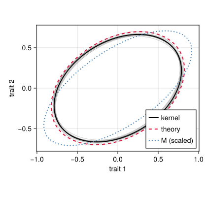
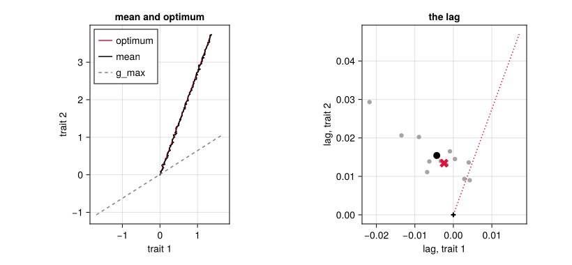
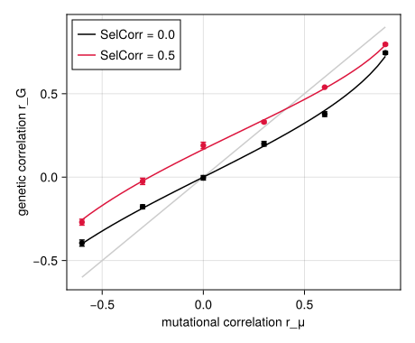
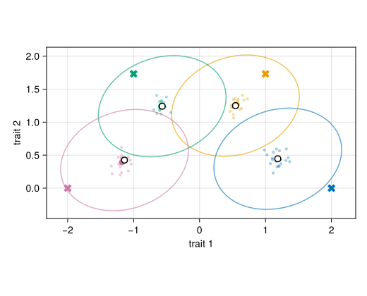

# Several traits and pleiotropy
Simon Frost

- [Overview](#overview)
- [Setup](#setup)
- [The model](#the-model)
- [The G matrix at mutation–selection
  balance](#the-g-matrix-at-mutationselection-balance)
- [Correlated response and the line of least
  resistance](#correlated-response-and-the-line-of-least-resistance)
- [Pleiotropy and the mutational
  correlation](#pleiotropy-and-the-mutational-correlation)
- [Local adaptation across demes](#local-adaptation-across-demes)
- [A fluctuating optimum](#a-fluctuating-optimum)
- [Kernel and SLiM](#kernel-and-slim)
- [Where next](#where-next)

## Overview

QTSim follows one trait. QTLSim can follow `n` of them at once
(`NoTraits = n`): every locus carries a vector of `n` allelic effects,
so a mutation can change several traits together (pleiotropy), and
selection acts on the traits jointly through a fitness function in `n`
dimensions. This is the classical multivariate quantitative genetics of
Lande ([1979](#ref-Lande1979)) and Lande ([1980](#ref-Lande1980)), in
which the additive genetic covariance matrix `G` takes the place of the
genetic variance, and of the simulation studies of `G`’s stability by
Jones et al. ([2003](#ref-Jones2003)), Jones et al.
([2004](#ref-Jones2004)) and Jones et al. ([2007](#ref-Jones2007)).

The life cycle does not change. The model of several traits is a second
family of lowerings of the same morphism of the life-cycle category:
each step is sent to an operator on populations whose genotypes are
vectors rather than numbers, and the steps that do not care what an
allele is (inheritance, the change of width, the swap of generations)
are sent to the same operators as for one trait. The design note
[Several
traits](https://ecorecipes.github.io/QTLSim.jl/dev/traits_design/)
records what generalised and what did not. This vignette shows the
model, checks the `G` matrix it maintains against theory, and follows
the correlated response to a moving optimum, the effect of the
mutational correlation, local adaptation of several demes in two traits,
and an optimum that fluctuates.

## Setup

``` julia
using QTLSim
using QTLSim: eigen, Symmetric, norm, dot   # LinearAlgebra, through the package
import Catlab                                # loads the categorical layer
using Catlab: ⋅, ⊗
using CairoMakie, Printf, Random, Statistics
CairoMakie.activate!(type = "png")
L = lifecycle(); g = L.generation            # QTSim's generation, Zygotes → Zygotes
```

    develop⋅select⋅reproduce⋅record⋅rescale⋅mutate⋅swap: Zygotes → Zygotes

## The model

With `NoTraits = 2`, three things become matrices. The phenotype is
`z = g + e`, with the genotype `g` the sum of the loci’s effect vectors
and `e ~ N(0, V_E I)`. A mutation adds a draw from `N(0, M/(2L·rate))`
to the effect vector of a random locus, so that the expected input per
individual per generation is the mutational covariance `M`: here `m V_E`
on the diagonal scaled by a shape `[1 0.5; 0.5 0.6]`, given as `MutCov`.
Fitness is QTSim’s Gaussian in two dimensions,
`W(z) = c·exp(−½ (z−θ)ᵀ Ω⁻¹ (z−θ))`, with QTSim’s constant `c` and
`Ω = ω² S`, here with a correlation of −0.3 between the two traits’
fitness (`SelCorr`). The two matrices do not share eigenvectors.

``` julia
p = Params(PopSize = 1000, NoQTL = 20, Ploidy = 2, NoGenerations = 3000, PhenotypeVar = 1.0,
           Heritability = 0.5, MutationScalar = 0.01, MutationRatePerGamete = 0.02,
           RecombPoissonMean = 2.0, InitFitnessSD = 1.5, NoTraits = 2,
           MutCov = 0.01 * 0.5 .* [1.0 0.5; 0.5 0.6], SelCorr = -0.3)
M, Ω = mutational_covariance(p), selection_covariance(p)
@printf("M = [%.4f %.4f; %.4f %.4f], Ω = [%.3f %.3f; %.3f %.3f], V_E = %.2f per trait\n",
        M[1, 1], M[1, 2], M[2, 1], M[2, 2], Ω[1, 1], Ω[1, 2], Ω[2, 1], Ω[2, 2], envVar(p))
```

    M = [0.0050 0.0025; 0.0025 0.0030], Ω = [2.250 -0.675; -0.675 2.250], V_E = 0.50 per trait

The parameters a step can carry belong to the model. `model_of(p)` is
the model of `TraitModel(2)`, and its schema says what each step takes;
for one trait `select`’s optimum `θ` is a number, for two it is a
vector, and only the model of several traits has a fitness covariance
`Ω` of its own:

``` julia
step_schema(OneTraitModel())[:select], step_schema(model_of(p))[:select]
```

    ((:ω, :θ, :MoveType, :MoveFitnessSD, :MoveFitnessSDGen, :MoveNoiseSD, :MoveAutocorr, :MoveAmplitude, :MovePeriod, :Drift, :Selection, :StandardisePhenotype), (:ω, :θ, :Ω, :MoveType, :MoveFitnessSD, :MoveFitnessSDGen, :MoveNoiseSD, :MoveAutocorr, :MoveAmplitude, :MovePeriod, :Drift, :Selection, :SelCorr, :MoveDirection, :MoveNoiseCov, :FluctDirection))

The lowering to the kernel is chosen by the model: the same life cycle
`g` is sent to the one-trait operators by default, and to the operators
of two traits with `model = model_of(p)`. Each refuses a population of
the other model:

``` julia
w = World(p); init_env!(w, Xoshiro(1))
try
    lower(g, :kernel)(w, Xoshiro(2))
catch err
    println(sprint(showerror, err))
end
lower(g, :kernel; model = model_of(p))(w, Xoshiro(2)); w.gen
```

    ArgumentError: the one-trait model's image of a step got a population of 2 traits; lower with model = model_of(p), TraitModel(2)

    1

`simulate` and `run_composed` choose the model from the `Params`. The
records keep QTSim’s columns, which describe trait 1, and add the mean
vector, `G` and `P`, the lag `θ − z̄` and the selection differential, one
vector or matrix per recorded generation:

``` julia
o = simulate(Params(p; NoGenerations = 200); seed = 1)
o.trait_mean[end], o.gmatrix[end]
```

    ([-0.07612673006000431, 0.09251806520933846], [0.3884374534076863 0.1368816965638535; 0.1368816965638535 0.24572006469229007])

## The G matrix at mutation–selection balance

Each locus’s share of `G` loses `(G/2L)(A + G)⁻¹(G/2L)` to selection for
good, with `A = Ω + V_E I`, while the rest of selection’s reduction is
linkage disequilibrium that recombination breaks up. Without drift the
equilibrium of this multilocus Gaussian model is the solution of
`G (A + G)⁻¹ G = 2L·M` (`gaussian_G_loci`), which for one trait is
QTLSim’s `gaussian_vg_loci` ([Lande 1980](#ref-Lande1980),
[1975](#ref-Lande1975)). Drift among `N` adults lowers it
(`gaussian_G_loci(p; drift = true)`), and the moments lowering
(`run_moments`) iterates the same recursion generation by generation.
Twelve replicate populations, from genotypes of zero, averaged over
generations 1000–2999:

``` julia
R = 12
runs = Vector{Any}(undef, R)
Threads.@threads :greedy for r in 1:R
    runs[r] = simulate(p; seed = 100 + r)
end
window(o, lo, hi) = findall(t -> lo <= t <= hi, o.gen)
Gk = [mean(o.gmatrix[window(o, 1000, 2999)]) for o in runs]
Gbar = mean(Gk)
Gth, Gd = gaussian_G_loci(p), gaussian_G_loci(p; drift = true)
Gmo = run_moments(p; erosion = true).gmatrix[end]
corr(G) = G[1, 2] / sqrt(G[1, 1] * G[2, 2])
angle(v) = mod(atand(v[2], v[1]), 180)
```

    angle (generic function with 1 method)

``` julia
println("| | G₁₁ | G₁₂ | G₂₂ | genetic correlation | g_max (degrees from trait 1) |\n|:--|--:|--:|--:|--:|--:|")
se(f) = std(f.(Gk)) / sqrt(R)
@printf("| kernel, 12 runs (± SE) | %.4f ± %.4f | %.4f ± %.4f | %.4f ± %.4f | %.3f ± %.3f | %.1f |\n",
        Gbar[1, 1], se(G -> G[1, 1]), Gbar[1, 2], se(G -> G[1, 2]), Gbar[2, 2], se(G -> G[2, 2]),
        corr(Gbar), se(corr), angle(gmax(Gbar)))
for (nm, G) in (("multilocus Gaussian, with drift (`gaussian_G_loci(p; drift = true)`)", Gd),
                ("moments lowering, with drift (`run_moments(p; erosion = true)`)", Gmo),
                ("multilocus Gaussian, no drift (`gaussian_G_loci(p)`)", Gth))
    @printf("| %s | %.4f | %.4f | %.4f | %.3f | %.1f |\n", nm, G[1, 1], G[1, 2], G[2, 2], corr(G), angle(gmax(G)))
end
@printf("| mutation, `M` | %.4f | %.4f | %.4f | %.3f | %.1f |\n", M[1, 1], M[1, 2], M[2, 2], corr(M), angle(gmax(M)))
```

|  | G₁₁ | G₁₂ | G₂₂ | genetic correlation | g_max (degrees from trait 1) |
|:---|---:|---:|---:|---:|---:|
| kernel, 12 runs (± SE) | 0.6211 ± 0.0064 | 0.1716 ± 0.0039 | 0.4417 ± 0.0063 | 0.328 ± 0.008 | 31.2 |
| multilocus Gaussian, with drift (`gaussian_G_loci(p; drift = true)`) | 0.6795 | 0.1910 | 0.4876 | 0.332 | 31.7 |
| moments lowering, with drift (`run_moments(p; erosion = true)`) | 0.6795 | 0.1910 | 0.4876 | 0.332 | 31.7 |
| multilocus Gaussian, no drift (`gaussian_G_loci(p)`) | 0.7775 | 0.2007 | 0.5674 | 0.302 | 31.2 |
| mutation, `M` | 0.0050 | 0.0025 | 0.0030 | 0.645 | 34.1 |

The kernel’s variances are 0.91 and 0.91 times the prediction with
drift, and its genetic correlation 0.328 against 0.332: the Gaussian
approximation somewhat overestimates the variances and gets their
correlation right (`validate/moments_loci.jl` compares it with the
kernel systematically). The leading axis of `G`, `g_max`, lies at 31°
from trait 1 (32° predicted), against 34° for `M`: Lande’s equilibrium
mixes the mutational and the selective covariances (for weak mutation it
is their matrix geometric mean), so `G` is not a scaled copy of `M`.

``` julia
ellipse(G; n = 100) = (F = eigen(Symmetric(G)); [F.vectors * (sqrt.(F.values) .* [cos(t), sin(t)]) for t in range(0, 2π, n)])
pts(G) = (e = ellipse(G); (first.(e), last.(e)))
fig = Figure(size = (420, 400))
ax = Axis(fig[1, 1], aspect = DataAspect(), xlabel = "trait 1", ylabel = "trait 2")
for G in Gk
    lines!(ax, pts(G)..., color = (:grey, 0.5), linewidth = 0.8)
end
lines!(ax, pts(Gbar)..., color = :black, linewidth = 2, label = "kernel")
lines!(ax, pts(Gd)..., color = :crimson, linestyle = :dash, linewidth = 2, label = "theory")
Ms = M .* sqrt(abs(QTLSim.det(Gbar)) / abs(QTLSim.det(M)))
lines!(ax, pts(Ms)..., color = :steelblue, linestyle = :dot, linewidth = 2, label = "M (scaled)")
axislegend(ax, position = :rb)
fig
```

```@raw html
<div id="fig-g">
```



Figure 1: The G matrix at equilibrium, as ellipses of points x with
xᵀG⁻¹x = 1. Thin grey: each of the 12 kernel runs; black: their mean;
red dashed: the multilocus Gaussian prediction with drift; blue dotted:
the mutational covariance M, scaled to the same area.

```@raw html
</div>
```

## Correlated response and the line of least resistance

Selection on one trait moves the others through their genetic
covariances. Lande’s response is `Δz̄ = G β` with the selection gradient
`β = (A + G)⁻¹(θ − z̄)` ([Lande 1979](#ref-Lande1979); [Lande and Arnold
1983](#ref-LandeArnold1983)): in `G`’s eigenbasis each component of `β`
is multiplied by its eigenvalue, so the response turns from the gradient
toward `g_max`, the genetic line of least resistance ([Schluter
1996](#ref-Schluter1996)). For an optimum moving at a constant rate `k`
(a vector) the population settles at the lag `λ = (A + G) G⁻¹ k`
(`steady_lag_vector`): the mean keeps up exactly along `k`, but the lag
is longest, and points, where there is least genetic variance. Here the
optimum moves by 0.002 per generation from generation 3000, at 70° from
trait 1:

``` julia
pm = Params(p; NoGenerations = 5000, MoveFitnessSDGen = 3000, MoveType = :continuous,
            MoveFitnessSD = 0.002, MoveDirection = [cosd(70), sind(70)])
mruns = Vector{Any}(undef, R)
Threads.@threads :greedy for r in 1:R
    mruns[r] = simulate(pm; seed = 200 + r)
end
lagk = mean(mean(o.trait_lag[window(o, 4000, 4999)]) for o in mruns)
Gm = mean(mean(o.gmatrix[window(o, 4000, 4999)]) for o in mruns)
k = 0.002 .* move_direction(pm)
λth = steady_lag_vector(k; G = Gm, A = selection_variance_matrix(pm))
mo = run_moments(pm; erosion = true)
λmo = mean(mo.trait_lag[4001:5000])
d = response_deflection(λth; G = Gm, A = selection_variance_matrix(pm))
```

    (β = [-0.00010392035566370727, 0.004176965489138944], response = [0.0006840402866513374, 0.0018793852415718167], angle_response_gradient = 21.425190066496775, angle_response_gmax = 37.56582972885954, angle_gradient_gmax = 58.991019795356316)

``` julia
println("| | lag, trait 1 | lag, trait 2 | direction (degrees) |\n|:--|--:|--:|--:|")
for (nm, v) in (("kernel, generations 4000–4999", lagk), ("`steady_lag_vector`, kernel's G", λth),
                ("moments lowering", λmo), ("the optimum's motion `k` (×10)", 10 .* k))
    @printf("| %s | %.4f | %.4f | %.1f |\n", nm, v[1], v[2], mod(atand(v[2], v[1]), 360))
end
```

|  | lag, trait 1 | lag, trait 2 | direction (degrees) |
|:---|---:|---:|---:|
| kernel, generations 4000–4999 | -0.0043 | 0.0154 | 105.6 |
| `steady_lag_vector`, kernel’s G | -0.0024 | 0.0134 | 100.2 |
| moments lowering | -0.0022 | 0.0126 | 99.8 |
| the optimum’s motion `k` (×10) | 0.0068 | 0.0188 | 70.0 |

The optimum moves at 70°, `g_max` lies at 32°, and the lag points at
106° in the kernel (100° predicted): it is deflected away from `g_max`,
toward the direction of least genetic variance, while the gradient it
creates, `β`, is turned by `G` back onto the optimum’s path. At the
steady lag the response `Gβ` lies at 37.6° from `g_max` and the gradient
`β` at 59.0°: selection pulls off the line of least resistance, and `G`
turns the response back toward it.

``` julia
fig = Figure(size = (820, 380))
ax1 = Axis(fig[1, 1], aspect = DataAspect(), xlabel = "trait 1", ylabel = "trait 2", title = "mean and optimum")
zt = [mean(o.trait_mean[i] for o in mruns) for i in 3001:10:5000]
θt = [mean(o.trait_mean[i] + o.trait_lag[i] for o in mruns) for i in 3001:10:5000]
lines!(ax1, first.(θt), last.(θt), color = :crimson, label = "optimum")
lines!(ax1, first.(zt), last.(zt), color = :black, label = "mean")
gm = gmax(Gm); z0 = zt[1]
lines!(ax1, [z0[1] - 2gm[1], z0[1] + 2gm[1]], [z0[2] - 2gm[2], z0[2] + 2gm[2]], color = :grey, linestyle = :dash, label = "g_max")
axislegend(ax1, position = :lt)
ax2 = Axis(fig[1, 2], aspect = DataAspect(), xlabel = "lag, trait 1", ylabel = "lag, trait 2", title = "the lag")
lr = [mean(o.trait_lag[window(o, 4000, 4999)]) for o in mruns]
scatter!(ax2, first.(lr), last.(lr), color = (:grey, 0.7))
scatter!(ax2, [lagk[1]], [lagk[2]], color = :black, markersize = 14)
scatter!(ax2, [λth[1]], [λth[2]], color = :crimson, marker = :xcross, markersize = 18)
lines!(ax2, [0, 0.05cosd(70)], [0, 0.05sind(70)], color = :crimson, linestyle = :dot)
scatter!(ax2, [0.0], [0.0], color = :black, marker = :cross)
fig
```

```@raw html
<div id="fig-lag">
```



Figure 2: Tracking an optimum that moves at 70° from trait 1. Left: the
mean phenotype (black, mean of 12 runs) and the optimum (red) in the
plane of the two traits from generation 3000; the dashed line is the
g_max axis through the mean at 3000. Right: the lag θ − z̄, each run’s
mean over generations 4000–4999 (grey), their mean (black) and the
steady lag vector (red cross).

```@raw html
</div>
```

## Pleiotropy and the mutational correlation

How much of the genetic correlation between two traits comes from the
mutations, and how much from selection? Lande’s equilibrium answers it:
`G` is shaped by both `M` and `A`, and with weak mutation it is their
geometric mean, so a mutational correlation `r_μ` is carried into `G`
but pulled toward the correlation that selection favours ([Lande
1980](#ref-Lande1980); [Jones et al. 2003](#ref-Jones2003)). With
`M = m V_E [1 r_μ; r_μ 1]` and selection uncorrelated (`SelCorr = 0`) or
correlated (`SelCorr = 0.5`), four runs each:

``` julia
rμs = [-0.6, -0.3, 0.0, 0.3, 0.6, 0.9]
rωs = [0.0, 0.5]
pc = Params(p; MutCov = zeros(0, 0), PopSize = 500, NoGenerations = 2500)
cases = [(rμ, rω) for rω in rωs for rμ in rμs]
pcase(rμ, rω) = Params(pc; MutCorr = rμ, SelCorr = rω)
cjobs = [(i, r) for i in eachindex(cases) for r in 1:4]
cres = Vector{Float64}(undef, length(cjobs))
Threads.@threads :greedy for j in eachindex(cjobs)
    i, r = cjobs[j]
    o = simulate(pcase(cases[i]...); seed = 300 + 10i + r)
    cres[j] = corr(mean(o.gmatrix[window(o, 1000, 2499)]))
end
rG = [mean(cres[j] for j in eachindex(cjobs) if cjobs[j][1] == i) for i in eachindex(cases)]
rGse = [std([cres[j] for j in eachindex(cjobs) if cjobs[j][1] == i]) / 2 for i in eachindex(cases)]
rGth(rμ, rω) = corr(gaussian_G_loci(pcase(rμ, rω); drift = true))
```

    rGth (generic function with 1 method)

``` julia
fig = Figure(size = (460, 380))
ax = Axis(fig[1, 1], xlabel = "mutational correlation r_μ", ylabel = "genetic correlation r_G")
xs = range(-0.6, 0.9, 40)
lines!(ax, [-0.6, 0.9], [-0.6, 0.9], color = :grey80)
for (rω, col) in zip(rωs, (:black, :crimson))
    lines!(ax, xs, [rGth(x, rω) for x in xs], color = col, label = "SelCorr = $rω")
    ii = findall(c -> c[2] == rω, cases)
    errorbars!(ax, rμs, rG[ii], rGse[ii], color = col, whiskerwidth = 6)
    scatter!(ax, rμs, rG[ii], color = col)
end
axislegend(ax, position = :lt)
fig
```

```@raw html
<div id="fig-rmu">
```



Figure 3: The genetic correlation at equilibrium against the mutational
correlation, with uncorrelated selection (black) and with a fitness
correlation of 0.5 (red). Points: kernel, mean of 4 runs with ±1 SE;
lines: the multilocus Gaussian equilibrium with drift; grey: r_G = r_μ.

```@raw html
</div>
```

The kernel follows the prediction across the range: the largest
difference in r_G is 0.023. A positive fitness correlation (individuals
far off along both traits together are selected less against, `Ω`
elongated along (1, 1)) maintains more variance along (1, 1), so with
uncorrelated mutations r_G is 0.19 (0.17 predicted), not zero. The
genetic correlation is a compromise between the mutational and the
selective correlations, not a copy of either.

## Local adaptation across demes

Steps carry parameters of their model, so a deme can be given an optimum
vector of its own: `withparams(g, p; θ = [θ₁, θ₂])` is the generation of
a deme selected toward `(θ₁, θ₂)`. Four demes of 100 diploids with
optima at distance 2 from the origin, at 0°, 60°, 120° and 180°,
exchange migrants at forward rate 0.01 (island model). The moments
lowering of several demes (`between = true`) carries, for each deme, the
haplotype moments of the multilocus model as matrices and, with drift,
the cross-moments between demes, so it predicts the deme means, the
within-deme `G` and the covariance matrix of the deme means. Twenty
kernel runs:

``` julia
pd = Params(Ploidy = 2, NoQTL = 20, PhenotypeVar = 2.0, Heritability = 0.5, MutationScalar = 1e-3,
            MutationRatePerGamete = 0.02, PopSize = 100, NoGenerations = 3000, Sample = 10, InitFitnessSD = 5.0,
            NoTraits = 2, MutCorr = 0.3, SelCorr = 0.2)
φs = [0.0, 60.0, 120.0, 180.0]
θs = [2.0 .* [cosd(φ), sind(φ)] for φ in φs]
dcycle = foldl(⊗, [withparams(g, pd; θ = θ) for θ in θs]) ⋅ L.migrate(4)
census = collect(1500:10:2990)
function deme_run(seed)
    s = pd ⊗ demes(4)
    idx = IdDict(w => i for (i, w) in enumerate(s.demes))
    mg = [zeros(2) for _ in 1:4, _ in census]
    gw = [zeros(2, 2) for _ in 1:4, _ in census]
    rec = operator(:record, function (w, rng)
        j = searchsortedfirst(census, w.gen)
        if j <= length(census) && census[j] == w.gen
            gt = traitvalues(w; what = :genotype)
            mg[idx[w], j] = vec(mean(gt; dims = 2)); gw[idx[w], j] = cov(gt; dims = 2)
        end
        w
    end)
    run_composed(s, Xoshiro(seed); cycle = dcycle, record = false, images = Dict(:record => rec), migration_rate = 0.01)
    (means = [mean(mg[a, :]) for a in 1:4], W = mean(gw),
     A = mean(cov(reduce(hcat, mg[:, j]); dims = 2) for j in eachindex(census)))
end
dres = Vector{Any}(undef, 20)
Threads.@threads :greedy for r in 1:20
    dres[r] = deme_run(400 + r)
end
dm = run_moments(pd; cycle = dcycle, migration_rate = 0.01, between = true)
sel = findall(in(census), dm.metapop.gen)
Wm, Am = mean(dm.metapop.within[sel]), mean(dm.metapop.var_among[sel])
rows = findall(in(census), dm.gen)
mmeans = [mean(dm.trait_mean[r] for r in rows if dm.deme[r] == a) for a in 1:4]
kmeans = [mean(x.means[a] for x in dres) for a in 1:4]
qst(W, A) = (σ2 = 3 / 4 .* (A .- W ./ 100); [σ2[i, i] / (σ2[i, i] + 2W[i, i]) for i in 1:2])
```

    qst (generic function with 1 method)

``` julia
println("| deme | optimum | kernel mean | moments mean | direction, kernel | direction, moments |\n|--:|--:|--:|--:|--:|--:|")
for a in 1:4
    @printf("| %d | (%.2f, %.2f) | (%.3f, %.3f) | (%.3f, %.3f) | %.1f° | %.1f° |\n", a, θs[a]..., kmeans[a]..., mmeans[a]...,
            atand(kmeans[a][2], kmeans[a][1]), atand(mmeans[a][2], mmeans[a][1]))
end
Wk, Ak = mean(x.W for x in dres), mean(x.A for x in dres)
println("\n| | G₁₁ | G₁₂ | G₂₂ | among, 11 | among, 12 | among, 22 | Q_ST trait 1 | Q_ST trait 2 |\n|:--|--:|--:|--:|--:|--:|--:|--:|--:|")
@printf("| kernel, 20 runs | %.3f | %.3f | %.3f | %.3f | %.3f | %.3f | %.3f | %.3f |\n", Wk[1, 1], Wk[1, 2], Wk[2, 2],
        Ak[1, 1], Ak[1, 2], Ak[2, 2], qst(Wk, Ak)...)
@printf("| moments, `between = true` | %.3f | %.3f | %.3f | %.3f | %.3f | %.3f | %.3f | %.3f |\n", Wm[1, 1], Wm[1, 2], Wm[2, 2],
        Am[1, 1], Am[1, 2], Am[2, 2], qst(Wm, Am)...)
```

| deme | optimum | kernel mean | moments mean | direction, kernel | direction, moments |
|---:|---:|---:|---:|---:|---:|
| 1 | (2.00, 0.00) | (1.182, 0.440) | (1.186, 0.445) | 20.4° | 20.6° |
| 2 | (1.00, 1.73) | (0.560, 1.263) | (0.545, 1.251) | 66.1° | 66.5° |
| 3 | (-1.00, 1.73) | (-0.580, 1.245) | (-0.566, 1.241) | 115.0° | 114.5° |
| 4 | (-2.00, 0.00) | (-1.176, 0.391) | (-1.138, 0.426) | 161.6° | 159.5° |

|  | G₁₁ | G₁₂ | G₂₂ | among, 11 | among, 12 | among, 22 | Q_ST trait 1 | Q_ST trait 2 |
|:---|---:|---:|---:|---:|---:|---:|---:|---:|
| kernel, 20 runs | 0.859 | 0.155 | 0.591 | 1.245 | 0.034 | 0.323 | 0.351 | 0.167 |
| moments, `between = true` | 0.938 | 0.131 | 0.589 | 1.195 | 0.014 | 0.288 | 0.322 | 0.152 |

The demes do not reach their optima: migration pulls each toward the
others, so the deme whose optimum is at 0° has its mean at 20° and the
one at 180° at 162°. Trait 1, along which the optima are spread further,
is more differentiated than trait 2: Q_ST is 0.351 and 0.167 in the
kernel (0.322 and 0.152 predicted), against 0.064 for a neutral trait in
the same metapopulation. The largest difference between the kernel’s and
the moments’ deme means is 0.037, for optima at distance 2.

`validate/trait_moments_demes.jl` makes this comparison with 200 runs
and 50 loci, with tolerances fixed before the runs, and passes:

``` julia
logf = joinpath(@__DIR__, "..", "..", "validate", "trait_moments_demes.log")
if isfile(logf)
    inT1 = false
    for l in readlines(logf)
        occursin("T1 local", l) && (inT1 = true)
        occursin("deme means", l) && (inT1 = false)
        (inT1 || startswith(l, "PASS") || startswith(l, "FAIL")) && println("    ", l)
    end
end
```

    T1 local optima along four directions; 200 replicates
      statistic                 moments     kernel        SE                95% CI dev/scale  verdict
      G_W11                     0.89168    0.83124    0.0047 [   0.8221,    0.8404]     -6.8%       ok
      G_W12                      0.1572    0.16251    0.0029 [   0.1567,    0.1683]     +0.7%       ok
      G_W22                     0.63461    0.62651    0.0038 [   0.6191,     0.634]     -1.3%       ok
      A11                        1.1413     1.1977     0.008 [    1.182,     1.213]     +4.9%       ok
      A12                      0.031216   0.039574    0.0035 [  0.03268,   0.04647]     +1.4%       ok
      A22                       0.30726    0.33382    0.0028 [   0.3283,    0.3394]     +8.6%       ok
      Q_ST trait 1               0.3226    0.34921   0.00076 [   0.3477,    0.3507]     +8.2%       ok
      Q_ST trait 2              0.15097    0.16392   0.00081 [   0.1623,    0.1655]     +8.6%       ok
    PASS: every pre-specified criterion holds

``` julia
fig = Figure(size = (520, 420))
ax = Axis(fig[1, 1], aspect = DataAspect(), xlabel = "trait 1", ylabel = "trait 2")
cols = Makie.wong_colors()
for a in 1:4
    scatter!(ax, [θs[a][1]], [θs[a][2]], marker = :xcross, markersize = 16, color = cols[a])
    scatter!(ax, [x.means[a][1] for x in dres], [x.means[a][2] for x in dres], color = (cols[a], 0.35), markersize = 6)
    scatter!(ax, [kmeans[a][1]], [kmeans[a][2]], color = cols[a], markersize = 12)
    scatter!(ax, [mmeans[a][1]], [mmeans[a][2]], color = :white, strokecolor = :black, strokewidth = 1.5, markersize = 12)
    e = ellipse(Wm)
    lines!(ax, mmeans[a][1] .+ first.(e), mmeans[a][2] .+ last.(e), color = (cols[a], 0.6))
end
fig
```

```@raw html
<div id="fig-demes">
```



Figure 4: Four demes adapting to optima at 0°, 60°, 120° and 180°
(crosses), linked by migration. Points: the kernel’s deme means (20
runs, each run’s mean over generations 1500–2990, light; their mean,
dark); open circles: the moments lowering; ellipses: the within-deme G
of the moments (×1), centred on each deme’s mean.

```@raw html
</div>
```

## A fluctuating optimum

The optimum vector can also fluctuate around its trend: as a cycle along
a direction `f` (`MoveType = :periodic`, `FluctDirection`), or as red
noise, a vector AR(1) process with a stationary covariance `Σ`
(`MoveType = :red_noise`, `MoveNoiseCov`, by default
`MoveNoiseSD² f fᵀ`) and autocorrelation `ρ`. The lag then fluctuates
too. With the mean following `z̄' = z̄ + B (θ − z̄)`, `B = G (A + G)⁻¹`,
the lag and the noise form a linear system whose stationary covariance
solves a discrete Lyapunov equation; `red_noise_lag_cov(Σ, ρ; G, A)` is
its lag block, the matrix version of the one-trait `red_noise_lag_var`
(vignette 06), and `periodic_lag_cov` that of `periodic_response`.
Twelve runs with `Σ = [0.2 0.05; 0.05 0.1]` and `ρ = 0.7`, the lag’s
covariance over generations 1500–2499:

``` julia
pf = Params(p; PopSize = 500, NoQTL = 10, NoGenerations = 2500, MoveFitnessSDGen = 1000, MoveFitnessSD = 0.0,
            MoveType = :red_noise, MoveNoiseCov = [0.2 0.05; 0.05 0.1], MoveAutocorr = 0.7)
fruns = Vector{Any}(undef, R)
Threads.@threads :greedy for r in 1:R
    fruns[r] = simulate(pf; seed = 500 + r)
end
Λk = mean(mean(l * l' for l in o.trait_lag[window(o, 1500, 2499)]) for o in fruns)
Gf = mean(mean(o.gmatrix[window(o, 1500, 2499)]) for o in fruns)
Λth = red_noise_lag_cov(pf.MoveNoiseCov, 0.7; G = Gf, A = selection_variance_matrix(pf))
@printf("E[λλᵀ]: kernel [%.4f %.4f; %.4f %.4f], red_noise_lag_cov with the kernel's G [%.4f %.4f; %.4f %.4f]\n",
        Λk[1, 1], Λk[1, 2], Λk[2, 1], Λk[2, 2], Λth[1, 1], Λth[1, 2], Λth[2, 1], Λth[2, 2])
@printf("expected lag load tr((Ω + P)⁻¹ E[λλᵀ])/2 = %.4f\n", trait_lag_load(Params(pf); G = Gf))
```

    E[λλᵀ]: kernel [0.1666 0.0325; 0.0325 0.0907], red_noise_lag_cov with the kernel's G [0.1587 0.0330; 0.0330 0.0838]
    expected lag load tr((Ω + P)⁻¹ E[λλᵀ])/2 = 0.0422

The theory has the lag’s covariance to within 8% on the diagonal and 1%
off it. The excess on the diagonal, 0.0079 and 0.0069, is about the same
for both traits: it is what the deterministic theory leaves out, the
drift of the mean and the sampling error of the recorded mean phenotype,
which add to the lag in every direction.

## Kernel and SLiM

The lowering to SLiM’s Eidos has its own table of images for several
traits: an individual carries `L·n` values per chromosome, fitness is
computed with `matrixMult`, and mutations are drawn with `rmvnorm`. A
step’s own vector optimum, fitness covariance, move direction and
mutational covariance become literals in its code, so demes of a SLiM
model can differ in their trait parameters through steps. The generated
model is compared with the kernel, 40 runs each, by two-sample KS tests,
in `validate/slim/compare_traits.jl` (stabilising selection and a moving
optimum) and `validate/slim/compare_traits_fluctuating.jl` (red noise
and a cycle, which also compares the kernel’s lag covariance with the
theory above). From their logs:

``` julia
for f in ("valid_traits.log", "valid_traits_fluctuating.log")
    path = joinpath(@__DIR__, "..", "..", "validate", "slim", f)
    isfile(path) || continue
    println("`$f`:\n")
    for l in readlines(path)
        (startswith(l, "smallest") || startswith(l, "theory:")) && println("- ", strip(l))
    end
    println()
end
```

`valid_traits.log`:

- smallest p = 0.263: no discrepancy

`valid_traits_fluctuating.log`:

- smallest KS p = 0.263: no discrepancy between kernel and SLiM
- theory: every pre-specified criterion holds

## Where next

- The equilibrium `G` assumes Gaussian allelic effects at every locus;
  with rare mutations of large effect (the house-of-cards regime) it
  fails for one trait ([Mutation–selection
  balance](02_mutation_selection_balance.md)),
  and for several the shape of `G`, not only its size, should change.
- `G` itself evolves under a moving optimum ([Jones et al.
  2004](#ref-Jones2004)), and the mutation matrix can evolve ([Jones et
  al. 2007](#ref-Jones2007)); the records here keep `G` every
  generation, so its orientation and stability can be followed directly.
- Demography: `Demography = :beverton_holt` works with several traits,
  so rescue in two dimensions, where the lag’s direction matters for the
  load (`trait_lag_load`), is a few lines away ([Demography and
  evolutionary
  rescue](10_demography_and_rescue.md)).
- Per-deme trait parameters in a SLiM model go through steps,
  `withparams(g, p; θ = …)`; `slim_script` with one `Params` per deme
  still requires the demes’ trait fields to agree.

```@raw html
<div id="refs" class="references csl-bib-body hanging-indent">
```

```@raw html
<div id="ref-Jones2003" class="csl-entry">
```

Jones, Adam G., Stevan J. Arnold, and Reinhard Bürger. 2003. “Stability
of the G-Matrix in a Population Experiencing Pleiotropic Mutation,
Stabilizing Selection, and Genetic Drift.” *Evolution* 57 (8): 1747–60.
<https://doi.org/10.1111/j.0014-3820.2003.tb00583.x>.

```@raw html
</div>
```

```@raw html
<div id="ref-Jones2004" class="csl-entry">
```

Jones, Adam G., Stevan J. Arnold, and Reinhard Bürger. 2004. “Evolution
and Stability of the G-Matrix on a Landscape with a Moving Optimum.”
*Evolution* 58 (8): 1639–54.
<https://doi.org/10.1111/j.0014-3820.2004.tb00450.x>.

```@raw html
</div>
```

```@raw html
<div id="ref-Jones2007" class="csl-entry">
```

Jones, Adam G., Stevan J. Arnold, and Reinhard Bürger. 2007. “The
Mutation Matrix and the Evolution of Evolvability.” *Evolution* 61 (4):
727–45. <https://doi.org/10.1111/j.1558-5646.2007.00071.x>.

```@raw html
</div>
```

```@raw html
<div id="ref-Lande1975" class="csl-entry">
```

Lande, Russell. 1975. “The Maintenance of Genetic Variability by
Mutation in a Polygenic Character with Linked Loci.” *Genetical
Research* 26 (3): 221–35. <https://doi.org/10.1017/S0016672300016037>.

```@raw html
</div>
```

```@raw html
<div id="ref-Lande1979" class="csl-entry">
```

Lande, Russell. 1979. “Quantitative Genetic Analysis of Multivariate
Evolution, Applied to Brain:body Size Allometry.” *Evolution* 33 (1):
402–16. <https://doi.org/10.1111/j.1558-5646.1979.tb04694.x>.

```@raw html
</div>
```

```@raw html
<div id="ref-Lande1980" class="csl-entry">
```

Lande, Russell. 1980. “The Genetic Covariance Between Characters
Maintained by Pleiotropic Mutations.” *Genetics* 94 (1): 203–15.
<https://doi.org/10.1093/genetics/94.1.203>.

```@raw html
</div>
```

```@raw html
<div id="ref-LandeArnold1983" class="csl-entry">
```

Lande, Russell, and Stevan J. Arnold. 1983. “The Measurement of
Selection on Correlated Characters.” *Evolution* 37 (6): 1210–26.
<https://doi.org/10.1111/j.1558-5646.1983.tb00236.x>.

```@raw html
</div>
```

```@raw html
<div id="ref-Schluter1996" class="csl-entry">
```

Schluter, Dolph. 1996. “Adaptive Radiation Along Genetic Lines of Least
Resistance.” *Evolution* 50 (5): 1766–74.
<https://doi.org/10.1111/j.1558-5646.1996.tb03563.x>.

```@raw html
</div>
```

```@raw html
</div>
```
