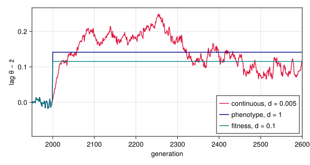
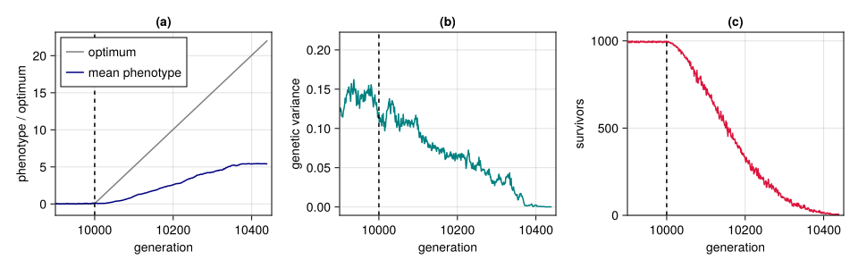
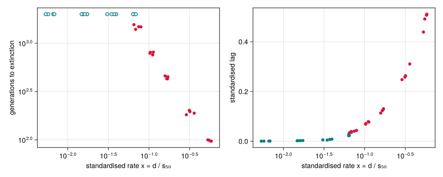

# Adaptation to a moving optimum
Simon Frost

- [Overview](#overview)
- [Setup](#setup)
- [Three ways to move the optimum](#three-ways-to-move-the-optimum)
- [Anatomy of an extinction](#anatomy-of-an-extinction)
- [The paper’s measures](#the-papers-measures)
- [How long populations last](#how-long-populations-last)

## Overview

The paper asks how fast an environment can change before a population
that adapts to it goes extinct ([Pagel et al. 2025](#ref-Pagel2025)).
Its experiments move the optimum of the fitness function by a fixed
amount every generation and record how the population responds. This
vignette looks at the ways the optimum can move, follows one population
to extinction, defines the measures the paper uses to summarise a run,
and shows how the time to extinction depends on the rate of change. The
theory behind the experiment goes back to Lynch and Lande ([Lynch and
Lande 1993](#ref-LynchLande1993)) and Bürger and Lynch ([Bürger and
Lynch 1995](#ref-BurgerLynch1995)): a population follows a moving
optimum with a lag, and the lag it can sustain is limited by its genetic
variance and by how strongly selection acts.

## Setup

``` julia
using QTLSim
using CairoMakie, Printf, Statistics
CairoMakie.activate!(type = "png")
```

## Three ways to move the optimum

From generation `MoveFitnessSDGen` on, the optimum $\theta$ is updated
at the start of every generation, in one of three ways chosen by
`MoveType`:

- `:continuous` moves it by a fixed amount,
  $\theta \leftarrow \theta + d$, with $d$ given by `MoveFitnessSD`.
  This is a steadily changing environment, and it is what the paper
  uses.
- `:phenotype` resets it to the current mean phenotype plus $d$
  phenotypic standard deviations, $\theta = \bar z + d\sqrt{V_P}$.
- `:fitness` resets it to the mean plus $d$ fitness-function widths,
  $\theta = \bar z + d\omega$.

The last two keep the optimum a fixed distance ahead of the population,
so the lag $\theta - \bar z$ is set by construction and the population
can never fall behind. Only the continuous move lets the lag evolve.

``` julia
p = Params(PopSize = 1000, Ploidy = 2, NoQTL = 100, NoGenerations = 2600,
           PhenotypeVar = 0.02, Heritability = 0.4, MutationScalar = 0.004,
           MutationRatePerGamete = 1e-4, RecombPoissonMean = 3.0, MoveFitnessSDGen = 2000)
runs = [(name, simulate(Params(p; MoveType = type, MoveFitnessSD = d); seed = 1))
        for (name, type, d) in (("continuous, d = 0.005", :continuous, 0.005),
                                ("phenotype, d = 1", :phenotype, 1.0),
                                ("fitness, d = 0.1", :fitness, 0.1))]
nothing
```

``` julia
fig = Figure(size = (640, 340))
ax = Axis(fig[1, 1], xlabel = "generation", ylabel = "lag θ − z̄", limits = ((1950, 2600), nothing))
for ((name, r), c) in zip(runs, (:crimson, :navy, :teal))
    lines!(ax, r.gen, r.theta .- r.pheno_mean, color = c, label = name)
end
axislegend(ax, position = :rb)
fig
```

<div id="fig-move-types">



Figure 1: The lag θ − z̄ between the optimum and the mean phenotype after
the optimum starts moving at generation 2000. The phenotype and fitness
moves hold the lag at √V_P·d and ω·d; under the continuous move the lag
grows until the response to selection matches the rate of change.

</div>

## Anatomy of an extinction

The paper’s populations first spend 10,000 generations under stabilising
selection and then face a continuously moving optimum. Here is one such
population, with parameters near the middle of the paper’s ranges,
followed until it dies out (compare the paper’s Supplementary Figure
S3).

``` julia
paperlike = Params(PopSize = 1000, Ploidy = 2, NoQTL = 100, NoGenerations = 12_000,
                   PhenotypeVar = 0.022, Heritability = 0.32, MutationScalar = 0.004,
                   MutationRatePerGamete = 1e-4, RecombPoissonMean = 3.0, InitFitnessSD = 5.0,
                   MoveFitnessSDGen = 10_000, MoveType = :continuous)
ex = simulate(Params(paperlike; MoveFitnessSD = 0.05); seed = 3)
(extinct = ex.extinct, extinct_generation = ex.extinct_gen)
```

    (extinct = true, extinct_generation = 10441)

``` julia
window = (9_900, ex.extinct ? ex.extinct_gen + 10 : 12_000)
fig = Figure(size = (960, 300))
ax1 = Axis(fig[1, 1], xlabel = "generation", ylabel = "phenotype / optimum", title = "(a)",
           limits = (window, nothing))
lines!(ax1, ex.gen, ex.theta, color = :gray, label = "optimum")
lines!(ax1, ex.gen, ex.pheno_mean, color = :navy, label = "mean phenotype")
axislegend(ax1, position = :lt)
ax2 = Axis(fig[1, 2], xlabel = "generation", ylabel = "genetic variance", title = "(b)",
           limits = (window, nothing))
lines!(ax2, ex.gen, ex.geno_var, color = :teal)
ax3 = Axis(fig[1, 3], xlabel = "generation", ylabel = "survivors", title = "(c)",
           limits = (window, (0, 1050)))
lines!(ax3, ex.gen, ex.nsurv, color = :crimson)
for ax in (ax1, ax2, ax3); vlines!(ax, [10_000], color = :black, linestyle = :dash); end
fig
```

<div id="fig-extinction">



Figure 2: One population after the optimum starts moving at generation
10,000 (dashed line). (a) The mean phenotype falls ever further behind
the optimum. (b) Genetic variance is eroded as survival collapses. (c)
The number of individuals surviving selection each generation; the
population is refilled to 1000 by the survivors’ offspring until fewer
than two survive.

</div>

## The paper’s measures

The paper summarises each run by a handful of numbers, all measured in
units of the phenotypic standard deviation so that populations with
different variances can be compared. With the move starting at
generation $g_0$:

- **Generations to extinction** $T$: the number of generations of
  directional selection until the population dies, counting the
  generation in which it dies.
- **50% mortality**: the first generation after the move at which the
  number of survivors is closest to $N/2$; $T_{50}$ counts generations
  to it in the same way as $T$. The phenotypic standard deviation
  $s_{50}$ at that generation is the unit for everything else.
- **Standardised environmental change** $x = d / s_{50}$.
- **Standardised rate of phenotypic change**: how far the mean phenotype
  moved, per generation, in units of $s_{50}$, either until extinction
  or until 50% mortality.
- **Standardised lag**: $x$ minus the rate of phenotypic change to
  extinction, the amount per generation by which the population falls
  further behind.

The function below computes them from a run, following the conventions
of the paper’s results table, which counts generations from one (so its
“generation 10,000” is the last generation before the move). The
[replication
vignette](../09_replicating_pagel_2025/09_replicating_pagel_2025.qmd)
checks it against the table itself.

``` julia
function paper_measures(o, p::Params)
    g0, N, d = p.MoveFitnessSDGen, p.PopSize, p.MoveFitnessSD
    sd = sqrt.(o.pheno_var)
    i0 = findfirst(==(g0 - 1), o.gen)                         # last generation before the move
    post = findall(>=(g0), o.gen)
    k = isempty(post) ? lastindex(o.gen) : post[argmin(abs.(o.nsurv[post] .- N ÷ 2))]
    T = o.extinct ? o.gen[end] + 2 - g0 : length(post)        # the last record precedes the dying generation
    T50 = o.gen[k] + 2 - g0
    x = d / sd[k]
    rate = (o.pheno_mean[end] - o.pheno_mean[i0]) / T / sd[k]
    rate50 = (o.pheno_mean[k] - o.pheno_mean[i0]) / T50 / sd[k]
    (; T, survived = !o.extinct, T50, sd50 = sd[k], x, rate, rate50, lag = x - rate)
end

paper_measures(ex, Params(paperlike; MoveFitnessSD = 0.05))
```

    (T = 442, survived = false, T50 = 154, sd50 = 0.28499912426570245, x = 0.17543913557216897, rate = 0.04213412512639793, rate50 = 0.03911414122609284, lag = 0.13330501044577103)

## How long populations last

Now the same population faces a range of rates, four replicates each,
each run allowed up to 2000 generations of directional selection. Runs
are independent, so they are spread over threads.

``` julia
rates = [0.002, 0.005, 0.01, 0.015, 0.02, 0.03, 0.05, 0.1, 0.2]
jobs = [(d, rep) for d in rates for rep in 1:4]
res = Vector{Any}(undef, length(jobs))
Threads.@threads for k in eachindex(jobs)
    d, rep = jobs[k]
    q = Params(paperlike; MoveFitnessSD = d)
    res[k] = (; d, paper_measures(simulate(q; seed = 100k + rep), q)...)
end
for d in rates
    rs = filter(r -> r.d == d, res)
    @printf("d = %.3f   x ≈ %.3f   survived %d of 4   median T = %s\n", d,
            median(r.x for r in rs), count(r -> r.survived, rs),
            all(r -> r.survived, rs) ? "> 2000" : string(round(Int, median(r.T for r in rs))))
end
```

    d = 0.002   x ≈ 0.006   survived 4 of 4   median T = > 2000
    d = 0.005   x ≈ 0.016   survived 4 of 4   median T = > 2000
    d = 0.010   x ≈ 0.036   survived 4 of 4   median T = > 2000
    d = 0.015   x ≈ 0.064   survived 4 of 4   median T = > 2000
    d = 0.020   x ≈ 0.071   survived 0 of 4   median T = 1481
    d = 0.030   x ≈ 0.107   survived 0 of 4   median T = 798
    d = 0.050   x ≈ 0.167   survived 0 of 4   median T = 440
    d = 0.100   x ≈ 0.316   survived 0 of 4   median T = 192
    d = 0.200   x ≈ 0.564   survived 0 of 4   median T = 98

``` julia
fig = Figure(size = (900, 360))
ax1 = Axis(fig[1, 1], xscale = log10, yscale = log10, xlabel = "standardised rate x = d / s₅₀",
           ylabel = "generations to extinction")
ax2 = Axis(fig[1, 2], xscale = log10, xlabel = "standardised rate x = d / s₅₀",
           ylabel = "standardised lag")
dead = filter(r -> !r.survived, res); alive = filter(r -> r.survived, res)
scatter!(ax1, [r.x for r in dead], [r.T for r in dead], color = :crimson)
scatter!(ax1, [r.x for r in alive], [r.T for r in alive], color = :white,
         strokecolor = :teal, strokewidth = 1.5)
scatter!(ax2, [r.x for r in res], [r.lag for r in res],
         color = [r.survived ? :teal : :crimson for r in res])
fig
```

<div id="fig-rate-sweep">



Figure 3: Generations to extinction (left) and standardised lag (right)
against the standardised rate of environmental change x for one
parameter set. Open circles (left) and teal points (right) are
populations still alive after 2000 generations of directional selection;
the others died.

</div>

Populations that survive keep pace: their lag per generation is close to
zero. Once the environment moves faster than they can respond, the lag
grows every generation and the population dies, sooner the faster the change. For this parameter set every
population survived 2000 generations at rates up to about 6% of a
phenotypic standard deviation per generation, and every one died at
about 7% and above. Surviving 2000 generations is not surviving
indefinitely, though: the paper ran its populations for up to 240,000
generations, and its estimate of the sustainable rate, about 3% of a
standard deviation per generation, comes from the populations that
lasted that long. The [replication
vignette](../09_replicating_pagel_2025/09_replicating_pagel_2025.qmd)
maps the boundary across the paper’s whole parameter space.

<div id="refs" class="references csl-bib-body hanging-indent">

<div id="ref-BurgerLynch1995" class="csl-entry">

Bürger, Reinhard, and Michael Lynch. 1995. “Evolution and Extinction in
a Changing Environment: A Quantitative-Genetic Analysis.” *Evolution* 49
(1): 151–63. <https://doi.org/10.1111/j.1558-5646.1995.tb05967.x>.

</div>

<div id="ref-LynchLande1993" class="csl-entry">

Lynch, Michael, and Russell Lande. 1993. “Evolution and Extinction in
Response to Environmental Change.” In *Biotic Interactions and Global
Change*, edited by Peter M. Kareiva, Joel G. Kingsolver, and Raymond B.
Huey. Sinauer.

</div>

<div id="ref-Pagel2025" class="csl-entry">

Pagel, Mark, Jacob D. Gardner, and Andrew Meade. 2025.
“Quantitative-Genetic Analysis of Directional Adaptation Suggests Low
Maximum Sustainable Rates of Change in Agreement with Data from Field
Populations.” *Scientific Reports* 15.
<https://doi.org/10.1038/s41598-025-24445-2>.

</div>

</div>
