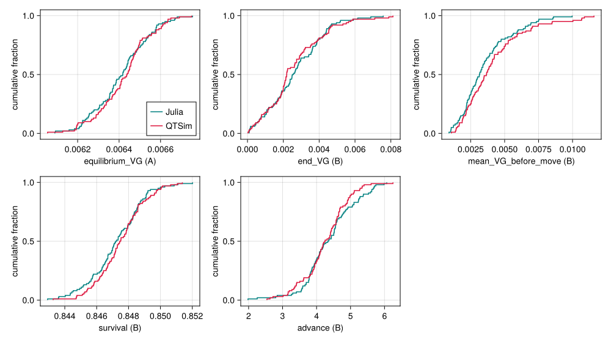
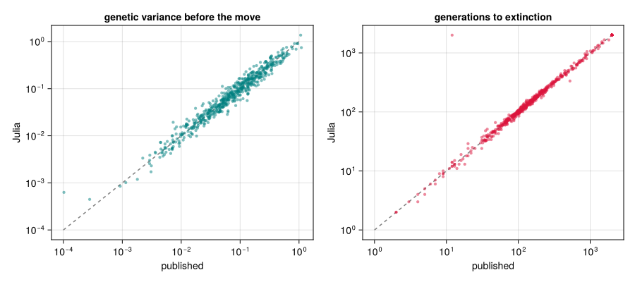

# Validation against QTSim
Simon Frost

- [Overview](#overview)
- [Setup](#setup)
- [Statistical parity](#statistical-parity)
- [Exact parity](#exact-parity)
- [The paper’s published results](#the-papers-published-results)

## Overview

The package is meant to be the paper’s model, not an approximation of
it. This vignette collects the evidence at three strengths:

1.  **Statistical**: the Julia model and QTSim, run many times with
    their own random numbers, produce the same distributions of the
    quantities the paper studies.
2.  **Exact**: a replica that draws its random numbers from the same
    library routines as QTSim, in the same order, reproduces QTSim’s
    output generation by generation.
3.  **Published**: on the paper’s own inputs, the Julia model reproduces
    the paper’s published per-run results.

The first two need the QTSim program, and the replica needs the GSL
library QTSim is built on. They look for QTSim in a `Repository/` folder
next to the package’s folder, which is where the paper’s code sits in
the project this package comes from, and are skipped if it is not there.
The third uses results stored with the package.

## Setup

``` julia
using QTLSim
using CairoMakie, DelimitedFiles, HypothesisTests, Printf, Random, Statistics
CairoMakie.activate!(type = "png")

const PKG = normpath(joinpath(@__DIR__, "..", ".."))
const QTSIM_BIN = normpath(joinpath(PKG, "..", "Repository", "Code", "QTSim", "src", "QTSim"))
have_qtsim = isfile(QTSIM_BIN)
```

    true

## Statistical parity

Two scenarios with one locus, the protocol of the input-generator script
shipped with QTSim. In scenario A the population sits at a sharp
mutation–selection balance; in scenario B its optimum starts moving at
generation 5000 (`MoveType = :phenotype`) and the fitness function
narrows. Each is run 100 times by each program, and the distributions of
five summary statistics are compared with two-sample Kolmogorov–Smirnov
tests.

QTSim is driven through its options file, and its output is parsed into
the same shape as `simulate`’s.

``` julia
function write_qtsim_options(path, q::Params, seed)
    open(path, "w") do io
        println(io, "Sample $(q.Sample)\nPopSize $(q.PopSize)\nNoQTL $(q.NoQTL)")
        println(io, "Generations $(q.NoGenerations)\nPloidy $(q.Ploidy)")
        q.MoveFitnessSDGen != -1 && println(io, "MoveFitnessSD $(q.MoveFitnessSDGen) $(q.MoveFitnessSD)")
        q.ChangeFitnessGen != -1 && println(io, "ChangeFitnessSD $(q.ChangeFitnessGen) $(q.ChangeFitnessSD)")
        println(io, "OptimumMoveType $(q.MoveType)\nPhenotypeVar $(q.PhenotypeVar)")
        println(io, "MutationScalar $(q.MutationScalar)\nHeritability $(q.Heritability)")
        println(io, "MutationRatePerGamete $(q.MutationRatePerGamete)")
        println(io, "RecombinationPoissonMean $(q.RecombPoissonMean)")
        q.InitFitnessSD >= 0 && println(io, "InitFitnessSD $(q.InitFitnessSD)")
        println(io, "Seed $seed")
    end
end

function run_qtsim(q::Params, seed)
    opts = tempname() * ".txt"; write_qtsim_options(opts, q, seed)
    text = try read(`$QTSIM_BIN $opts`, String) finally rm(opts; force = true) end
    gen = Int[]; zbar = Float64[]; vg = Float64[]; ns = Int[]; inbody = false
    for line in split(text, '\n')
        startswith(line, "Pop all died") &&
            return (; gen, pheno_mean = zbar, geno_var = vg, nsurv = ns, extinct = true)
        startswith(line, "Generation\t") && (inbody = true; continue)   # the column header
        (inbody && !isempty(strip(line))) || continue
        f = split(line, '\t')
        push!(gen, parse(Int, f[1])); push!(zbar, parse(Float64, f[2]))
        push!(vg, parse(Float64, f[4])); push!(ns, parse(Int, f[5]))
    end
    (; gen, pheno_mean = zbar, geno_var = vg, nsurv = ns, extinct = false)
end

A = Params(Sample = 10, PopSize = 1000, Ploidy = 2, NoQTL = 1, NoGenerations = 4000,
           PhenotypeVar = 0.02, Heritability = 0.5, MutationScalar = 0.02,
           MutationRatePerGamete = 0.5, InitFitnessSD = 0.3)
B = Params(Sample = 1, PopSize = 1000, Ploidy = 2, NoQTL = 1, NoGenerations = 6500,
           PhenotypeVar = 0.02, Heritability = 0.5, MutationScalar = 0.001,
           ChangeFitnessGen = 5000, ChangeFitnessSD = 0.30,
           MoveFitnessSDGen = 5000, MoveFitnessSD = 1.0, MoveType = :phenotype)
R = 100
nothing
```

The summary statistics are applied to both programs’ output alike. Under
the phenotype move the lag $\theta - \bar z$ is fixed by construction,
so instead of the lag we compare how far the mean phenotype advances.

``` julia
window(r, lo, hi) = findall(g -> lo <= g <= hi, r.gen)
metrics_A(r) = (; equilibrium_VG = mean(r.geno_var[window(r, 3000, 3999)]))
metrics_B(r) = (; end_VG = mean(r.geno_var[window(r, 6400, 6499)]),
                  mean_VG_before_move = mean(r.geno_var[window(r, 1000, 4999)]),
                  survival = mean(r.nsurv[window(r, 5000, 6499)]) / B.PopSize,
                  advance = mean(r.pheno_mean[window(r, 6400, 6499)]) -
                            mean(r.pheno_mean[window(r, 5000, 5010)]))
stats = [(:A, :equilibrium_VG), (:B, :end_VG), (:B, :mean_VG_before_move),
         (:B, :survival), (:B, :advance)]

out = Any[]
if have_qtsim
    jobs = [(prog, scen, s) for prog in (:julia, :qtsim) for scen in (:A, :B) for s in 1:R]
    out = Vector{Any}(undef, length(jobs))
    Threads.@threads for k in eachindex(jobs)
        prog, scen, s = jobs[k]
        q = scen === :A ? A : B
        r = prog === :julia ? simulate(q; seed = 10_000 + s) : run_qtsim(q, 20_000 + s)
        out[k] = (; prog, scen, extinct = r.extinct,
                  m = r.extinct ? nothing : (scen === :A ? metrics_A(r) : metrics_B(r)))
    end
end
pick(prog, scen, f) = [getfield(o.m, f) for o in out
                       if o.prog === prog && o.scen === scen && !o.extinct]
nothing
```

``` julia
if have_qtsim
    println("| scenario | statistic | Julia mean | QTSim mean | KS D | KS p |")
    println("|:--|:--|--:|--:|--:|--:|")
    for (scen, f) in stats
        j, c = pick(:julia, scen, f), pick(:qtsim, scen, f)
        t = ApproximateTwoSampleKSTest(j, c)
        @printf("| %s | %s | %.4g | %.4g | %.3f | %.2f |\n", scen, f, mean(j), mean(c), t.δ, pvalue(t))
    end
    @printf("\nExtinctions in scenario B: Julia %d of %d, QTSim %d of %d.\n",
            count(o -> o.prog === :julia && o.scen === :B && o.extinct, out), R,
            count(o -> o.prog === :qtsim && o.scen === :B && o.extinct, out), R)
else
    println("QTSim was not found at `$QTSIM_BIN`, so this section was skipped.")
end
```

| scenario | statistic           | Julia mean | QTSim mean |  KS D | KS p |
|:---------|:--------------------|-----------:|-----------:|------:|-----:|
| A        | equilibrium_VG      |   0.006411 |   0.006423 | 0.110 | 0.58 |
| B        | end_VG              |   0.002667 |   0.002599 | 0.150 | 0.21 |
| B        | mean_VG_before_move |   0.003579 |   0.004113 | 0.140 | 0.28 |
| B        | survival            |     0.8472 |     0.8475 | 0.110 | 0.58 |
| B        | advance             |      4.365 |      4.251 | 0.110 | 0.58 |

Extinctions in scenario B: Julia 0 of 100, QTSim 0 of 100.

``` julia
if have_qtsim
    fig = Figure(size = (1000, 560))
    for (k, (scen, f)) in enumerate(stats)
        ax = Axis(fig[fldmod1(k, 3)...], xlabel = "$f ($scen)", ylabel = "cumulative fraction")
        ecdfplot!(ax, pick(:julia, scen, f), color = :teal, label = "Julia")
        ecdfplot!(ax, pick(:qtsim, scen, f), color = :crimson, label = "QTSim")
        k == 1 && axislegend(ax, position = :rb)
    end
    fig
end
```

<div id="fig-ecdf">



Figure 1: Empirical distribution functions of the summary statistics,
Julia (teal) against QTSim (crimson), 100 runs each.

</div>

The distributions coincide. The genetic-variance statistics of scenario
B, a single locus under weak selection, are heavy-tailed and noisy even
with 100 runs; scenario A’s equilibrium variance is the sharp test of
the same quantity.

## Exact parity

Statistical agreement leaves room for small systematic differences
hidden by noise. To rule them out, `validate/gsl_locked.jl` contains a
replica of the model that draws every random number from the GNU
Scientific Library routines QTSim uses, in QTSim’s order, and sums
genotypes in QTSim’s order. Given QTSim’s seed it should reproduce
QTSim’s printed output exactly: the mean phenotype and genetic variance
to all six printed decimals and the number of survivors, every
generation. `compare` runs both and reports any generation that differs.
The checks cover the single-locus protocol and one of the paper’s own
100-locus input files, which runs until the population dies; a negative
control applies every crossover point, which QTSim does not, and must
diverge.

``` julia
include(joinpath(PKG, "validate", "gsl_locked.jl"))   # defines the replica; runs nothing
```

``` julia
if have_qtsim && isfile(LIBGSL)
    compare(B, 12345, "single-locus protocol, seed 12345")
    q, seed = read_qtsim_opts(joinpath(SIMDIR, "QT0100-Possion3.0", "Input-00001.txt"))
    compare(Params(q; NoGenerations = 10_600), seed, "QT0100-Possion3.0/Input-00001.txt")
    compare(Params(q; NoGenerations = 2_000), seed, "same input, every crossover point";
            allpoints = true)
else
    println("QTSim or the GSL library was not found, so this section was skipped.")
end
```

    single-locus protocol, seed 12345            gens compared=6500   mismatches=0    survived (replica extinct=false)
      ⇒ BIT-IDENTICAL (6 dp + survivor counts, every generation)
    QT0100-Possion3.0/Input-00001.txt            gens compared=10168  mismatches=0    extinct at gen 10168 (replica 10168)
      ⇒ BIT-IDENTICAL (6 dp + survivor counts, every generation)
    same input, every crossover point            gens compared=2000   mismatches=1998 survived (replica extinct=false)
      ⇒ DIVERGES at gen 2

    false

The replica is bit-identical to QTSim, and the negative control diverges
at once. The replica’s random numbers come from the same routines as
QTSim’s, while the package’s kernel uses Julia’s own generators, so the
kernel can only be compared statistically; the replica shows that the
algorithm is QTSim’s.

## The paper’s published results

The strongest check uses the paper’s own inputs.
`validate/published_sweep.jl` drew 589 of the paper’s 119,984 input
files, about 75 from each of the eight strata of locus count and
recombination rate, and ran each with the Julia model under both
crossover models (only QTSim’s at 5000 loci, where runs are slowest),
stopping 2000 generations after the optimum starts to move. (It also
confirms that QTSim reproduces the published table exactly on the inputs
it reruns.) Its results are stored with the package, next to the
published values for the same inputs.

``` julia
data, header = readdlm(joinpath(PKG, "validate", "published_sweep_results.csv"), ',', header = true)
num(x) = x isa Real ? Float64(x) : something(tryparse(Float64, String(x)), NaN)   # empty cells → NaN
col(name) = num.(data[:, findfirst(==(name), vec(header))])
cens(T) = min.(T, 2000.0)                               # survival after the move, capped
pub_VG, pub_T = col("pub_gv10000"), cens(col("pub_T"))

println("| crossover model | quantity | Julia / published | 95% interval |")
println("|:--|:--|--:|--:|")
for (model, label) in (("qtsim", "QTSim (`:qtsim`)"), ("all", "every point (`:all`)"))
    for (name, jl, pub) in (("genetic variance before the move", col("jl_$(model)_gv10000"), pub_VG),
                            ("generations to extinction, capped at 2000", cens(col("jl_$(model)_Tcens")), pub_T))
        ok = isfinite.(jl) .& isfinite.(pub) .& (jl .> 0) .& (pub .> 0)
        d = log.(jl[ok]) .- log.(pub[ok])
        m, se = mean(d), std(d) / sqrt(length(d))
        @printf("| %s | %s | %.3f | %.3f–%.3f (%d inputs) |\n", label, name, exp(m), exp(m - 1.96se), exp(m + 1.96se), length(d))
    end
end
```

| crossover model | quantity | Julia / published | 95% interval |
|:---|:---|---:|---:|
| QTSim (`:qtsim`) | genetic variance before the move | 1.007 | 0.986–1.029 (589 inputs) |
| QTSim (`:qtsim`) | generations to extinction, capped at 2000 | 1.008 | 0.990–1.026 (589 inputs) |
| every point (`:all`) | genetic variance before the move | 1.056 | 1.035–1.077 (565 inputs) |
| every point (`:all`) | generations to extinction, capped at 2000 | 1.123 | 1.094–1.152 (565 inputs) |

``` julia
fig = Figure(size = (900, 400))
ax1 = Axis(fig[1, 1], xscale = log10, yscale = log10, xlabel = "published", ylabel = "Julia",
           title = "genetic variance before the move")
jv = col("jl_qtsim_gv10000"); ok = isfinite.(jv) .& isfinite.(pub_VG) .& (jv .> 0) .& (pub_VG .> 0)
lines!(ax1, [1e-4, 1], [1e-4, 1], color = :gray, linestyle = :dash)
scatter!(ax1, pub_VG[ok], jv[ok], color = (:teal, 0.5), markersize = 6)
ax2 = Axis(fig[1, 2], xscale = log10, yscale = log10, xlabel = "published", ylabel = "Julia",
           title = "generations to extinction")
jT = cens(col("jl_qtsim_Tcens"))
lines!(ax2, [1, 2000], [1, 2000], color = :gray, linestyle = :dash)
scatter!(ax2, pub_T, jT, color = (:crimson, 0.5), markersize = 6)
fig
```

<div id="fig-published">



Figure 2: The Julia model (QTSim’s crossover model) against the paper’s
published results for the same 589 inputs. Left: genetic variance just
before the optimum starts moving. Right: generations to extinction after
the move, capped at 2000. The lines are equality.

</div>

Individual runs scatter around the line, as they must: the Julia model
and QTSim use different random numbers, so the same input gives a
different realisation. On average the Julia model with QTSim’s crossover
model reproduces the published values to within about one per cent.
Applying every crossover point instead gives populations that hold about
6% more genetic variance and survive about 12% longer than the published
ones, so the published results depend on QTSim’s single-crossover
recombination ([Loci and
recombination](../06_loci_and_recombination/06_loci_and_recombination.qmd)).
