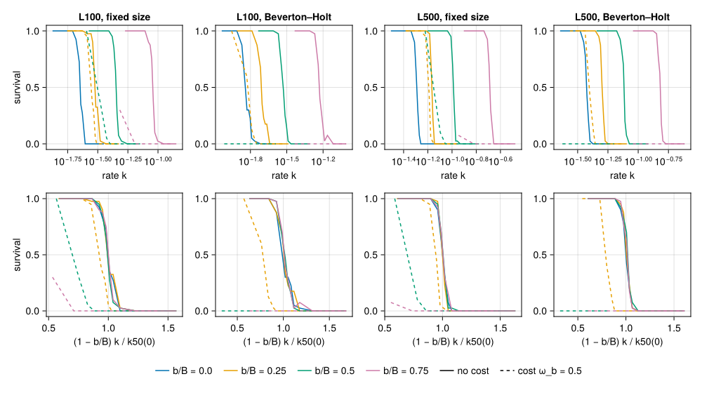
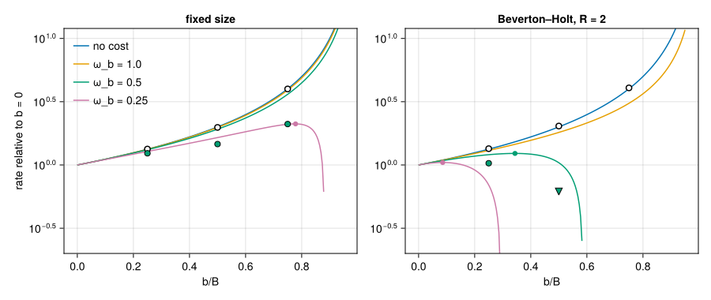
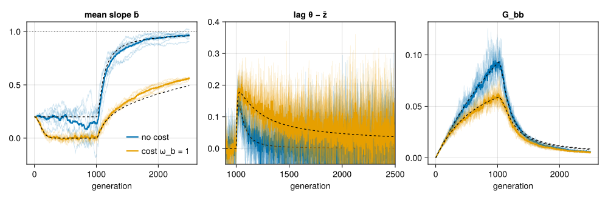
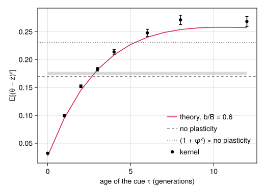

# Plasticity and sustainable rates of change
Simon Frost

- [Overview](#overview)
- [Setup](#setup)
- [A reaction norm of fixed slope](#a-reaction-norm-of-fixed-slope)
- [An exact correspondence](#an-exact-correspondence)
- [Survival against the rate of
  change](#survival-against-the-rate-of-change)
  - [With a cost](#with-a-cost)
- [The cost trade-off](#the-cost-trade-off)
- [A heritable reaction norm](#a-heritable-reaction-norm)
- [A delayed cue under a fluctuating
  optimum](#a-delayed-cue-under-a-fluctuating-optimum)
- [Where next](#where-next)

## Overview

The paper’s question is how fast the environment can change before a
population that adapts to it genetically goes extinct ([Pagel et al.
2025](#ref-Pagel2025)). Genetic change is not the only way to keep up:
an individual can respond to the environment it develops in. Phenotypic
plasticity is the standard reason a population might track an optimum
that moves faster than its genes can follow, and the standard theory of
how much it helps, and what it costs, is that of Chevin et al.
([2010](#ref-Chevin2010)) for a linear reaction norm, with the evolution
of the norm itself treated by Lande ([2009](#ref-Lande2009)).

QTLSim has a linear reaction norm (Julia only, off by default). This
vignette shows where it sits in the life cycle, an exact correspondence
that makes a plastic population with a perfect cue and no cost a
slower-moving non-plastic one, what that means for the rate a population
can sustain (from a pre-specified experiment of 12,320 kernel runs, read
from its cache), the trade-off a cost of plasticity creates, the
evolution of a heritable slope, and what a delayed cue does under a
fluctuating optimum.

A caution on sources. The formulas in QTLSim are derived from its own
moments recursion, `ḡ′ = ḡ + β (θ_t − ḡ − (b/B) θ_{t−τ})`, and checked
symbolically (`validate/symbolic/check_plasticity.jl`); the equations of
Chevin et al. ([2010](#ref-Chevin2010)) were not read (they are images
in the article), so this vignette does not claim to reproduce them. Only
their qualitative statements were checked: the critical rate rises as
`|B − b|` falls, a cost lowers the population’s growth, and above a
threshold cost an intermediate plasticity is best. The design note
[Phenotypic
plasticity](https://ecorecipes.github.io/QTLSim.jl/dev/plasticity_design/)
gives the details.

## Setup

``` julia
using QTLSim
import Catlab                                # loads the categorical layer, for run_moments
using CairoMakie, Printf, Random, Statistics
CairoMakie.activate!(type = "png")
L = lifecycle(); g = L.generation            # QTSim's generation, Zygotes → Zygotes
```

    develop⋅select⋅reproduce⋅record⋅rescale⋅mutate⋅swap: Zygotes → Zygotes

## A reaction norm of fixed slope

The environment `ε` is measured by the optimum it sets, `θ = B ε`, with
`B` (`OptimumSlope`, 1 by default) the environmental sensitivity of
selection. An individual’s phenotype is

$$z = g + b\,\varepsilon_{\text{cue}} + e, \qquad \varepsilon_{\text{cue}} = \theta_{t-\tau}/B,$$

with slope `b` (`Plasticity`), and a cue that is the environment `τ`
(`CueLag`) generations before selection; `τ = 0` is a perfect cue. A
cost of plasticity is stabilising selection on the slope: every fitness
is multiplied by `exp(−b²/(2ω_b²))`, `ω_b = PlasticityCostSD` (`Inf`, no
cost, by default). For a fixed slope only the ratio `φ = b/B` matters:
the plastic part of the phenotype, `φ θ_{t−τ}`, is the fraction of the
optimum’s displacement that is tracked without any genetic change.

Where is it expressed? In QTSim’s generation the optimum of generation
`t` is set in `select`, after `develop` has formed the phenotypes
(QTSim’s `PopFitness`: phenotypes, then the move, then fitness). The
environment a perfect cue reports is not known when `develop` runs, so
`develop` is unchanged (it gives `g + e`, the phenotype in the reference
environment) and `select` moves the optimum, then expresses the norm,
then computes fitness. The plasticity fields are parameters of `select`:

``` julia
step_schema(OneTraitModel())[:select]
```

    (:ω, :θ, :MoveType, :MoveFitnessSD, :MoveFitnessSDGen, :MoveNoiseSD, :MoveAutocorr, :MoveAmplitude, :MovePeriod, :Drift, :Selection, :StandardisePhenotype, :Plasticity, :OptimumSlope, :CueLag, :PlasticityCostSD)

so a `select` step can carry its own slope and cost, and demes can
differ in them:

``` julia
gp = withparams(g; Plasticity = 0.5, PlasticityCostSD = 1.0)
```

    develop⋅select(Plasticity = 0.5, PlasticityCostSD = 1.0)⋅reproduce⋅record⋅rescale⋅mutate⋅swap: Zygotes → Zygotes

Only optima with a trajectory of their own are allowed: `:continuous`,
`:red_noise`, `:periodic`, or a step’s fixed `θ`. QTSim’s default
`:phenotype` move (and `:fitness`) re-anchors the optimum to the current
mean phenotype every generation, `θ = z̄ + lead`, so a plastic shift of
the mean would be carried along by the optimum and have no meaning:

``` julia
try
    World(Params(Plasticity = 0.5, MoveType = :phenotype, MoveFitnessSDGen = 100))
catch err
    println(sprint(showerror, err))
end
```

    ArgumentError: Params: plasticity needs an optimum with its own trajectory (MoveType :continuous, :red_noise or :periodic); :phenotype re-anchors the optimum to the mean phenotype every generation

## An exact correspondence

With a perfect cue and no cost,

$$z - \theta = g + e - (1 - \varphi)\,\theta,$$

so fitness depends on the genotype and the optimum only through
`(1 − φ) θ`. A plastic population whose optimum moves `k` per generation
is therefore, in distribution and not only at steady state, a
non-plastic population whose optimum moves `(1 − φ) k`. In the kernel it
is more than that: for the same seed the two runs draw the same random
numbers and make the same decisions. The parameters below are the
100-locus set of the experiment in the next section (rare mutations, as
in the paper’s inputs), with a shorter burn-in:

``` julia
p = Params(PopSize = 1000, Ploidy = 2, NoQTL = 100, PhenotypeVar = 0.03, Heritability = 0.4,
           MutationScalar = 0.005, MutationRatePerGamete = 1e-4, InitFitnessSD = 4.0,
           RecombPoissonMean = 3.0, MoveType = :continuous, NoGenerations = 3000,
           MoveFitnessSDGen = 1000, MoveFitnessSD = 0.02)
plastic = simulate(Params(p; Plasticity = 0.5); seed = 1)            # φ = 0.5, k = 0.02
slower  = simulate(Params(p; MoveFitnessSD = 0.01); seed = 1)       # φ = 0,   k = 0.01
lag(o) = o.theta .- o.pheno_mean
@printf("survivors identical in every generation: %s\n", plastic.nsurv == slower.nsurv)
@printf("genetic variance identical in every generation: %s\n", plastic.geno_var == slower.geno_var)
@printf("largest difference in the lag θ − z̄: %.1e\n", maximum(abs.(lag(plastic) .- lag(slower))))
@printf("optimum at the end: %.2f (plastic) and %.2f (slower)\n", plastic.theta[end], slower.theta[end])
```

    survivors identical in every generation: true
    genetic variance identical in every generation: true
    largest difference in the lag θ − z̄: 2.8e-14
    optimum at the end: 40.00 (plastic) and 20.00 (slower)

The optimum of the plastic run is twice as far away, its mean phenotype
too, and everything genetic is identical. Theory says the same: the
steady lag behind a trend is `(1 − φ) k (V_G + V_s)/V_G` (`steady_lag`),
and `sustainable_rate`, the largest rate at which the deterministic
moments recursion persists (mean fitness at the steady lag above
`Ploidy/PopSize` at a fixed size, `1/R` under Beverton–Holt), is the
rate without plasticity divided by `1 − φ`:

``` julia
win = findall(t -> 2000 <= t <= 2999, plastic.gen)
VG = mean(plastic.geno_var[win])
println("| | kernel lag, generations 2000–2999 | `steady_lag` at the kernel's V_G | `sustainable_rate` |\n|:--|--:|--:|--:|")
for (nm, o, q) in (("φ = 0.5, k = 0.02", plastic, Params(p; Plasticity = 0.5)),
                   ("φ = 0, k = 0.01", slower, Params(p; MoveFitnessSD = 0.01)),
                   ("φ = 0, k = 0.02", nothing, p))
    @printf("| %s | %s | %.3f | %.4f |\n", nm, o === nothing ? "" : @sprintf("%.3f", mean(lag(o)[win])),
            steady_lag(q; VG), sustainable_rate(q; VG))
end
```

|  | kernel lag, generations 2000–2999 | `steady_lag` at the kernel’s V_G | `sustainable_rate` |
|:---|---:|---:|---:|
| φ = 0.5, k = 0.02 | 1.143 | 1.117 | 0.2536 |
| φ = 0, k = 0.01 | 1.143 | 1.117 | 0.1268 |
| φ = 0, k = 0.02 |  | 2.234 | 0.1268 |

The kernel’s lag, 1.14 (2.8 phenotypic standard deviations), is 102% of
the deterministic steady lag at its own V_G (1.12), and it is the same
for the plastic and the slower population. The rest of the vignette is
about what can break the correspondence: a cost, a heritable slope, and
a cue that is out of date.

## Survival against the rate of change

`validate/plasticity_rates.jl` is a pre-specified experiment (criteria
written before the first run, in the script’s header) on the rate a
population can sustain. Two synthetic parameter sets within the paper’s
priors, with 100 and 500 loci (`L100`, `L500`), 1000 diploids, 10,000
generations of stabilising selection, then a continuous move; QTSim’s
fixed size and Beverton–Holt with `R = 2`; `b/B` = 0, 0.25, 0.5 and 0.75
with a perfect cue, without a cost and with `ω_b = 0.5`; eleven rates
per cell; 40 burn-ins per cell; a run survives if it is alive 2000
generations after the move. Without a cost one burn-in serves all four
slopes (the optimum is at the origin before the move, so the plastic
part is exactly zero), and the rates are chosen so that the *effective*
rates `(1 − b/B) k` are the same in every cell. Its 12,320 runs took
about 10 hours; this vignette reads them from
`validate/plasticity_rates.csv`.

``` julia
csv = joinpath(@__DIR__, "..", "..", "validate", "plasticity_rates.csv")
lines_ = readlines(csv)
hdr = Symbol.(split(lines_[1], ','))
runs = map(lines_[2:end]) do l
    f = split(l, ',')
    (set = Symbol(f[1]), dem = Symbol(f[2]), cost = f[3] == "true", b = parse(Float64, f[4]),
     rep = parse(Int, f[5]), rate = parse(Float64, f[6]), keff = parse(Float64, f[7]),
     alive = f[8] == "false", vg0 = parse(Float64, f[10]), n0 = parse(Int, f[11]))
end
cell(set, dem, cost, b) = filter(r -> r.set == set && r.dem == dem && r.cost == cost && r.b == b, runs)
SETS, DEMS, SLOPES = (:L100, :L500), (:fixed, :bh), (0.0, 0.25, 0.5, 0.75)
length(runs)
```

    12320

The half-survival rate `k50` of a cell is the script’s estimator: a
maximum-likelihood logistic regression of survival on `ln k` over the
cell’s eleven rates, `k50 = exp(−a/c)`.

``` julia
function logistic(x, y)                      # logit P(y) = a + c x, by Newton's method
    a, c = 0.0, 0.0
    xm = mean(x); xc = x .- xm
    for _ in 1:100
        q = 1 ./ (1 .+ exp.(-clamp.(a .+ c .* xc, -30, 30)))
        g1, g2 = sum(y .- q), sum((y .- q) .* xc)
        w = q .* (1 .- q) .+ 1e-9
        h11, h12, h22 = sum(w), sum(w .* xc), sum(w .* xc .^ 2)
        d = h11 * h22 - h12^2
        da, dc = (h22 * g1 - h12 * g2) / d, (h11 * g2 - h12 * g1) / d
        s = min(1.0, 5 / max(abs(da), abs(dc), 1e-12))
        a += s * da; c += s * dc
        max(abs(da), abs(dc)) < 1e-10 && break
    end
    (a - c * xm, c)
end
function k50(rs)
    y = [r.alive for r in rs]
    (all(y) || !any(y)) && return NaN       # survival does not cross one half in the grid
    a, c = logistic([log(r.rate) for r in rs], y)
    c < 0 ? exp(-a / c) : NaN
end
survival(rs) = (ks = sort(unique(r.rate for r in rs));
                (ks, [mean(r.alive for r in rs if r.rate == k) for k in ks]))
```

    survival (generic function with 1 method)

``` julia
fig = Figure(size = (1000, 560))
cols = Makie.wong_colors()
titles = Dict((:L100, :fixed) => "L100, fixed size", (:L100, :bh) => "L100, Beverton–Holt",
              (:L500, :fixed) => "L500, fixed size", (:L500, :bh) => "L500, Beverton–Holt")
for (j, (set, dem)) in enumerate([(s, d) for s in SETS for d in DEMS])
    k0 = k50(cell(set, dem, false, 0.0))
    ax1 = Axis(fig[1, j], xscale = log10, title = titles[(set, dem)], xlabel = "rate k",
               ylabel = j == 1 ? "survival" : "")
    ax2 = Axis(fig[2, j], xlabel = "(1 − b/B) k / k50(0)", ylabel = j == 1 ? "survival" : "")
    for (i, b) in enumerate(SLOPES), cost in (false, true)
        (cost && b == 0) && continue
        rs = cell(set, dem, cost, b)
        isempty(rs) && continue
        ks, s = survival(rs)
        st = cost ? :dash : :solid
        lines!(ax1, ks, s, color = cols[i], linestyle = st, label = cost ? nothing : "b/B = $b")
        lines!(ax2, (1 - b) .* ks ./ k0, s, color = cols[i], linestyle = st)
    end
    j == 4 && Legend(fig[3, :], [[LineElement(color = cols[i]) for i in 1:4]; [LineElement(color = :black, linestyle = st) for st in (:solid, :dash)]],
                       [["b/B = $b" for b in SLOPES]; ["no cost", "cost ω_b = 0.5"]], orientation = :horizontal, framevisible = false)
end
fig
```

<div id="fig-survival">



Figure 1: Survival 2000 generations after the move against the rate of
change of the optimum, 40 populations per point. Top: against the rate k
itself; bottom: against the effective rate (1 − b/B)k, as multiples of
the half-survival rate without plasticity. Solid lines: no cost; dashed:
cost ω_b = 0.5. Columns: the 100- and 500-locus parameter sets, at a
fixed size and under Beverton–Holt with R = 2. Without a cost the four
curves of the bottom row coincide, as the correspondence requires.

</div>

The top row shows what plasticity buys: the curves move to the right, by
more the larger the slope. The bottom row shows why: without a cost
(solid lines) survival depends on the effective rate only. The
half-survival rates against the prediction `1/(1 − b/B)` (criterion P1:
within 15%):

``` julia
println("| cell | k50, b = 0 | b/B = 0.25 | b/B = 0.5 | b/B = 0.75 |\n|:--|--:|--:|--:|--:|")
println("| predicted ratio `1/(1 − b/B)` | | 1.333 | 2.000 | 4.000 |")
K0 = Dict((s, d) => k50(cell(s, d, false, 0.0)) for s in SETS for d in DEMS)
for set in SETS, dem in DEMS
    @printf("| %s | %.4f | %s |\n", titles[(set, dem)], K0[(set, dem)],
            join((@sprintf("%.3f", k50(cell(set, dem, false, b)) / K0[(set, dem)]) for b in SLOPES[2:end]), " | "))
end
```

| cell                          | k50, b = 0 | b/B = 0.25 | b/B = 0.5 | b/B = 0.75 |
|:------------------------------|-----------:|-----------:|----------:|-----------:|
| predicted ratio `1/(1 − b/B)` |            |      1.333 |     2.000 |      4.000 |
| L100, fixed size              |     0.0226 |      1.336 |     1.981 |      3.989 |
| L100, Beverton–Holt           |     0.0145 |      1.346 |     2.031 |      4.067 |
| L500, fixed size              |     0.0511 |      1.332 |     2.008 |      4.022 |
| L500, Beverton–Holt           |     0.0375 |      1.344 |     2.025 |      4.032 |

All twelve cells pass, within 2% of the prediction (the log’s 95%
bootstrap intervals are within 1.32–1.38, 1.95–2.07 and 3.93–4.13). That
is a check of the implementation, not a test of a theory: the
correspondence above is exact, so it must hold whatever the genetics.
The lag at equal effective rates (criterion P3) passes in all twelve
cells too.

### With a cost

With `ω_b = 0.5` every fitness is multiplied by `plasticity_cost`, 0.88,
0.61 and 0.32 for the three slopes, and the correspondence is broken.
The pre-specified prediction (P2) was the ratio of `sustainable_rate`
with and without the cost, evaluated at each cell’s mean `V_G` at the
move, to within 25%; under Beverton–Holt at `b/B = 0.75` the prediction
is that the population dies before the move
(`R W̄(0) = 2 × 0.997 × 0.32 < 1`).

``` julia
base(set, dem) = Params(; PopSize = 1000, Ploidy = 2, NoQTL = set == :L100 ? 100 : 500, RecombPoissonMean = 3.0,
                        PhenotypeVar = set == :L100 ? 0.03 : 0.05, Heritability = set == :L100 ? 0.4 : 0.3,
                        MutationScalar = set == :L100 ? 0.005 : 0.008, MutationRatePerGamete = 1e-4,
                        InitFitnessSD = set == :L100 ? 4.0 : 3.0, MoveType = :continuous,
                        (dem == :bh ? (Demography = :beverton_holt, GrowthRate = 2.0) : (;))...)
meanfin(v) = (w = filter(isfinite, collect(v)); isempty(w) ? NaN : mean(w))
println("| cell | b/B | V_G at the move, no cost | with cost | N at the move, with cost | burn-ins dead | k50 ratio, observed | predicted | observed/predicted | P2 |")
println("|:--|--:|--:|--:|--:|--:|--:|--:|--:|:--|")
p2 = Dict{Any,String}()
for set in SETS, dem in DEMS, b in SLOPES[2:end]
    p0 = base(set, dem)
    v0 = mean(r.vg0 for r in cell(set, dem, false, 0.0))
    rs = cell(set, dem, true, b)
    vc = meanfin(r.vg0 for r in rs)
    nc = mean(r.n0 for r in rs)
    dead = mean(r.n0 == 0 for r in rs)
    pred = sustainable_rate(Params(p0; Plasticity = b, PlasticityCostSD = 0.5); VG = isfinite(vc) ? vc : v0) /
           sustainable_rate(p0; VG = v0)
    obs = k50(rs) / K0[(set, dem)]
    v = pred == 0 ? (dead >= 0.9 ? "PASS" : "FAIL") : (isfinite(obs) && 0.75 <= obs / pred <= 1.25 ? "PASS" : "FAIL")
    p2[(set, dem, b)] = v
    @printf("| %s | %.2f | %.4f | %s | %.0f | %.0f%% | %s | %.3f | %s | %s |\n", titles[(set, dem)], b, v0,
            isfinite(vc) ? @sprintf("%.4f", vc) : "–", nc, 100dead,
            isfinite(obs) ? @sprintf("%.3f", obs) : (pred == 0 ? "–" : "below 0.63"), pred,
            isfinite(obs) && pred > 0 ? @sprintf("%.2f", obs / pred) : "–", v)
end
```

| cell | b/B | V_G at the move, no cost | with cost | N at the move, with cost | burn-ins dead | k50 ratio, observed | predicted | observed/predicted | P2 |
|:---|---:|---:|---:|---:|---:|---:|---:|---:|:---|
| L100, fixed size | 0.25 | 0.1360 | 0.1159 | 1000 | 0% | 1.237 | 1.125 | 1.10 | PASS |
| L100, fixed size | 0.50 | 0.1360 | 0.0915 | 1000 | 0% | 1.463 | 1.292 | 1.13 | PASS |
| L100, fixed size | 0.75 | 0.1360 | 0.0568 | 1000 | 0% | 2.106 | 1.515 | 1.39 | FAIL |
| L100, Beverton–Holt | 0.25 | 0.1283 | 0.0997 | 860 | 0% | 1.032 | 0.939 | 1.10 | PASS |
| L100, Beverton–Holt | 0.50 | 0.1283 | 0.0356 | 346 | 0% | below 0.63 | 0.292 | – | FAIL |
| L100, Beverton–Holt | 0.75 | 0.1283 | – | 0 | 100% | – | 0.000 | – | PASS |
| L500, fixed size | 0.25 | 0.3233 | 0.3057 | 1000 | 0% | 1.255 | 1.249 | 1.00 | PASS |
| L500, fixed size | 0.50 | 0.3233 | 0.2356 | 1000 | 0% | 1.546 | 1.405 | 1.10 | PASS |
| L500, fixed size | 0.75 | 0.3233 | 0.1493 | 1000 | 0% | 2.131 | 1.688 | 1.26 | FAIL |
| L500, Beverton–Holt | 0.25 | 0.3200 | 0.2720 | 845 | 0% | 1.064 | 1.028 | 1.04 | PASS |
| L500, Beverton–Holt | 0.50 | 0.3200 | 0.1081 | 330 | 0% | below 0.63 | 0.357 | – | FAIL |
| L500, Beverton–Holt | 0.75 | 0.3200 | – | 0 | 100% | – | 0.000 | – | PASS |

P2 passes in 8 of 12 cells and fails in 4, as in
`validate/plasticity_rates.log`. At a fixed size the cost is less
harmful than predicted, increasingly so at larger slopes
(observed/predicted up to 1.39), and the two fixed-size cells at
`b/B = 0.75` fail on that side. Under Beverton–Holt at `b/B = 0.5` every
population died even at the lowest rate of the grid, so the
half-survival rate is not bracketed (it is below 0.63 of `k50(0)`); the
grid had been placed using the nominal `V_G`, and the prediction with
the realised `V_G`, 0.29–0.36, lies below it, in the same direction as
the observation.

What the table shows directly is that the cost lowers the genetic
variance at the move, before the optimum has moved at all: by 5–58% at a
fixed size and by 15–72% under Beverton–Holt, where the population also
shrinks (to about 340 at `b/B = 0.5`). That lost variance seemed the
obvious reason P2 fails, but a later pre-specified test refutes it
(`validate/plasticity_erosion.jl`, fresh seeds, all four failed cells):
populations that pay the cost only *before* the move start it with
28–81% of the variance yet sustain 0.88–0.99 of the no-cost `k50`, so
the pre-move loss accounts for only 3–9% of the cost’s effect. The cost
does its damage *after* the move, 2–7 times more strongly than the
fitness-margin term of `sustainable_rate` predicts; the correspondence
itself plays no part (the same constant fitness cost without plasticity
gives the same `k50`, within 2%).

The likely reason is a known feedback that `sustainable_rate` leaves
out: the lag and the cost both lower the number of breeders, drift then
lowers `V_G`, and the lag grows. Bürger and Lynch
([1995](#ref-BurgerLynch1995)) described it from simulations as the main
reason their fixed-variance critical rate overestimates persistence, Xu
and Shen ([2026](#ref-XuShen2026)) define a critical rate as the maximum
over steady states with drift-reduced variance (continuous time,
logistic growth), and Polechová and Barton
([2015](#ref-PolechovaBarton2015)) and Polechová
([2026](#ref-Polechova2026)) treat the analogue along spatial gradients.
`drift_critical_rate` is a discrete-generation implementation matched to
QTSim’s life cycle. To first order a constant log cost `c` lowers either
kind of critical rate by a fraction `c/M`, `M` being twice the lag load
at the critical lag; for `sustainable_rate` the square root expands to
`1 − c/(2 ln(W̄₀/W_min))`, the same linear form. The difference is the
scale: drift makes the critical lag, and so `M`, 2.5–7 times smaller in
the cells tested, so the same cost removes several times more of the
rate. In a later pre-specified test (`validate/critical_rate.jl`, fresh
seeds, observed cost ratios down to 0.25) a ratio linear in the cost
fitted the kernel’s `k50(c)/k50(0)` better than a square root in 8 of 8
groups, `drift_critical_rate`’s ratio was within 0.054 in 24 of 24
cells, and `sustainable_rate`’s was within tolerance in 0 of 24.

## The cost trade-off

Without a cost, more plasticity is always better, and at `b = B` the
population tracks the optimum without any genetic change. A cost changes
that. At the steady lag the mean fitness is

$$\bar W(\lambda) = c\, e^{-b^2/(2\omega_b^2)}\,\frac{\omega}{\sqrt{s}}\, e^{-\lambda^2/(2s)},\qquad s = \omega^2 + V_G + V_E,$$

and the largest sustainable rate is

$$k_{\max} = \frac{V_G}{s}\,\frac{\sqrt{2s\,\big(\ln(\bar W_0/W_{\min}) - b^2/(2\omega_b^2)\big)}}{|1 - b/B|},$$

with `W̄₀` the mean fitness at no lag without a cost and `W_min` the
threshold: `Ploidy/N` at a fixed size, `1/R` under Beverton–Holt
(`sustainable_rate`). Plasticity divides the rate the genotype must
supply by `1 − b/B`, and the cost eats into the logarithmic “headroom”
`ln(W̄₀/W_min)`. When the headroom is large the gain wins up to large
slopes; when it is small the cost wins early, and an intermediate slope
is best. A fixed size of 1000 diploids has a headroom of
`ln(500 W̄₀) ≈ 6`; Beverton–Holt with `R = 2` has `ln(2 W̄₀) ≈ 0.7`.
`plasticity_cost` gives the factor:

``` julia
pc = Params(base(:L100, :fixed); PlasticityCostSD = 0.5)
[plasticity_cost(pc; b) for b in SLOPES]
```

    4-element Vector{Float64}:
     1.0
     0.8824969025845955
     0.6065306597126334
     0.32465246735834974

``` julia
bs = range(0, 0.95, 200)
fig = Figure(size = (900, 380))
for (j, dem) in enumerate(DEMS)
    p0 = base(:L100, dem)
    v0 = mean(r.vg0 for r in cell(:L100, dem, false, 0.0))
    r0 = sustainable_rate(p0; VG = v0)
    ax = Axis(fig[1, j], xlabel = "b/B", ylabel = j == 1 ? "rate relative to b = 0" : "", yscale = log10,
              title = dem == :fixed ? "fixed size" : "Beverton–Holt, R = 2")
    for (i, ωb) in enumerate((Inf, 1.0, 0.5, 0.25))
        r = [sustainable_rate(Params(p0; PlasticityCostSD = ωb); VG = v0, b) / r0 for b in bs]
        ok = r .> 0
        lines!(ax, bs[ok], r[ok], color = cols[i], label = isinf(ωb) ? "no cost" : "ω_b = $ωb")
        isinf(ωb) || (m = argmax(r); m < length(bs) && scatter!(ax, [bs[m]], [r[m]], color = cols[i]))
    end
    scatter!(ax, collect(SLOPES[2:end]), [k50(cell(:L100, dem, false, b)) / K0[(:L100, dem)] for b in SLOPES[2:end]],
             color = :white, strokecolor = :black, strokewidth = 1.5, markersize = 10)
    obs = [k50(cell(:L100, dem, true, b)) / K0[(:L100, dem)] for b in SLOPES[2:end]]
    for (b, o) in zip(SLOPES[2:end], obs)
        if isfinite(o)
            scatter!(ax, [b], [o], color = cols[3], strokecolor = :black, strokewidth = 1, markersize = 10)
        elseif dem == :bh && b == 0.5
            scatter!(ax, [b], [0.63], marker = :dtriangle, color = cols[3], strokecolor = :black, strokewidth = 1, markersize = 12)
        end
    end
    ylims!(ax, 0.2, 12)
    j == 1 && axislegend(ax, position = :lt, framevisible = false)
end
fig
```

<div id="fig-tradeoff">



Figure 2: The sustainable rate with plasticity relative to that without,
against the slope b/B, for the 100-locus set at a fixed size (left) and
under Beverton–Holt with R = 2 (right), at the V_G of the populations
without a cost. Lines: sustainable_rate for no cost and three costs;
small dots mark the best slope where it lies below B. Points: the
experiment’s half-survival rates relative to b = 0, without a cost
(open) and with ω_b = 0.5 (filled); under Beverton–Holt the populations
with cost at b/B = 0.5 all died at the lowest rate tried (plotted at
that bound, triangle) and at 0.75 before the move (plotted at 0).

</div>

At a fixed size a cost of `ω_b = 0.5` never uses up the headroom before
`b = B` (`b²/(2ω_b²) < 2`), so the sustainable rate still grows without
bound as the slope approaches `B`; with `ω_b = 0.25` the best slope is
0.78. Under Beverton–Holt, with a headroom of about 0.7, a cost of
`ω_b = 1` still leaves the rate unbounded (`b²/2 < 0.5`), but
`ω_b = 0.5` puts the best slope at 0.34 and `ω_b = 0.25` at 0.09. The
experiment agrees in direction. At a fixed size the half-survival rate
with the cost rose with the slope across the grid (1.24, 1.46 and 2.11
times that at `b = 0` for the 100-locus set), more than the prediction.
Under Beverton–Holt the slope 0.25 helped a little (1.03 times), 0.5 was
fatal at every rate tried, and 0.75 killed every population before the
move: an intermediate plasticity is best, and the demography decides
where.

## A heritable reaction norm

With `ReactionNorm = true` and `NoTraits = 2` the slope is heritable:
the two heritable values of the model of several traits (vignette
[Several traits and
pleiotropy](../13_multiple_traits/13_multiple_traits.qmd)) are the
elevation `a = g₁` and the deviation of the slope from `Plasticity`,
`b = Plasticity + g₂`. Selection acts on the one phenotype
`z = a + b ε + e` and the cost on the individual’s slope. It is
`TraitModel(2)` with a linear map `(a, b) ↦ a + b ε`, which changes with
the environment, composed before selection (`ReactionNormModel()`); the
kernel and the moments lowering have it, the Eidos lowering does not.

Without a cost the slope responds in proportion to `ε`
(`reaction_norm_response`: `Δ(ā, b̄) = G v λ/s`, `v = (1, ε)`), so it
evolves only away from the reference environment, and under a sustained
move the mean slope approaches `B`. With a cost, in a constant
environment the only equilibrium has `b̄ = 0` (genetic assimilation,
[Lande 2009](#ref-Lande2009)), and under a sustained move the slope
settles below `B`. The parameters are those of
`validate/reaction_norm.jl` (1000 diploids, 50 loci in the Gaussian
regime, initial slope 0.2, 1000 generations of stabilising selection at
`ε = 0`, then the optimum moves 0.02 per generation for 1500
generations), with 8 runs per scenario instead of 40:

``` julia
rn = Params(NoGenerations = 2500, PopSize = 1000, Ploidy = 2, NoQTL = 50, MutationRatePerGamete = 0.01,
            MoveType = :continuous, MoveFitnessSDGen = 1000, MoveFitnessSD = 0.02, RecombPoissonMean = 3.0,
            InitFitnessSD = 1.0, PhenotypeVar = 1.0, Heritability = 0.5)
Vm = muteVar(rn)
norm_params(ωb) = Params(rn; NoTraits = 2, ReactionNorm = true, Plasticity = 0.2,
                         MutCov = [Vm 0.0; 0.0 Vm / 4], PlasticityCostSD = ωb)
scen = [("no cost", Inf), ("cost ω_b = 1", 1.0)]
njobs = [(i, r) for i in eachindex(scen) for r in 1:8]
nruns = Vector{Any}(undef, length(njobs))
Threads.@threads :greedy for j in eachindex(njobs)
    i, r = njobs[j]
    nruns[j] = simulate(norm_params(scen[i][2]); seed = 31_000 + 100i + r)
end
nmom = [run_moments(norm_params(ωb); erosion = true, loci = :multilocus) for (_, ωb) in scen]
kruns(i) = [nruns[j] for j in eachindex(njobs) if njobs[j][1] == i]
slope(o) = [m[2] for m in o.trait_mean]
nlag(o) = o.theta .- [m[1] for m in o.trait_mean]
Gbb(o) = [G[2, 2] for G in o.gmatrix];
```

``` julia
fig = Figure(size = (1000, 330))
axs = [Axis(fig[1, j], xlabel = "generation", title = t) for (j, t) in enumerate(("mean slope b̄", "lag θ − z̄", "G_bb"))]
for (i, (nm, _)) in enumerate(scen)
    rs = kruns(i)
    for (ax, f) in zip(axs, (slope, nlag, Gbb))
        for o in rs
            lines!(ax, 1:2500, f(o), color = (cols[i], 0.2), linewidth = 0.6)
        end
        lines!(ax, 1:2500, mean(f.(rs)), color = cols[i], linewidth = 2, label = nm)
        lines!(ax, 1:2500, f(nmom[i]), color = :black, linestyle = :dash, linewidth = 1.2)
    end
end
hlines!(axs[1], [1.0], color = :grey, linestyle = :dot)
xlims!(axs[2], 900, 2500); ylims!(axs[2], -0.05, 0.4)
axislegend(axs[1], position = :rb, framevisible = false)
fig
```

<div id="fig-norm">



Figure 3: A heritable reaction norm under a sustained move from
generation 1000. Left: the mean slope; middle: the lag θ − z̄; right: the
slope’s genetic variance G_bb. Thin lines: each kernel run; thick: their
mean; dashed black: the moments lowering (multilocus Gaussian with
drift). Blue: no cost; orange: cost ω_b = 1. The optimum’s slope on the
environment is B = 1.

</div>

``` julia
println("| | mean slope, generation 1250 | 1500 | 2000 | 2500 | lag at 2500 |\n|:--|--:|--:|--:|--:|--:|")
for (i, (nm, _)) in enumerate(scen)
    rs = kruns(i)
    @printf("| %s, kernel (8 runs) | %s | %.3f |\n", nm,
            join((@sprintf("%.3f", mean(slope(o)[t] for o in rs)) for t in (1250, 1500, 2000, 2500)), " | "),
            mean(mean(nlag(o)[2451:2500]) for o in rs))
    @printf("| %s, moments | %s | %.3f |\n", nm,
            join((@sprintf("%.3f", slope(nmom[i])[t]) for t in (1250, 1500, 2000, 2500)), " | "),
            mean(nlag(nmom[i])[2451:2500]))
end
```

|  | mean slope, generation 1250 | 1500 | 2000 | 2500 | lag at 2500 |
|:---|---:|---:|---:|---:|---:|
| no cost, kernel (8 runs) | 0.733 | 0.855 | 0.938 | 0.968 | 0.002 |
| no cost, moments | 0.772 | 0.883 | 0.941 | 0.961 | 0.001 |
| cost ω_b = 1, kernel (8 runs) | 0.240 | 0.347 | 0.475 | 0.562 | 0.044 |
| cost ω_b = 1, moments | 0.216 | 0.307 | 0.415 | 0.493 | 0.037 |

Without a cost the mean slope climbs from 0.2 toward `B = 1` and the
lag, after a peak early in the move, falls toward zero: with heritable,
cost-free plasticity this model has no critical rate, only a transient.
With the cost the slope is first drawn to zero during the stationary
phase (genetic assimilation), rises more slowly under the move and stays
well below `B`, and the lag stays larger. In both the slope’s genetic
variance is used up as the slope responds. `validate/reaction_norm.jl`
makes this comparison with 40 runs and passes 28 of its 30 pre-specified
criteria; the two failures are the quasi-steady lag formula
(`reaction_norm_lag`) late in the cost-free move, where the lag has
fallen to 0.003 and below and the ratio is noise:

``` julia
logf = joinpath(@__DIR__, "..", "..", "validate", "reaction_norm.log")
if isfile(logf)
    for l in readlines(logf)
        (occursin("C2 FAIL", l) || occursin("criteria pass", l)) && println("    ", strip(l))
    end
end
```

    quasi-steady lag at the kernel's own G, slope and environment 0.0017; kernel/it 1.870  C2 FAIL
    quasi-steady lag at the kernel's own G, slope and environment 0.0011; kernel/it -0.769  C2 FAIL
    28 of 30 criteria pass (1.3 min)

## A delayed cue under a fluctuating optimum

A cue that is `τ` generations old makes no difference to the steady lag
behind a trend: the genotype makes up the constant shortfall. It matters
when the optimum fluctuates. With red noise (`MoveType = :red_noise`: an
AR(1) optimum of standard deviation `σ`, autocorrelation `ρ`) the lag
with plasticity is `λ_t = L_t − φ L_{t−τ}`, with `L` the lag without
plasticity, so

$$\operatorname{Var}\lambda = (1 + \varphi^2)\,\Gamma(0) - 2\varphi\,\Gamma(\tau),$$

with `Γ` the autocovariance of `L` (`red_noise_lag_var` with `b`, `B`
and `τ`; `red_noise_lag_autocov`). A perfect cue scales the variance by
`(1 − φ)²`; a cue so old that the environment has forgotten it
(`ρ^τ → 0`) makes plasticity add noise, `1 + φ²` times the variance
without plasticity. In between there is a delay at which plasticity
stops helping.

``` julia
pr = Params(PopSize = 500, Ploidy = 2, NoQTL = 10, PhenotypeVar = 1.0, Heritability = 0.5,
            MutationScalar = 0.01, MutationRatePerGamete = 0.02, InitFitnessSD = 1.5,
            NoGenerations = 3000, MoveFitnessSDGen = 1000, MoveFitnessSD = 0.0,
            MoveType = :red_noise, MoveNoiseSD = 0.5, MoveAutocorr = 0.8)
φ = 0.6
τs = [0, 1, 2, 3, 4, 6, 8, 12]
rjobs = [(b, τ, r) for (b, τ) in vcat([(0.0, 0)], [(φ, τ) for τ in τs]) for r in 1:6]
rres = Vector{Any}(undef, length(rjobs))
Threads.@threads :greedy for j in eachindex(rjobs)
    b, τ, r = rjobs[j]
    o = simulate(Params(pr; Plasticity = b, CueLag = τ); seed = 7000 + j)
    w = findall(t -> 1500 <= t <= 2999, o.gen)
    rres[j] = (; b, τ, lag2 = mean((o.theta[w] .- o.pheno_mean[w]) .^ 2), VG = mean(o.geno_var[w]))
end
Vs = selection_variance(pr)
VGk = mean(r.VG for r in rres)
th(b, τ) = red_noise_lag_var(pr.MoveNoiseSD, pr.MoveAutocorr; VG = VGk, Vs, b, τ)
obs(b, τ) = (v = [r.lag2 for r in rres if r.b == b && r.τ == τ]; (mean(v), std(v) / sqrt(length(v))));
```

``` julia
fig = Figure(size = (520, 380))
ax = Axis(fig[1, 1], xlabel = "age of the cue τ (generations)", ylabel = "E[(θ − z̄)²]")
τf = 0:12
lines!(ax, τf, [th(φ, τ) for τ in τf], color = :crimson, label = "theory, b/B = $φ")
m0, s0 = obs(0.0, 0)
band!(ax, [0, 12], [m0 - s0, m0 - s0], [m0 + s0, m0 + s0], color = (:grey, 0.3))
hlines!(ax, [th(0.0, 0)], color = :grey, linestyle = :dash, label = "no plasticity")
hlines!(ax, [(1 + φ^2) * th(0.0, 0)], color = :grey, linestyle = :dot, label = "(1 + φ²) × no plasticity")
mo = [obs(φ, τ) for τ in τs]
errorbars!(ax, τs, first.(mo), last.(mo), color = :black, whiskerwidth = 6)
scatter!(ax, τs, first.(mo), color = :black, label = "kernel")
axislegend(ax, position = :rb, framevisible = false)
fig
```

<div id="fig-cue">



Figure 4: The mean squared lag behind red noise (σ = 0.5, ρ = 0.8) with
a reaction norm of slope b/B = 0.6, against the age τ of the cue. Line:
red_noise_lag_var at the kernel’s mean V_G; points: kernel, 6 runs each
(mean ± SE over generations 1500–2999); grey: without plasticity, theory
(dashed) and kernel (band, ± SE). Illustrative, not a pre-specified
validation.

</div>

With a perfect cue plasticity cuts the mean squared lag to 0.032 from
0.175 without (theory 0.027 and 0.170). Plasticity stops helping once
the cue is 3 generations old, and at 12 generations it is 52% worse than
none, beyond the limit `1 + φ²` (36% worse) for a very old cue, because
the lag’s autocovariance `Γ(12)` is negative: an old cue is
anticorrelated with the present lag. The kernel lies 0–18% above the
deterministic theory: the theory leaves out the drift of the mean and
the sampling error of the recorded mean, which add to the lag (as for
several traits in vignette 13). This is an illustration with a few runs,
not a validation: a delayed cue has not been tested against the theory
in a pre-specified experiment.

The same holds for a periodic optimum, where `expected_lag2` multiplies
the squared amplitude of the lag by `1 + φ² − 2φ cos(2πτ/P)`: a cue half
a period old doubles down on the wrong phase. And `lag_load` adds the
cost `b²/(2ω_b²)` to the load of the lag, so with a cost and an
unreliable cue the best slope is smaller still.

## Where next

- The cost’s effect on the sustainable rate was predicted from the
  deterministic threshold at the realised `V_G`, and failed in 4 of 12
  cells. A prediction that allows for the extra drift a cost causes, or
  for the spectrum of segregating mutations under a moving optimum
  (`run_moments(…; loci = :spectrum)`), has not been tried.
- A heritable norm under fluctuating environments is the setting of the
  plasticity-first and genetic-assimilation literature ([Lande
  2009](#ref-Lande2009)); the kernel and the moments lowering can run
  it, but nothing here has validated it, and it has no SLiM lowering.
- Not validated: a delayed cue in a pre-specified test, plasticity with
  fecundity selection, and plasticity in metapopulations with migration
  (a migrant expresses the norm in the deme it develops in;
  `withparams(g; Plasticity = …)` gives demes their own slopes).

<div id="refs" class="references csl-bib-body hanging-indent">

<div id="ref-BurgerLynch1995" class="csl-entry">

Bürger, Reinhard, and Michael Lynch. 1995. “Evolution and Extinction in
a Changing Environment: A Quantitative-Genetic Analysis.” *Evolution* 49
(1): 151–63. <https://doi.org/10.1111/j.1558-5646.1995.tb05967.x>.

</div>

<div id="ref-Chevin2010" class="csl-entry">

Chevin, Luis-Miguel, Russell Lande, and Georgina M. Mace. 2010.
“Adaptation, Plasticity, and Extinction in a Changing Environment:
Towards a Predictive Theory.” *PLoS Biology* 8 (4): e1000357.
<https://doi.org/10.1371/journal.pbio.1000357>.

</div>

<div id="ref-Lande2009" class="csl-entry">

Lande, Russell. 2009. “Adaptation to an Extraordinary Environment by
Evolution of Phenotypic Plasticity and Genetic Assimilation.” *Journal
of Evolutionary Biology* 22 (7): 1435–46.
<https://doi.org/10.1111/j.1420-9101.2009.01754.x>.

</div>

<div id="ref-Pagel2025" class="csl-entry">

Pagel, Mark, Jacob D. Gardner, and Andrew Meade. 2025.
“Quantitative-Genetic Analysis of Directional Adaptation Suggests Low
Maximum Sustainable Rates of Change in Agreement with Data from Field
Populations.” *Scientific Reports* 15.
<https://doi.org/10.1038/s41598-025-24445-2>.

</div>

<div id="ref-Polechova2026" class="csl-entry">

Polechová, Jitka. 2026. “Evolution of Species’ Range and Niche in
Changing Environments.” *Proceedings of the National Academy of Sciences
of the USA* 123 (19): e2604510123.
<https://doi.org/10.1073/pnas.2604510123>.

</div>

<div id="ref-PolechovaBarton2015" class="csl-entry">

Polechová, Jitka, and Nicholas H. Barton. 2015. “Limits to Adaptation
Along Environmental Gradients.” *Proceedings of the National Academy of
Sciences of the USA* 112 (20): 6401–6.
<https://doi.org/10.1073/pnas.1421515112>.

</div>

<div id="ref-XuShen2026" class="csl-entry">

Xu, Kuangyi, and Hao Shen. 2026. *Eco-Evolutionary Feedbacks Generate
Bistability in Population Persistence Under Gradual Environmental
Change*. bioRxiv preprint.

</div>

</div>
